<!-- This vignette is precompiled: edit b5_empirical_relabeling.Rmd.orig and run
     vignettes/precompile.R. It needs an OpenAI API key (embeddings and LLM)
     or a local Python with sentence-transformers, so it is not run when the
     package is built. -->


## Idea

Find jingle and jangle fallacies among four Big Five inventories (**BFI-2**, **Big Five Aspects**, **FacetMap** and **SENNA**), following Wulff & Mata (2025), and then fix them step by step with an **empirical relabeling** pipeline: scales whose items overlap are merged, scales whose definitions overlap are relabeled, and an LLM writes the new labels and definitions from the items.

-   **scale side** = empirical scale embeddings (average of the item embeddings of each facet scale);
-   **label side** = the authors' definitions of each facet scale.

A scale is identified by `test_domain_facet` (e.g. `bfi2_O_aes`). Its short display label is the facet name (e.g. *Aesthetic Sensitivity*), shown as `facet name (test)` in the plots.

*Jangle* here means: two scales whose items look alike but whose definitions differ. *Jingle* means: two scales whose items look different but whose definitions are alike.

Three kinds of embeddings are used: **item** embeddings, **scale** embeddings (the average of the item embeddings of a scale) and **definition** embeddings (the theoretical definition of each scale). Items stay fixed; scales and definitions change at each relabeling step.

## Libraries


``` r
# remotes::install_github("rprimi/embeddcv", force = TRUE)
library(tidyverse)
library(embeddcv)
```

## Data

The package includes `b5_items` (one row per item) and `b5_scales` (one row per facet scale, with the authors' definition).


``` r
items  <- b5_items
scales <- b5_scales

# scale id = test_domain_facet
items <- items %>%
  mutate(scale_id = paste(test, domain, facet, sep = "_"),
         item_id  = paste(test, coditem, sep = "_"))
stopifnot(!anyDuplicated(items$item_id))

# keep only scales that have items (7 FacetMap scales have no items)
definitions <- scales %>%
  filter(n_items > 0) %>%
  mutate(scale_id = paste(test, domain, facet, sep = "_")) %>%
  select(scale_id, test, domain, facet, facet_name, definition, n_items)

# every item scale has a definition, and vice versa
stopifnot(setequal(unique(items$scale_id), definitions$scale_id))

definitions %>% count(test)
#>         test  n
#> 1 b5_aspects 10
#> 2       bfi2 15
#> 3   facetmap 70
#> 4      senna 18
```

## 1. Prepare embeddings

Choose the embedding model. Wulff & Mata (2025) used `mpnet-personality`, a sentence transformer fine-tuned on personality items; `openai` uses `text-embedding-3-small`. Embeddings are cached in `emb_cache/`.


``` r
emb_model <- "openai"   # "mpnet" or "openai"

embed <- function(text) {
  switch(emb_model,
    mpnet  = {
      reticulate::py_require(c("sentence-transformers", "torch"))
      get_embeddings(text, provider = "huggingface_local",
                     model = "dwulff/mpnet-personality")
    },
    openai = get_embeddings(text, provider = "openai",
                            model = "text-embedding-3-small"))
}

cached_embeddings <- function(file, text) {
  path <- file.path("emb_cache", paste0(file, "_", emb_model, ".rds"))
  if (file.exists(path)) return(readRDS(path))
  dir.create("emb_cache", showWarnings = FALSE)
  emb <- embed(text)
  saveRDS(emb, path)
  emb
}

out_dir <- "figures"
dir.create(out_dir, showWarnings = FALSE)

```


``` r
# Items + the scale each item belongs to.
items_emb <- as.matrix(cached_embeddings("b5_items", items$item_en_text))
rownames(items_emb) <- items$item_id

count(items, test)
#>         test   n
#> 1 b5_aspects 100
#> 2       bfi2  60
#> 3   facetmap 386
#> 4      senna 162

# SCALE side: empirical scale embedding = mean of its item embeddings.
# Rownames = scale ids (test_domain_facet).
scale_emb <- get_scale_embeddings(items_emb, items$scale_id)

# LABEL side: definition embeddings (authors' facet definitions).
# Rownames = scale ids too, so a scale's label id is its own scale id.
definitions_emb <- as.matrix(cached_embeddings("b5_definitions", definitions$definition))
rownames(definitions_emb) <- definitions$scale_id

# put scale_emb in the same order as the definitions
scale_emb <- scale_emb[definitions$scale_id, ]
stopifnot(identical(rownames(scale_emb), rownames(definitions_emb)))

# Each scale's label is its own definition (identity map over ids).
definitions_by_scale <- setNames(definitions$scale_id, definitions$scale_id)

# DISPLAY only: short label (facet name) and instrument (test) per scale.
# Different tests can share a short label (e.g. "Assertiveness"); the
# instrument suffix keeps them apart in the plots.
short_by_scale      <- setNames(definitions$facet_name, definitions$scale_id)
instrument_by_scale <- setNames(definitions$test, definitions$scale_id)

dim(scale_emb)
#> [1]  113 1536
dim(definitions_emb)
#> [1]  113 1536
```

## 2. Similarity matrices


``` r
# Content similarity between scales (empirical, item-based).
scale_cos <- cosine_matrix(scale_emb)

# Definition similarity = similarity between the authors' definitions.
definitions_cos <- cosine_matrix(definitions_emb)

# Scale x definition cross-similarity: the weights used to assign a
# definition to each cluster in the relabeling step.
scale_definitions <- cosim_xy(
  scale_emb, definitions_emb,
  x_type = "scale", y_type = "definition", make_plot = TRUE
)
scale_definitions_cross <- scale_definitions$matrix

plot_similarity_distribution(scale_cos, title = "Scale-scale (items)")
```


``` r
plot_similarity_distribution(definitions_cos, title = "Definition-definition")
```

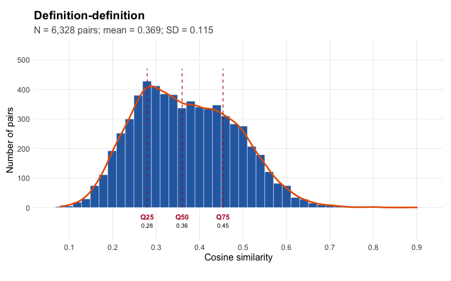

``` r
plot_similarity_distribution(scale_definitions_cross, matrix_triangle = "all",
                             title = "Scale x definition")
```

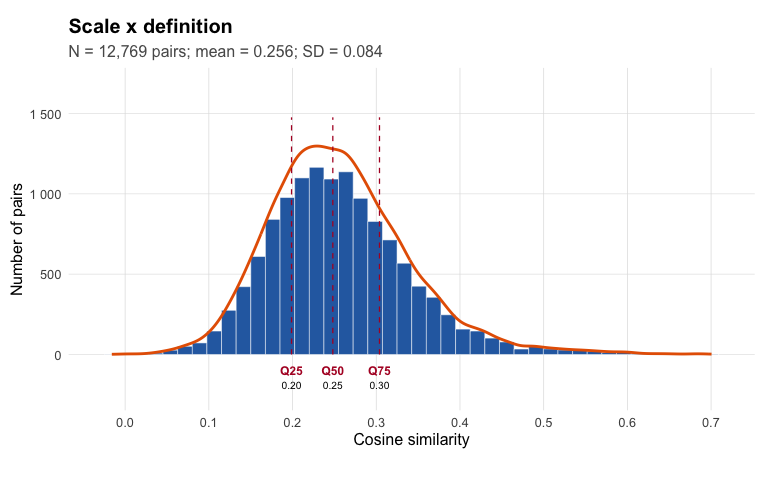

How well does each scale's item content match its own definition? The diagonal of the cross matrix is the similarity of each scale with its own definition; we compare it with the scale's similarity to all other definitions.


``` r
self_match <- tibble(
  scale_id = rownames(scale_definitions_cross),
  own_def  = diag(scale_definitions_cross)
) %>%
  mutate(rank_own = map_int(scale_id, ~ as.integer(rank(-scale_definitions_cross[.x, ])[[.x]])),
         best_def = colnames(scale_definitions_cross)[apply(scale_definitions_cross, 1, which.max)],
         test     = instrument_by_scale[scale_id],
         facet    = short_by_scale[scale_id],
         best_def_label = paste0(short_by_scale[best_def], " (", instrument_by_scale[best_def], ")"))

# share of scales whose own definition is the best-matching definition, by test
self_match %>%
  group_by(test) %>%
  summarise(n = n(), own_is_best = mean(rank_own == 1), median_rank = median(rank_own),
            mean_cos_own = mean(own_def))
#> # A tibble: 4 × 5
#>   test           n own_is_best median_rank mean_cos_own
#>   <chr>      <int>       <dbl>       <dbl>        <dbl>
#> 1 b5_aspects    10       0.3             2        0.518
#> 2 bfi2          15       0.133           3        0.515
#> 3 facetmap      70       0.729           1        0.504
#> 4 senna         18       0.444           2        0.524

# scales that best match another scale's definition
self_match %>%
  filter(rank_own > 1) %>%
  select(test, facet, rank_own, best_def_label) %>%
  arrange(desc(rank_own))
#> # A tibble: 49 × 4
#>    test     facet                                       rank_own best_def_label           
#>    <chr>    <chr>                                          <int> <chr>                    
#>  1 bfi2     Responsibility                                    16 Dependability (facetmap) 
#>  2 bfi2     Sociability                                       13 Enthusiasm (b5_aspects)  
#>  3 facetmap Self-Reliance                                      9 Organization (bfi2)      
#>  4 bfi2     Energy Level                                       8 Enthusiasm (energy; posi…
#>  5 bfi2     Assertiveness                                      7 Assertiveness (b5_aspect…
#>  6 bfi2     Compassion                                         7 Empathy (Compassionate c…
#>  7 facetmap Self-Efficacy                                      7 Perseverance (facetmap)  
#>  8 facetmap Warmth                                             6 Sociability (facetmap)   
#>  9 senna    Curiosity to learn                                 5 Intellectual Curiosity (…
#> 10 senna    Assertiveness (courage, finding your voice)        5 Assertiveness (b5_aspect…
#> # ℹ 39 more rows
```

## 3. Jingle-jangle classification


``` r
# Pair table: one row per scale pair, with content sim (scale_cos) and
# definition sim (definitions_cos). `labels` and `instrument` set the text
# shown in the plots: "facet name (test)".
jj_base <- jingle_jangle_pairs(
  scale_cos, definitions_cos,
  label_by_scale = definitions_by_scale,
  labels         = short_by_scale[rownames(scale_cos)],
  instrument     = instrument_by_scale[rownames(scale_cos)]
)

# Cutoffs at the .25 / .75 quantiles of the similarity distributions (Wulff &
# Mata used .80 / .99, the default). Only the upper triangle of each matrix is
# used, so each pair counts once and the diagonal of 1s is left out; the
# scatter below (threshold_rule = "quartile") draws the same cutoffs.
thresholds <- jingle_jangle_thresholds(
  scale_cos, definitions_cos,
  probs = c(.25, .75)
)

thresholds
#>  scale_low  label_low scale_high label_high 
#>  0.3593800  0.2792177  0.4941089  0.4538605

# Tag each pair as jingle / jangle / nothing.
jj <- classify_jingle_jangle(jj_base, thresholds)

count(jj, type)
#>             type    n
#> 1 Jangle fallacy  147
#> 2 Jingle fallacy   97
#> 3        nothing 6084

plot_jingle_jangle_scatter(
  jj,
  output_file = file.path(out_dir, "b5_empirical_relabeling-scatter_scale_definitions.png"),
  show_threshold_note = TRUE, threshold_rule = "quartile"
)
```

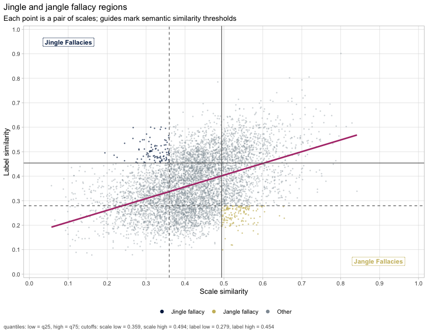

``` r

plot_jingle_jangle(jj, thresholds,
                   output_file = file.path(out_dir, "b5_empirical_relabeling-selected_jingle_jangle.png"), res = 150)
```

<div class="figure">
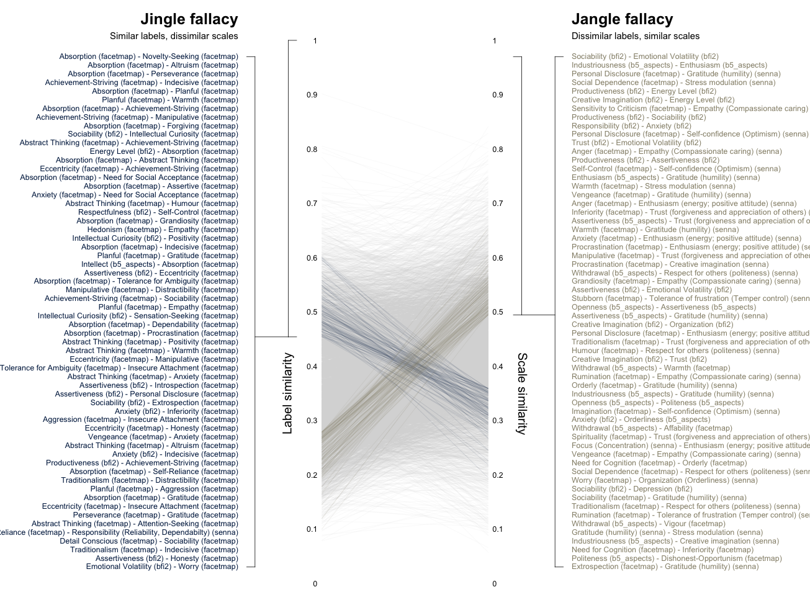
<p class="caption">plot of chunk jj-display</p>
</div>

Jingle and jangle pairs between **different tests** are the most informative: they show where the tests use different names for the same content, or the same names for different content. Note that most jingles occur **within** a test: definitions written by the same authors share a style (e.g. all FacetMap definitions start with "Propensity to ..."), which inflates their similarity even when the items differ.


``` r
jj_pairs <- jj %>%
  filter(type %in% c("Jingle fallacy", "Jangle fallacy")) %>%
  mutate(between_tests = instrument_1 != instrument_2)

count(jj_pairs, type, between_tests)
#>             type between_tests   n
#> 1 Jangle fallacy         FALSE  44
#> 2 Jangle fallacy          TRUE 103
#> 3 Jingle fallacy         FALSE  70
#> 4 Jingle fallacy          TRUE  27

jj_pairs %>%
  filter(between_tests) %>%
  transmute(type,
            scale_1 = paste0(label_1, " (", instrument_1, ")"),
            scale_2 = paste0(label_2, " (", instrument_2, ")"),
            item_sim = scale_cos, definition_sim = label_cos) %>%
  arrange(type, desc(abs(item_sim - definition_sim))) %>%
  mutate(across(where(is.numeric), ~ round(.x, 2)))
#>               type                             scale_1
#> 1   Jangle fallacy             Withdrawal (b5_aspects)
#> 2   Jangle fallacy      Personal Disclosure (facetmap)
#> 3   Jangle fallacy             Withdrawal (b5_aspects)
#> 4   Jangle fallacy      Personal Disclosure (facetmap)
#> 5   Jangle fallacy      Personal Disclosure (facetmap)
#> 6   Jangle fallacy        Social Dependence (facetmap)
#> 7   Jangle fallacy      Personal Disclosure (facetmap)
#> 8   Jangle fallacy             Withdrawal (b5_aspects)
#> 9   Jangle fallacy              Grandiosity (facetmap)
#> 10  Jangle fallacy             Withdrawal (b5_aspects)
#> 11  Jangle fallacy Sensitivity to Criticism (facetmap)
#> 12  Jangle fallacy      Personal Disclosure (facetmap)
#> 13  Jangle fallacy              Inferiority (facetmap)
#> 14  Jangle fallacy             Self-Control (facetmap)
#> 15  Jangle fallacy                    Anger (facetmap)
#> 16  Jangle fallacy Sensitivity to Criticism (facetmap)
#> 17  Jangle fallacy             Self-Control (facetmap)
#> 18  Jangle fallacy             Enthusiasm (b5_aspects)
#> 19  Jangle fallacy                   Warmth (facetmap)
#> 20  Jangle fallacy                Vengeance (facetmap)
#> 21  Jangle fallacy             Self-Control (facetmap)
#> 22  Jangle fallacy Sensitivity to Criticism (facetmap)
#> 23  Jangle fallacy                    Anger (facetmap)
#> 24  Jangle fallacy              Inferiority (facetmap)
#> 25  Jangle fallacy            Orderliness (b5_aspects)
#> 26  Jangle fallacy          Assertiveness (b5_aspects)
#> 27  Jangle fallacy             Withdrawal (b5_aspects)
#> 28  Jangle fallacy             Enthusiasm (b5_aspects)
#> 29  Jangle fallacy                   Warmth (facetmap)
#> 30  Jangle fallacy                  Anxiety (facetmap)
#> 31  Jangle fallacy          Procrastination (facetmap)
#> 32  Jangle fallacy             Withdrawal (b5_aspects)
#> 33  Jangle fallacy             Manipulative (facetmap)
#> 34  Jangle fallacy          Procrastination (facetmap)
#> 35  Jangle fallacy             Withdrawal (b5_aspects)
#> 36  Jangle fallacy             Withdrawal (b5_aspects)
#> 37  Jangle fallacy              Grandiosity (facetmap)
#> 38  Jangle fallacy                 Stubborn (facetmap)
#> 39  Jangle fallacy                 Critical (facetmap)
#> 40  Jangle fallacy              Inferiority (facetmap)
#> 41  Jangle fallacy          Assertiveness (b5_aspects)
#> 42  Jangle fallacy      Personal Disclosure (facetmap)
#> 43  Jangle fallacy            Self-Reliance (facetmap)
#> 44  Jangle fallacy             Withdrawal (b5_aspects)
#> 45  Jangle fallacy      Personal Disclosure (facetmap)
#> 46  Jangle fallacy           Traditionalism (facetmap)
#> 47  Jangle fallacy                   Humour (facetmap)
#> 48  Jangle fallacy             Withdrawal (b5_aspects)
#> 49  Jangle fallacy    Dishonest-Opportunism (facetmap)
#> 50  Jangle fallacy             Withdrawal (b5_aspects)
#> 51  Jangle fallacy               Rumination (facetmap)
#> 52  Jangle fallacy             Manipulative (facetmap)
#> 53  Jangle fallacy              Imagination (facetmap)
#> 54  Jangle fallacy            Self-Efficacy (facetmap)
#> 55  Jangle fallacy                  Orderly (facetmap)
#> 56  Jangle fallacy                  Orderly (facetmap)
#> 57  Jangle fallacy                 Critical (facetmap)
#> 58  Jangle fallacy        Industriousness (b5_aspects)
#> 59  Jangle fallacy               Openness (b5_aspects)
#> 60  Jangle fallacy             Withdrawal (b5_aspects)
#> 61  Jangle fallacy              Imagination (facetmap)
#> 62  Jangle fallacy               Aggression (facetmap)
#> 63  Jangle fallacy             Withdrawal (b5_aspects)
#> 64  Jangle fallacy                      Anxiety (bfi2)
#> 65  Jangle fallacy               Openness (b5_aspects)
#> 66  Jangle fallacy                   Vigour (facetmap)
#> 67  Jangle fallacy             Withdrawal (b5_aspects)
#> 68  Jangle fallacy             Spirituality (facetmap)
#> 69  Jangle fallacy              Inferiority (facetmap)
#> 70  Jangle fallacy        Attention-Seeking (facetmap)
#> 71  Jangle fallacy               Suspicious (facetmap)
#> 72  Jangle fallacy            Orderliness (b5_aspects)
#> 73  Jangle fallacy                  Callous (facetmap)
#> 74  Jangle fallacy        Social Dependence (facetmap)
#> 75  Jangle fallacy            Orderliness (b5_aspects)
#> 76  Jangle fallacy                    Worry (facetmap)
#> 77  Jangle fallacy             Politeness (b5_aspects)
#> 78  Jangle fallacy        Attention-Seeking (facetmap)
#> 79  Jangle fallacy                Vengeance (facetmap)
#> 80  Jangle fallacy        Industriousness (b5_aspects)
#> 81  Jangle fallacy              Intellect (b5_aspects)
#> 82  Jangle fallacy        Social Dependence (facetmap)
#> 83  Jangle fallacy                    Worry (facetmap)
#> 84  Jangle fallacy                      Anxiety (bfi2)
#> 85  Jangle fallacy        Attention-Seeking (facetmap)
#> 86  Jangle fallacy                Vengeance (facetmap)
#> 87  Jangle fallacy              Sociability (facetmap)
#> 88  Jangle fallacy           Traditionalism (facetmap)
#> 89  Jangle fallacy             Enthusiasm (b5_aspects)
#> 90  Jangle fallacy            Self-Reliance (facetmap)
#> 91  Jangle fallacy               Rumination (facetmap)
#> 92  Jangle fallacy             Self-Control (facetmap)
#> 93  Jangle fallacy             Withdrawal (b5_aspects)
#> 94  Jangle fallacy        Industriousness (b5_aspects)
#> 95  Jangle fallacy            Orderliness (b5_aspects)
#> 96  Jangle fallacy          Assertiveness (b5_aspects)
#> 97  Jangle fallacy               Openness (b5_aspects)
#> 98  Jangle fallacy        Industriousness (b5_aspects)
#> 99  Jangle fallacy          Procrastination (facetmap)
#> 100 Jangle fallacy              Intellect (b5_aspects)
#> 101 Jangle fallacy          Distractibility (facetmap)
#> 102 Jangle fallacy             Politeness (b5_aspects)
#> 103 Jangle fallacy            Extrospection (facetmap)
#> 104 Jingle fallacy                  Sociability (bfi2)
#> 105 Jingle fallacy                  Sociability (bfi2)
#> 106 Jingle fallacy                  Sociability (bfi2)
#> 107 Jingle fallacy                  Sociability (bfi2)
#> 108 Jingle fallacy                 Energy Level (bfi2)
#> 109 Jingle fallacy                  Sociability (bfi2)
#> 110 Jingle fallacy       Intellectual Curiosity (bfi2)
#> 111 Jingle fallacy               Respectfulness (bfi2)
#> 112 Jingle fallacy       Intellectual Curiosity (bfi2)
#> 113 Jingle fallacy              Intellect (b5_aspects)
#> 114 Jingle fallacy                Assertiveness (bfi2)
#> 115 Jingle fallacy       Intellectual Curiosity (bfi2)
#> 116 Jingle fallacy                  Sociability (bfi2)
#> 117 Jingle fallacy                   Depression (bfi2)
#> 118 Jingle fallacy                Assertiveness (bfi2)
#> 119 Jingle fallacy                Assertiveness (bfi2)
#> 120 Jingle fallacy                  Sociability (bfi2)
#> 121 Jingle fallacy                      Anxiety (bfi2)
#> 122 Jingle fallacy                      Anxiety (bfi2)
#> 123 Jingle fallacy                      Anxiety (bfi2)
#> 124 Jingle fallacy               Productiveness (bfi2)
#> 125 Jingle fallacy                      Anxiety (bfi2)
#> 126 Jingle fallacy            Self-Reliance (facetmap)
#> 127 Jingle fallacy                 Energy Level (bfi2)
#> 128 Jingle fallacy                Assertiveness (bfi2)
#> 129 Jingle fallacy         Emotional Volatility (bfi2)
#> 130 Jingle fallacy                  Sociability (bfi2)
#>                                                    scale_2 item_sim definition_sim
#> 1           Enthusiasm (energy; positive attitude) (senna)     0.66           0.23
#> 2        Tolerance of frustration (Temper control) (senna)     0.52           0.12
#> 3                       Organization (Orderliness) (senna)     0.52           0.12
#> 4                             Gratitude (humility) (senna)     0.58           0.18
#> 5                                Stress modulation (senna)     0.50           0.10
#> 6                                Stress modulation (senna)     0.65           0.28
#> 7                  Respect for others (politeness) (senna)     0.56           0.20
#> 8                            Focus (Concentration) (senna)     0.50           0.14
#> 9                  Respect for others (politeness) (senna)     0.59           0.23
#> 10                                    Impetuous (facetmap)     0.58           0.23
#> 11                  Empathy (Compassionate caring) (senna)     0.60           0.25
#> 12                      Self-confidence (Optimism) (senna)     0.54           0.20
#> 13                 Respect for others (politeness) (senna)     0.56           0.22
#> 14          Enthusiasm (energy; positive attitude) (senna)     0.55           0.22
#> 15                  Empathy (Compassionate caring) (senna)     0.55           0.22
#> 16                               Stress modulation (senna)     0.60           0.28
#> 17                      Self-confidence (Optimism) (senna)     0.59           0.27
#> 18                            Gratitude (humility) (senna)     0.60           0.28
#> 19                               Stress modulation (senna)     0.51           0.20
#> 20                            Gratitude (humility) (senna)     0.52           0.20
#> 21                      Organization (Orderliness) (senna)     0.52           0.21
#> 22                            Gratitude (humility) (senna)     0.58           0.26
#> 23          Enthusiasm (energy; positive attitude) (senna)     0.59           0.28
#> 24  Trust (forgiveness and appreciation of others) (senna)     0.52           0.21
#> 25                                Self-Reliance (facetmap)     0.50           0.19
#> 26  Trust (forgiveness and appreciation of others) (senna)     0.54           0.22
#> 27                          Personal Disclosure (facetmap)     0.56           0.25
#> 28                               Stress modulation (senna)     0.56           0.24
#> 29                            Gratitude (humility) (senna)     0.55           0.25
#> 30          Enthusiasm (energy; positive attitude) (senna)     0.56           0.26
#> 31          Enthusiasm (energy; positive attitude) (senna)     0.55           0.25
#> 32                                     Stubborn (facetmap)     0.51           0.21
#> 33  Trust (forgiveness and appreciation of others) (senna)     0.56           0.27
#> 34                            Creative imagination (senna)     0.52           0.22
#> 35                 Respect for others (politeness) (senna)     0.49           0.20
#> 36                                      Orderly (facetmap)     0.53           0.23
#> 37                  Empathy (Compassionate caring) (senna)     0.54           0.25
#> 38       Tolerance of frustration (Temper control) (senna)     0.55           0.26
#> 39                            Gratitude (humility) (senna)     0.56           0.26
#> 40                               Social initiative (senna)     0.55           0.26
#> 41                            Gratitude (humility) (senna)     0.56           0.27
#> 42     Assertiveness (courage, finding your voice) (senna)     0.53           0.24
#> 43                               Social initiative (senna)     0.57           0.28
#> 44     Assertiveness (courage, finding your voice) (senna)     0.51           0.22
#> 45          Enthusiasm (energy; positive attitude) (senna)     0.53           0.24
#> 46  Trust (forgiveness and appreciation of others) (senna)     0.50           0.21
#> 47                 Respect for others (politeness) (senna)     0.54           0.25
#> 48                              Distractibility (facetmap)     0.57           0.28
#> 49                   Persistence (Self-discipline) (senna)     0.52           0.23
#> 50                                       Warmth (facetmap)     0.56           0.27
#> 51                  Empathy (Compassionate caring) (senna)     0.50           0.21
#> 52                  Empathy (Compassionate caring) (senna)     0.56           0.27
#> 53          Enthusiasm (energy; positive attitude) (senna)     0.50           0.22
#> 54                      Organization (Orderliness) (senna)     0.56           0.27
#> 55                            Gratitude (humility) (senna)     0.54           0.26
#> 56                               Stress modulation (senna)     0.54           0.26
#> 57                      Self-confidence (Optimism) (senna)     0.55           0.27
#> 58                            Gratitude (humility) (senna)     0.51           0.23
#> 59                           Focus (Concentration) (senna)     0.53           0.25
#> 60                            Gratitude (humility) (senna)     0.55           0.27
#> 61                      Self-confidence (Optimism) (senna)     0.52           0.24
#> 62          Enthusiasm (energy; positive attitude) (senna)     0.50           0.22
#> 63                               Social initiative (senna)     0.53           0.25
#> 64                                Orderliness (b5_aspects)     0.50           0.22
#> 65          Enthusiasm (energy; positive attitude) (senna)     0.55           0.27
#> 66                      Organization (Orderliness) (senna)     0.51           0.23
#> 67                                   Affability (facetmap)     0.54           0.27
#> 68  Trust (forgiveness and appreciation of others) (senna)     0.50           0.23
#> 69       Tolerance of frustration (Temper control) (senna)     0.49           0.22
#> 70       Tolerance of frustration (Temper control) (senna)     0.51           0.24
#> 71                            Gratitude (humility) (senna)     0.54           0.27
#> 72                               Stress modulation (senna)     0.51           0.23
#> 73                      Self-confidence (Optimism) (senna)     0.53           0.26
#> 74       Tolerance of frustration (Temper control) (senna)     0.54           0.27
#> 75                            Gratitude (humility) (senna)     0.54           0.28
#> 76          Enthusiasm (energy; positive attitude) (senna)     0.53           0.27
#> 77                      Self-confidence (Optimism) (senna)     0.53           0.27
#> 78                  Empathy (Compassionate caring) (senna)     0.54           0.28
#> 79                  Empathy (Compassionate caring) (senna)     0.54           0.28
#> 80                  Empathy (Compassionate caring) (senna)     0.50           0.24
#> 81     Assertiveness (courage, finding your voice) (senna)     0.54           0.28
#> 82                 Respect for others (politeness) (senna)     0.52           0.27
#> 83                      Organization (Orderliness) (senna)     0.50           0.24
#> 84          Enthusiasm (energy; positive attitude) (senna)     0.50           0.25
#> 85                 Respect for others (politeness) (senna)     0.51           0.26
#> 86       Tolerance of frustration (Temper control) (senna)     0.53           0.28
#> 87                            Gratitude (humility) (senna)     0.51           0.27
#> 88                 Respect for others (politeness) (senna)     0.52           0.28
#> 89                              Procrastination (facetmap)     0.51           0.26
#> 90          Enthusiasm (energy; positive attitude) (senna)     0.51           0.27
#> 91       Tolerance of frustration (Temper control) (senna)     0.52           0.28
#> 92   Determination (Goal striving, high standards) (senna)     0.51           0.27
#> 93                                       Vigour (facetmap)     0.51           0.27
#> 94                            Creative imagination (senna)     0.51           0.27
#> 95                                Self-Efficacy (facetmap)     0.50           0.26
#> 96       Tolerance of frustration (Temper control) (senna)     0.51           0.27
#> 97                            Gratitude (humility) (senna)     0.51           0.27
#> 98                            Social Confidence (facetmap)     0.51           0.27
#> 99                      Self-confidence (Optimism) (senna)     0.51           0.27
#> 100                  Persistence (Self-discipline) (senna)     0.49           0.26
#> 101         Enthusiasm (energy; positive attitude) (senna)     0.49           0.26
#> 102                       Dishonest-Opportunism (facetmap)     0.50           0.28
#> 103                           Gratitude (humility) (senna)     0.50           0.28
#> 104                                     Empathy (facetmap)     0.19           0.50
#> 105                  Need for Social Acceptance (facetmap)     0.29           0.55
#> 106                             Novelty-Seeking (facetmap)     0.28           0.54
#> 107                      Intellectual Curiosity (facetmap)     0.24           0.46
#> 108                                  Absorption (facetmap)     0.30           0.51
#> 109                                    Altruism (facetmap)     0.28           0.47
#> 110                                  Absorption (facetmap)     0.31           0.50
#> 111                                Self-Control (facetmap)     0.31           0.50
#> 112                                  Positivity (facetmap)     0.29           0.48
#> 113                                  Absorption (facetmap)     0.32           0.51
#> 114                                Eccentricity (facetmap)     0.30           0.49
#> 115                           Sensation-Seeking (facetmap)     0.29           0.47
#> 116                           Social Dependence (facetmap)     0.31           0.48
#> 117                  Need for Social Acceptance (facetmap)     0.29           0.46
#> 118                               Introspection (facetmap)     0.30           0.46
#> 119                         Personal Disclosure (facetmap)     0.34           0.50
#> 120                               Extrospection (facetmap)     0.32           0.48
#> 121                     Tolerance for Ambiguity (facetmap)     0.32           0.48
#> 122                                 Inferiority (facetmap)     0.33           0.47
#> 123                                  Indecisive (facetmap)     0.34           0.47
#> 124                        Achievement-Striving (facetmap)     0.34           0.48
#> 125                               Risk-Aversion (facetmap)     0.36           0.49
#> 126     Responsibility (Reliability, Dependabilty) (senna)     0.34           0.46
#> 127                           Sensation-Seeking (facetmap)     0.35           0.47
#> 128                                     Honesty (facetmap)     0.35           0.46
#> 129                                       Worry (facetmap)     0.36           0.46
#> 130                                  Suspicious (facetmap)     0.36           0.45
```

### Removing the style of each test: centering by test

Texts written for the same test share a style: a format ("Propensity to ...", "I am someone who ..."), recurring words, a typical length. The embedding model picks this up, so two scales of the same test look more alike than their content justifies. Pellert et al. (2026) remove it with a simple subtraction (SQuID): compute the average embedding of all items of a questionnaire and subtract it from each item embedding.

`center_embeddings(emb, group)` does this per group. We center the **item** embeddings by test and the **definition** embeddings by test, before computing any cosine. Items are centered by test, not by scale: subtracting the scale mean from its items would make every scale embedding (the mean of its items) zero.


``` r
items_emb_ctr       <- center_embeddings(items_emb, items$test)
definitions_emb_ctr <- center_embeddings(definitions_emb, definitions$test)

scale_emb_ctr <- get_scale_embeddings(items_emb_ctr, items$scale_id)[definitions$scale_id, ]
scale_cos_ctr       <- cosine_matrix(scale_emb_ctr)
definitions_cos_ctr <- cosine_matrix(definitions_emb_ctr)

jj_ctr <- jingle_jangle_pairs(
  scale_cos_ctr, definitions_cos_ctr,
  labels     = short_by_scale[rownames(scale_cos_ctr)],
  instrument = instrument_by_scale[rownames(scale_cos_ctr)]
)
thresholds_ctr <- jingle_jangle_thresholds(scale_cos_ctr, definitions_cos_ctr, probs = c(.25, .75))
jj_ctr <- classify_jingle_jangle(jj_ctr, thresholds_ctr)


# fallacies within and between tests, raw vs centered
bind_rows(raw = jj, centered = jj_ctr, .id = "embeddings") %>%
  mutate(between_tests = instrument_1 != instrument_2) %>%
  filter(type != "nothing") %>%
  count(embeddings, type, between_tests) %>%
  pivot_wider(names_from = between_tests, values_from = n,
              names_prefix = "between_tests_")
#> # A tibble: 4 × 4
#>   embeddings type           between_tests_FALSE between_tests_TRUE
#>   <chr>      <chr>                        <int>              <int>
#> 1 centered   Jangle fallacy                  34                 24
#> 2 centered   Jingle fallacy                  33                 33
#> 3 raw        Jangle fallacy                  44                103
#> 4 raw        Jingle fallacy                  70                 27

# agreement between item similarity and definition similarity
c(raw = cor(jj$scale_cos, jj$label_cos), centered = cor(jj_ctr$scale_cos, jj_ctr$label_cos))
#>       raw  centered 
#> 0.4490089 0.6680363
```

Centering removes most of the within-test jingles and makes item and definition similarities agree more. Mean similarity within a test is no longer higher than between tests:


``` r
bind_rows(raw = jj, centered = jj_ctr, .id = "embeddings") %>%
  mutate(pair = if_else(instrument_1 == instrument_2, "within test", "between tests")) %>%
  group_by(embeddings, pair) %>%
  summarise(item_sim = round(mean(scale_cos), 3), definition_sim = round(mean(label_cos), 3), .groups = "drop")
#> # A tibble: 4 × 4
#>   embeddings pair          item_sim definition_sim
#>   <chr>      <chr>            <dbl>          <dbl>
#> 1 centered   between tests    0              0    
#> 2 centered   within test     -0.02          -0.021
#> 3 raw        between tests    0.403          0.312
#> 4 raw        within test      0.456          0.443
```


``` r
count(jj_ctr, type)
#>             type    n
#> 1 Jangle fallacy   58
#> 2 Jingle fallacy   66
#> 3        nothing 6204

plot_jingle_jangle_scatter(
  jj_ctr,
  output_file = file.path(out_dir, "b5_empirical_relabeling-scatter_scale_definitions_ctr.png"),
  show_threshold_note = TRUE, threshold_rule = "quartile"
)
```

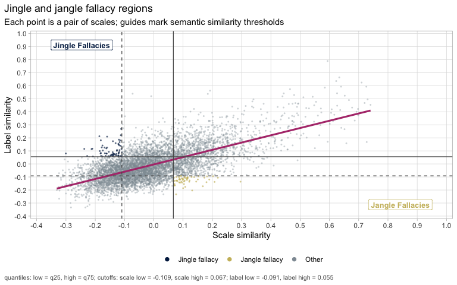

``` r

plot_jingle_jangle(jj_ctr, thresholds_ctr ,
                 output_file = file.path(out_dir, "b5_empirical_relabeling-selected_jingle_jangle_ctr.png"), res = 150)

```


### Alternative: centering the similarities

Centering the embeddings makes most cosines negative: after subtracting a test's mean, that test's vectors sum to zero, so their similarities are forced to average below zero (an ipsative-like constraint). The negative side cannot be read as "opposite". `center_similarity()` removes the test effect from the **similarities** instead and keeps their metric:

1.  record the overall mean and SD of the similarities;
2.  each similarity belongs to a pair of groups (e.g. BFI-2 x BFI-2, BFI-2 x FacetMap): subtract the mean of that block;
3.  put the residuals back on the original mean and SD.

`cosine_matrix(x, center_by = group)` and `cosim_xy(..., center_by_x, center_by_y)` do it in one call.


``` r
scale_cos_sc       <- cosine_matrix(scale_emb, center_by = instrument_by_scale[rownames(scale_emb)])
definitions_cos_sc <- cosine_matrix(definitions_emb, center_by = instrument_by_scale[rownames(definitions_emb)])

jj_sc <- jingle_jangle_pairs(
  scale_cos_sc, definitions_cos_sc,
  labels     = short_by_scale[rownames(scale_cos_sc)],
  instrument = instrument_by_scale[rownames(scale_cos_sc)]
)
jj_sc <- classify_jingle_jangle(
  jj_sc, jingle_jangle_thresholds(scale_cos_sc, definitions_cos_sc, probs = c(.25, .75))
)

# raw vs centered embeddings vs centered similarities
bind_rows(raw = jj, emb_centered = jj_ctr, sim_centered = jj_sc, .id = "method") %>%
  mutate(within = instrument_1 == instrument_2) %>%
  group_by(method) %>%
  summarise(
    item_sim_mean  = mean(scale_cos), item_sim_sd = sd(scale_cos),
    def_within_minus_between = mean(label_cos[within]) - mean(label_cos[!within]),
    jingle_within  = sum(type == "Jingle fallacy" & within),
    jingle_between = sum(type == "Jingle fallacy" & !within),
    jangle_within  = sum(type == "Jangle fallacy" & within),
    jangle_between = sum(type == "Jangle fallacy" & !within),
    r = cor(scale_cos, label_cos)
  ) %>%
  mutate(across(where(is.double), ~ round(.x, 3))) %>%
  as.data.frame()
#>         method item_sim_mean item_sim_sd def_within_minus_between jingle_within
#> 1 emb_centered        -0.009       0.146                   -0.021            33
#> 2          raw         0.425       0.107                    0.131            70
#> 3 sim_centered         0.425       0.107                    0.000            64
#>   jingle_between jangle_within jangle_between     r
#> 1             33            34             24 0.668
#> 2             27            44            103 0.449
#> 3             70            47             54 0.548
```

Centering the similarities keeps the mean and SD of the raw cosines and removes the within-test excess exactly (`def_within_minus_between` = 0). Centering the embeddings goes further: it also removes the test-specific *directions* in the embedding space, so item and definition similarities agree more (higher `r`), but it pushes within-test pairs below the between-test ones by an amount set by the number of texts per test.

### Keeping only between-test pairs

Pairs between **different tests** are the informative ones for comparing tests, so we can select them before relabeling. For a single classification this is just a filter:


``` r
jj_between <- jj_ctr %>%
  filter(instrument_1 != instrument_2, type != "nothing")

count(jj_between, type)
#>             type  n
#> 1 Jangle fallacy 24
#> 2 Jingle fallacy 33
```

In the relabeling pipeline the same filter is applied at every step with `between_tests_only = TRUE` (section 4). There, merged scales can mix items of several tests; a pair counts as within a test only when both scales contain items of that one test, so pairs involving a mixed scale are always kept. The cutoffs are still computed from all pairs; only the actions are restricted.

## 4. Empirical relabeling

The classification above points to two kinds of problems, and each has a natural fix:

-   **Jangle** (similar items, different definitions): the two scales measure the same thing under different names. We **merge** them: their items are combined into one new scale, and an LLM writes a short label (2 to 4 words) and a definition from the combined items.
-   **Jingle** (different items, similar definitions): the definitions do not tell the scales apart. We **contrast** them: the LLM rewrites both labels and definitions so each one is closer to its own items and more distinct from the other.

Then the new definitions are embedded, the scale embeddings are recomputed from the new item groupings, and the jingle-jangle classification is run again with new cutoffs (the 25th and 75th percentiles of that step's similarities). This is one **step**. `empirical_relabeling()` repeats it `n_steps` times, or until no fallacies are left.

A scale enters at most one action per step. Pairs are taken in order of the gap between item similarity and definition similarity, skipping pairs whose scales were already used, so each step merges disjoint pairs. Because the scales keep merging, many steps lead toward a few broad scales.

**How often a jingle is contrasted: `jingle_patience`.** A pair of scales is contrasted at most `jingle_patience` times. The first rewrite usually resolves the jingle; when it does not, rewriting the same pair again tends to return the same definitions, and the pipeline would loop. With `jingle_patience = 1` (default) a pair gets one rewrite; if it is still a jingle afterwards it is reported as **unresolved** (`relabel$unresolved`): its definitions stay alike, even after being rewritten to differ, although its items differ. Use `2` for a second try, `Inf` for no limit, and `0` to turn contrasts off and treat only jangles (merge-only). Merge-only keeps the authors' definitions untouched except where scales merge, and uses far fewer LLM calls, but jingles are never addressed: it answers the narrower question *which scales are redundant?*

With `test_col = "test"`, three options apply the previous section inside the pipeline:

-   `center_by_test = TRUE`: items and original definitions are centered by test. The LLM's definitions share a style too, so they form their own group: each one is centered by the mean of all LLM definitions written so far.
-   `center_similarities = TRUE`: the alternative above, inside the pipeline. In every step the scale, definition and scale x definition similarities go through `center_similarity()`; scales are grouped by test (`"mixed"` for merged scales combining tests) and definitions by author (their test, or `"llm"`).
-   `between_tests_only = TRUE`: only between-test pairs trigger merges and contrasts.

Choose the LLM with `provider` (`"openai"`, `"anthropic"`, `"google"`, `"deepseek"`) and `model`. LLM answers and the embeddings of the new definitions are cached in `cache_dir`, so the tutorial renders again without new API calls.


``` r
llm_provider <- "openai"          # or "anthropic", "google", "deepseek"
llm_model    <- "gpt-4.1-mini"    # e.g. "claude-sonnet-4-5", "gemini-2.5-flash"
n_steps      <- 12

center_by_test     <- TRUE    # remove the style of each test (SQuID)
between_tests_only <- FALSE    # act only on pairs between different tests
```


``` r
relabel_items  <- items %>% select(item_id, item_text = item_en_text, scale_id, test)
relabel_scales <- definitions %>%
  transmute(scale_id, label = paste0(facet_name, " (", test, ")"), definition, test)
relabel_cache  <- file.path("emb_cache", paste0("relabel_", emb_model, "_", llm_model))

relabel <- empirical_relabeling(
  items     = relabel_items,
  scales    = relabel_scales,
  item_emb  = items_emb,          # raw embeddings: centering happens inside
  def_emb   = definitions_emb,
  embed_fun = embed,
  n_steps   = n_steps,
  probs     = c(.25, .75),
  provider  = llm_provider,
  model     = llm_model,
  chat_args = list(params = ellmer::params(temperature = 0)),
  jingle_patience = 1,
  test_col  = "test",
  center_by_test     = center_by_test,
  between_tests_only = between_tests_only,
  cache_dir = relabel_cache
)
```

For comparison, the same pipeline on raw embeddings and all pairs:


``` r
relabel_raw <- empirical_relabeling(
  items = relabel_items, scales = relabel_scales,
  item_emb = items_emb, def_emb = definitions_emb, embed_fun = embed,
  n_steps = n_steps, probs = c(.25, .75),
  provider = llm_provider, model = llm_model,
  chat_args = list(params = ellmer::params(temperature = 0)),
  jingle_patience = 1, test_col = "test", center_by_test = FALSE, between_tests_only = FALSE,
  cache_dir = relabel_cache
)
```

The result is a list of tidy tables. The main ones:

-   `relabel$labels`: every label a scale ever had (`scale_id`, `step`, `source` = original / merge / contrast, `label`, `definition`);
-   `relabel$membership`: which items belong to each scale, for every scale ever created;
-   `relabel$merges`: the merge tree (`scale_id` = new scale, `parent` = merged scale);
-   `relabel$scales_by_step`: the active scales of each step with their current label and their fit with it;
-   `relabel$pairs`, `relabel$thresholds`: the jingle-jangle classification of each step;
-   `relabel$actions`: one row per LLM call, with its prompt.


``` r
relabel$labels %>% filter(step > 0) %>% select(scale_id, step, source, label, definition)
#> # A tibble: 87 × 5
#>    scale_id  step source label                             definition                     
#>    <chr>    <int> <chr>  <chr>                             <chr>                          
#>  1 S1.1         1 merge  Humorous Aggressiveness           Combines a strong sense of hum…
#>  2 S1.2         1 merge  Task Focus and Clarity Preference Engages diligently in tasks wi…
#>  3 S1.3         1 merge  Impulsivity and Rumination        Experiencing frequent spontane…
#>  4 S1.4         1 merge  Cognitive Engagement              Ability to quickly understand …
#>  5 S1.5         1 merge  Social Warmth and Self-Esteem     Experiencing and expressing wa…
#>  6 S1.6         1 merge  Emotional Stability               Ability to maintain calmness a…
#>  7 S1.7         1 merge  Social Interaction Quality        Engagement in social situation…
#>  8 S1.8         1 merge  Thoughtful Planning               Engagement in deliberate and c…
#>  9 S1.9         1 merge  Positive Emotionality             Experiencing frequent joy, ent…
#> 10 S1.10        1 merge  Emotional Sensitivity and Empathy Experiencing frequent mood flu…
#> # ℹ 77 more rows
relabel$merges
#> # A tibble: 110 × 3
#>     step scale_id parent                            
#>    <int> <chr>    <chr>                             
#>  1     1 S1.1     facetmap_O_humour                 
#>  2     1 S1.1     facetmap_A_aggression             
#>  3     1 S1.2     bfi2_C_prod                       
#>  4     1 S1.2     facetmap_O_tolerance_for_ambiguity
#>  5     1 S1.3     facetmap_N_impetuous              
#>  6     1 S1.3     facetmap_N_rumination             
#>  7     1 S1.4     b5_aspects_O_intellect            
#>  8     1 S1.4     senna_E_Assr                      
#>  9     1 S1.5     facetmap_E_warmth                 
#> 10     1 S1.5     facetmap_N_inferiority            
#> # ℹ 100 more rows
```

## 5. What changes across steps

`relabeling_summary()` gives one row per step. Besides the counts of scales, merges, contrasts and fallacies, three indices show how well the labels follow the item content:

-   `r_scale_label`: correlation, across pairs, between item similarity and definition similarity. When the labels describe the content well, scales with similar items have similar definitions.
-   `mean_own_cos`: mean similarity of each scale with its own definition.
-   `prop_own_best`: share of scales whose own definition is the best-matching definition among all definitions.


``` r
relabeling_summary(relabel) %>%
  mutate(across(where(is.double), ~ round(.x, 3)))
#> # A tibble: 9 × 16
#>    step n_scales merges contrasts mean_own_cos prop_own_best jingle jingle_unresolved
#>   <int>    <int>  <int>     <int>        <dbl>         <dbl>  <int>             <int>
#> 1     0      113      0         0        0.473         0.681     66                 0
#> 2     1       83     30         8        0.549         0.88      16                 0
#> 3     2       74      9         4        0.547         0.919      6                 1
#> 4     3       68      6         2        0.55          0.926      1                 0
#> 5     4       65      3         0        0.556         0.923      5                 0
#> 6     5       63      2         1        0.554         0.889      2                 1
#> 7     6       61      2         0        0.549         0.902      2                 0
#> 8     7       59      2         0        0.552         0.915      1                 0
#> 9     8       58      1         1        0.558         0.897      1                 1
#> # ℹ 8 more variables: jangle <int>, jingle_between <int>, jangle_between <int>,
#> #   r_scale_label <dbl>, scale_low <dbl>, label_low <dbl>, scale_high <dbl>,
#> #   label_high <dbl>

plot_relabeling_trajectory(relabel)
```

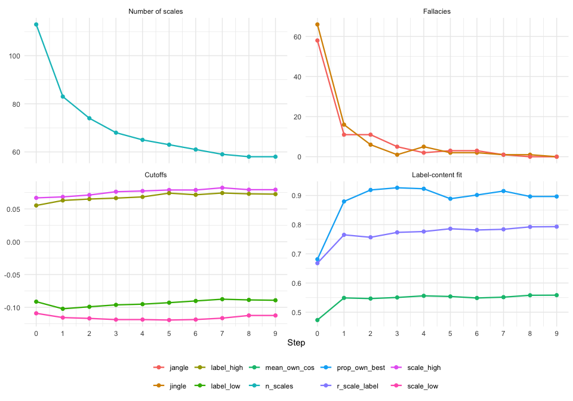

The fit of each scale with its own definition, step by step:


``` r
relabel$scales_by_step %>%
  ggplot(aes(factor(step), own_cos)) +
  geom_boxplot(outlier.size = .6, fill = "grey90") +
  labs(x = "Step", y = "Similarity of scale with its own definition") +
  theme_minimal()
```

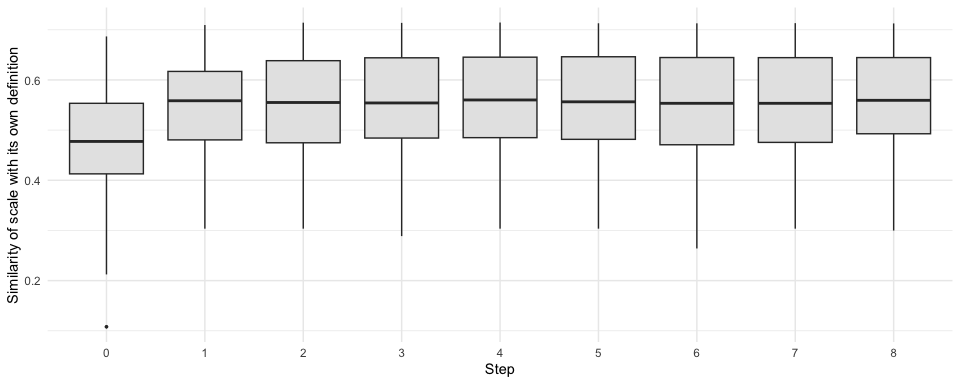

Centered and between-test vs raw and all pairs:


``` r
bind_rows(`centered, between tests` = relabeling_summary(relabel),
          `raw, all pairs`          = relabeling_summary(relabel_raw), .id = "run") %>%
  select(run, step, n_scales, jingle, jangle, r_scale_label, prop_own_best) %>%
  pivot_longer(-c(run, step)) %>%
  ggplot(aes(step, value, colour = run)) +
  geom_line() + geom_point(size = 1) +
  facet_wrap(~ name, scales = "free_y", nrow = 1) +
  scale_x_continuous(breaks = seq(0, n_steps, 3)) +
  labs(x = "Step", y = NULL, colour = NULL) +
  theme_minimal() +
  theme(legend.position = "bottom")
```

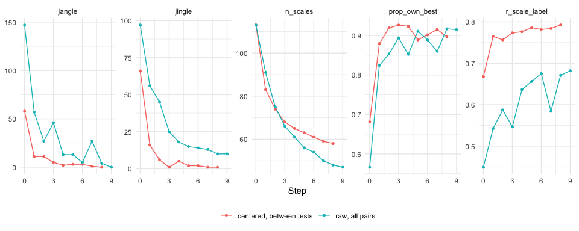

``` r

# final merged scales of each run
list(centered = relabel, raw = relabel_raw) %>%
  map(~ relabeling_scales(.x) %>% filter(n_original > 1) %>%
        select(label, n_items, n_original) %>% head(10))
#> $centered
#> # A tibble: 10 × 3
#>    label                                     n_items n_original
#>    <chr>                                       <int>      <int>
#>  1 Emotional Reactivity                          109         18
#>  2 Curiosity and Emotional Regulation             74         12
#>  3 Reliability and Trust                          30          4
#>  4 Emotional Openness and Trust                   21          4
#>  5 Social Support and Interaction                 24          3
#>  6 Self-Centered Indifference                     21          3
#>  7 Orderliness and Activity Level                 20          3
#>  8 Social Harmony and Intellectual Curiosity      15          3
#>  9 Cognitive Engagement                           19          2
#> 10 Empathy and Humility                           16          2
#> 
#> $raw
#> # A tibble: 10 × 3
#>    label                             n_items n_original
#>    <chr>                               <int>      <int>
#>  1 Personality Traits Spectrum           173         25
#>  2 Emotional and Social Resilience        74         12
#>  3 Psychological Well-being               46          7
#>  4 Emotional and Moral Balance            32          6
#>  5 Focused Self-Regulation                29          4
#>  6 Emotional Stability and Openness       16          4
#>  7 Emotional Sensitivity and Empathy      21          3
#>  8 Task Focus and Sociability             20          2
#>  9 Creativity and Leadership              20          2
#> 10 Classroom Engagement                   18          2
```

Note that `r_scale_label` and `prop_own_best` are computed on centered embeddings in one run and raw embeddings in the other, so they are not on the same scale; the counts of scales and fallacies are comparable.

## 6. Merge tree

The original scales are on the left. Each merge is a node at the step where it happened (pink), labeled with the LLM's short label; diamonds (blue) mark scales relabeled to undo a jingle (their labels show on hover; use `show_text = c("merge", "contrast")` to print them). Hover over a node to read its definition; click the legend to hide a node type; zoom in to read dense regions.


``` r
# interactive (plotly): run it in your own session
plot_relabeling_tree(relabel)
```

All three tree plots take `steps`, the last step to draw, so you can look at earlier, finer solutions.

**Circular tree.** The same tree as a circle, in the style of Wulff & Mata (2025): original scales on the rim, merges further inside the later they happened, each cluster in its own colour and labelled with its current short label.


``` r
plot_relabeling_circle(relabel)
```

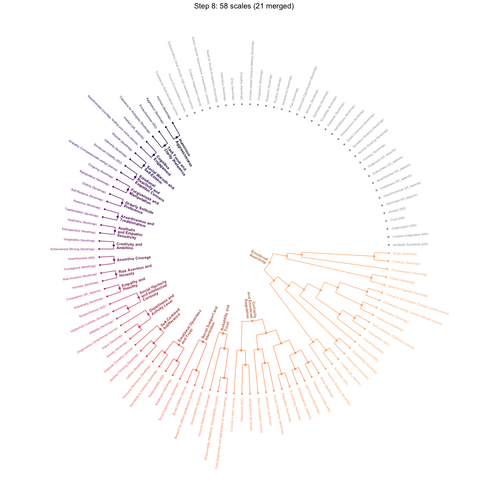

``` r
plot_relabeling_circle(relabel, steps = 2)
```

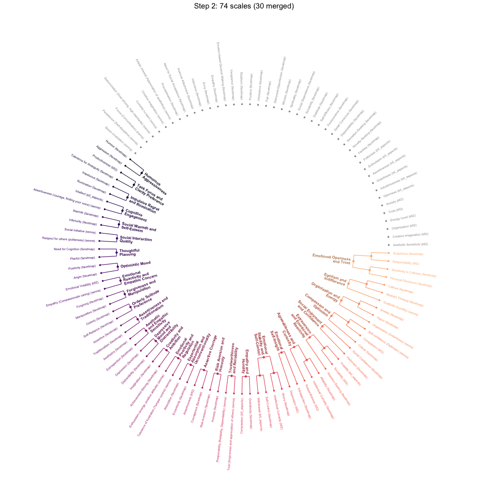

**ICLUST-style diagram.** Like `psych::ICLUST.diagram()`: original scales are boxes, merged scales are ellipses at the step where they were formed, and arrows carry the cosine between each part and the merged scale (the analogue of ICLUST's loadings). Each ellipse shows

-   $\alpha$: semantic alpha of the merged scale, $k\bar{c}/(1+(k-1)\bar{c})$ with $\bar{c}$ the mean item-item cosine;
-   $\beta$: split-half reliability between the two merged parts, ICLUST's beta for that split. A low $\beta$ flags a merge of heterogeneous content;
-   $N$: number of items.

Scales never merged are left out (`drop_unmerged = TRUE`). With `center_by_test = TRUE`, $\alpha$, $\beta$ and the arrow cosines are computed on the centered item embeddings, so they are lower than on raw embeddings.


``` r
plot_relabeling_iclust(relabel)
```

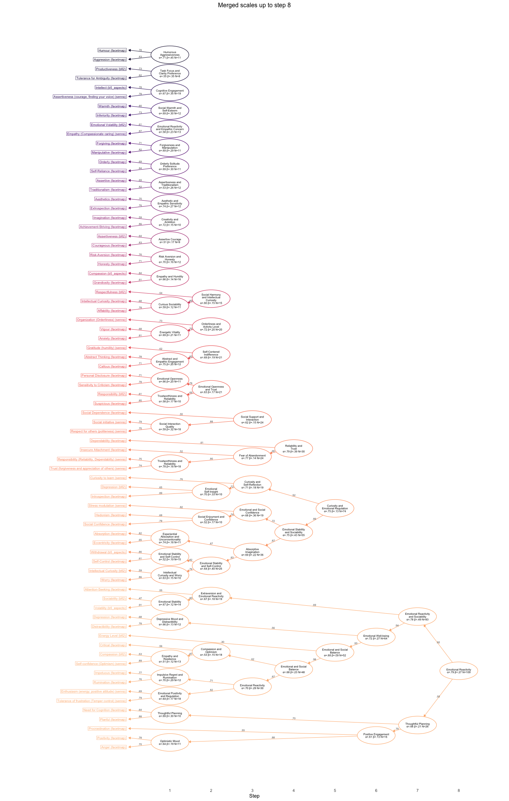


``` r
plot_relabeling_iclust(relabel, steps = 3)
```

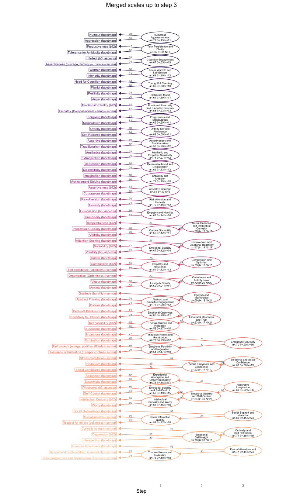

## 7. Scales at a given step

`relabeling_scales()` lists the active scales of a step with their label, definition and the original scales they contain.


``` r
final_scales <- relabeling_scales(relabel)            # last step
final_scales %>% select(scale_id, label, n_items, n_original, own_cos, definition)
#> # A tibble: 58 × 6
#>    scale_id label                                    n_items n_original own_cos definition
#>    <chr>    <chr>                                      <int>      <int>   <dbl> <chr>     
#>  1 S8.1     Emotional Reactivity                         109         18   0.497 Experienc…
#>  2 S5.2     Curiosity and Emotional Regulation            74         12   0.300 Interest …
#>  3 S4.1     Reliability and Trust                         30          4   0.694 Consisten…
#>  4 S2.9     Emotional Openness and Trust                  21          4   0.511 The exten…
#>  5 S3.4     Social Support and Interaction                24          3   0.497 Seeking a…
#>  6 S2.8     Self-Centered Indifference                    21          3   0.425 Prioritiz…
#>  7 S2.7     Orderliness and Activity Level                20          3   0.621 Maintaini…
#>  8 S2.3     Social Harmony and Intellectual Curiosi…      15          3   0.513 Exhibits …
#>  9 S1.4     Cognitive Engagement                          19          2   0.586 Ability t…
#> 10 S1.30    Empathy and Humility                          16          2   0.435 Experienc…
#> # ℹ 48 more rows

# an intermediate step
relabeling_scales(relabel, step = 5) %>%
  select(scale_id, label, n_items, n_original, original_scales)
#> # A tibble: 63 × 5
#>    scale_id label                                     n_items n_original original_scales  
#>    <chr>    <chr>                                       <int>      <int> <chr>            
#>  1 S5.2     Curiosity and Emotional Regulation             74         12 Absorption (face…
#>  2 S5.1     Emotional and Social Balance                   52          8 Compassion (bfi2…
#>  3 S4.1     Reliability and Trust                          30          4 Dependability (f…
#>  4 S2.9     Emotional Openness and Trust                   21          4 Personal Disclos…
#>  5 S3.4     Social Support and Interaction                 24          3 Respect for othe…
#>  6 S2.8     Self-Centered Indifference                     21          3 Abstract Thinkin…
#>  7 S2.7     Orderliness and Activity Level                 20          3 Anxiety (facetma…
#>  8 S2.4     Extraversion and Emotional Reactivity          19          3 Attention-Seekin…
#>  9 S2.3     Social Harmony and Intellectual Curiosity      15          3 Affability (face…
#> 10 S1.4     Cognitive Engagement                           19          2 Assertiveness (c…
#> # ℹ 53 more rows
```

Which tests contribute to each scale? Merges across tests show where different tests measure the same content.


``` r
step_show <- 5

relabel$scales_by_step %>%
  filter(step == step_show, scale_id %in% relabel$merges$scale_id) %>%   # merged scales only
  left_join(relabel$membership, by = "scale_id", relationship = "one-to-many") %>%
  left_join(select(items, item_id, test), by = "item_id") %>%
  left_join(select(relabel$labels, label_id, label), by = "label_id") %>%
  ggplot(aes(y = fct_rev(fct_infreq(label)), fill = test)) +
  geom_bar() +
  labs(x = "Number of items", y = NULL, fill = "Test",
       title = paste("Merged scales at step", step_show)) +
  theme_minimal()
```

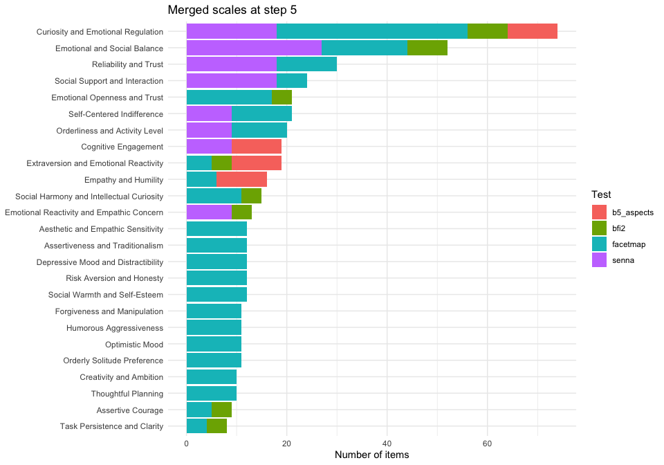

## 8. Jingle-jangle before and after

The same scatter as in section 3, for the original taxonomy and for later steps. Each panel uses its own quartile cutoffs.


``` r
steps_show <- unique(c(0, 1, 5, max(relabel$pairs$step)))

relabel$pairs %>%
  filter(step %in% steps_show) %>%
  ggplot(aes(scale_cos, label_cos, colour = type)) +
  geom_point(size = .5, alpha = .5) +
  geom_smooth(aes(group = 1), method = "lm", se = FALSE, colour = "black", linewidth = .6) +
  facet_wrap(~ step, nrow = 1, labeller = label_both) +
  scale_colour_manual(values = c(`Jingle fallacy` = "#2C7FB8",
                                 `Jangle fallacy` = "#B23A7A", nothing = "grey70")) +
  labs(x = "Item (scale) similarity", y = "Definition similarity", colour = NULL) +
  theme_minimal() +
  theme(legend.position = "bottom")
```

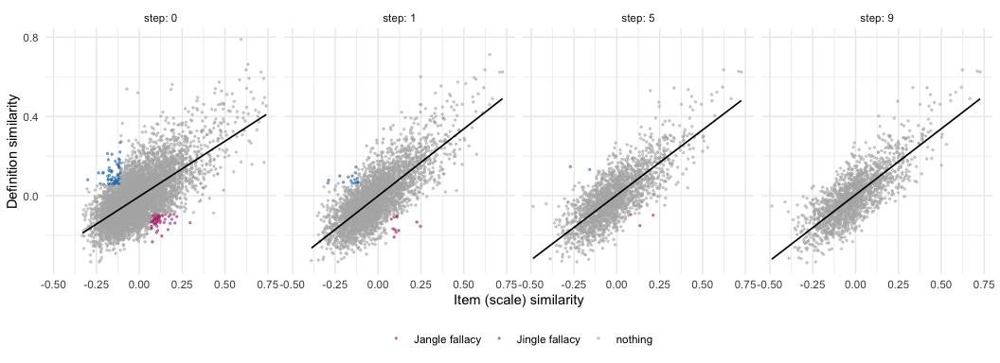

## 9. Inspect the LLM calls

Every LLM call is in `relabel$actions`, with the pair that triggered it and the prompt sent.


``` r
relabel$actions %>% count(step, action) %>% pivot_wider(names_from = action, values_from = n)
#> # A tibble: 8 × 3
#>    step contrast merge
#>   <int>    <int> <int>
#> 1     1        8    30
#> 2     2        4     9
#> 3     3        2     6
#> 4     4       NA     3
#> 5     5        1     2
#> 6     6       NA     2
#> 7     7       NA     2
#> 8     8        1     1

# one contrast (jingle) relabeling: before and after
one <- relabel$actions %>% filter(action == "contrast") %>% slice(1)
relabel$labels %>%
  filter(scale_id %in% c(one$scale_1, one$scale_2), step %in% c(0, one$step)) %>%
  select(scale_id, step, source, label, definition)
#> # A tibble: 4 × 5
#>   scale_id             step source   label               definition                       
#>   <chr>               <int> <chr>    <chr>               <chr>                            
#> 1 bfi2_N_dep              0 original Depression (bfi2)   Tendency to experience sadness a…
#> 2 facetmap_A_critical     0 original Critical (facetmap) Propensity to express adverse or…
#> 3 bfi2_N_dep              1 contrast Emotional Stability Experiences a balanced mood char…
#> 4 facetmap_A_critical     1 contrast Judgmental Attitude Inclination to evaluate others n…

cat(one$prompt)
#> Below are the items of 2 psychological scales. Their current labels are too similar, but their items measure different content. For each scale, write a new short label (2 to 4 words) and a definition that describe its own items closely and clearly distinguish it from the other scale. Answer scale_1 for Scale 1, scale_2 for Scale 2, and so on.
#> 
#> Rules:
#> - Base the label and definition only on the content of the items.
#> - Some items are reverse-keyed (they describe the opposite pole); name the construct by its positive pole.
#> - The definition should have 12 to 60 words; use more only if the content really needs it.
#> - Do not open the definition with generic phrases such as 'Tendency to' or 'Propensity to'; state the distinctive content directly.
#> - Do not repeat the label in the definition, and do not mention the items or the scale itself.
#> 
#> Scale 1:
#> Current label: Depression (bfi2) (Tendency to experience sadness and depression, rather than maintaining a positive outlook)
#> Items:
#> - Feels secure, comfortable with self.
#> - Often feels sad.
#> - Tends to feel depressed, blue.
#> - Stays optimistic after experiencing a setback.
#> 
#> Scale 2:
#> Current label: Critical (facetmap) (Propensity to express adverse or disapproving comments or judgements)
#> Items:
#> - I accept people as they are
#> - I criticise others’ shortcomings.
#> - I find fault with everything.
#> - I am quick to judge others.
#> - I am judgemental of people who do stupid things.
```

### Unresolved jingles

Pairs that are still jingles after `jingle_patience` rewrites. `contrasts` is how many times the pair was contrasted (0 for scales never contrasted, e.g. with `jingle_patience = 0`).


``` r
relabel$unresolved %>%
  select(label_1, label_2, item_sim = scale_cos, definition_sim = label_cos, contrasts) %>%
  mutate(across(where(is.double), ~ round(.x, 2)))
#> # A tibble: 1 × 5
#>   label_1                           label_2              item_sim definition_sim contrasts
#>   <chr>                             <chr>                   <dbl>          <dbl>     <int>
#> 1 Task Focus and Clarity Preference Social Harmony and …    -0.17           0.08         1

# per step: jingles left unresolved
relabeling_summary(relabel) %>% select(step, jingle, jingle_unresolved)
#> # A tibble: 9 × 3
#>    step jingle jingle_unresolved
#>   <int>  <int>             <int>
#> 1     0     66                 0
#> 2     1     16                 0
#> 3     2      6                 1
#> 4     3      1                 0
#> 5     4      5                 0
#> 6     5      2                 1
#> 7     6      2                 0
#> 8     7      1                 0
#> 9     8      1                 1
```

A merge-only run, for comparison (not run here):


``` r
relabel_merge_only <- empirical_relabeling(
  items = relabel_items, scales = relabel_scales,
  item_emb = items_emb, def_emb = definitions_emb, embed_fun = embed,
  n_steps = n_steps, provider = llm_provider, model = llm_model,
  jingle_patience = 0, test_col = "test", cache_dir = relabel_cache
)
relabel_merge_only$unresolved   # every jingle left at the end
```

## 10. Save results

Not run here: this writes an Excel file and the plots to `out_dir`.


``` r
# one row per item, with the scale and label it belongs to at each step
items_by_step <- relabel$scales_by_step %>%
  left_join(relabel$membership, by = "scale_id", relationship = "many-to-many") %>%
  left_join(select(relabel$labels, label_id, label), by = "label_id") %>%
  select(step, item_id, scale_id, label)

writexl::write_xlsx(
  list(summary        = relabeling_summary(relabel),
       labels         = relabel$labels,
       merges         = relabel$merges,
       scales_by_step = relabel$scales_by_step,
       final_scales   = final_scales,
       items_by_step  = items_by_step,
       actions        = relabel$actions,
       unresolved     = relabel$unresolved,
       pairs          = relabel$pairs %>% filter(type != "nothing")),
  file.path(out_dir, "b5_empirical_relabeling.xlsx")
)

htmlwidgets::saveWidget(plot_relabeling_tree(relabel),
                        file.path(out_dir, "b5_empirical_relabeling-relabeling_tree.html"))
ggsave(file.path(out_dir, "b5_empirical_relabeling-relabeling_circle.png"), plot_relabeling_circle(relabel),
       width = 12, height = 12, bg = "white")
ggsave(file.path(out_dir, "b5_empirical_relabeling-relabeling_iclust.png"), plot_relabeling_iclust(relabel),
       width = 14, height = 22, bg = "white")
```

## References

-   Pellert, M., Lechner, C. M., Sen, I., & Strohmaier, M. (2026). Neural network embeddings recover value dimensions from psychometric survey items on par with human data. In *Findings of the Association for Computational Linguistics: EACL 2026* (pp. 5738–5752).
-   Wulff, D. U., & Mata, R. (2025). Semantic embeddings reveal and address taxonomic incommensurability in psychological measurement. *Nature Human Behaviour, 9*(5), 944–954. https://doi.org/10.1038/s41562-024-02089-y
