<!-- This vignette is precompiled: edit b5_empirical_relabeling_harmonized.Rmd.orig and run
     vignettes/precompile.R. It needs an OpenAI API key (embeddings and LLM)
     or a local Python with sentence-transformers, so it is not run when the
     package is built. -->


## Idea

Find jingle and jangle fallacies among four Big Five inventories (**BFI-2**, **Big Five Aspects**, **FacetMap** and **SENNA**), following Wulff & Mata (2025), and then fix them step by step with an **empirical relabeling** pipeline: scales whose items overlap are merged, scales whose definitions overlap are relabeled, and an LLM writes the new labels and definitions from the items.

-   **scale side** = empirical scale embeddings (average of the item embeddings of each facet scale);
-   **label side** = the authors' definitions of each facet scale.

A scale is identified by `test_domain_facet` (e.g. `bfi2_O_aes`). Its short display label is the facet name (e.g. *Aesthetic Sensitivity*), shown as `facet name (test)` in the plots.

*Jangle* here means: two scales whose items look alike but whose definitions differ. *Jingle* means: two scales whose items look different but whose definitions are alike.

**This version harmonizes the definitions first.** Definitions written by different authors differ in style (all FacetMap definitions start with "Propensity to ...", SENNA definitions are long lists, BFI-2 definitions are short phrases), and the embedding model picks this up: definitions of the same test look alike even when their content differs. Before embedding them, an LLM rewrites every definition into one common template, keeping its meaning. The rest of the analysis is the same as in `vignette("b5_empirical_relabeling")` without centering.

Three kinds of embeddings are used: **item** embeddings, **scale** embeddings (the average of the item embeddings of a scale) and **definition** embeddings (the theoretical definition of each scale). Items stay fixed; scales and definitions change at each relabeling step.

## Libraries


``` r
# remotes::install_github("rprimi/embeddcv", force = TRUE)
library(tidyverse)
library(embeddcv)
```

## Data

The package includes `b5_items` (one row per item) and `b5_scales` (one row per facet scale, with the authors' definition).


``` r
items  <- b5_items
scales <- b5_scales

# scale id = test_domain_facet
items <- items %>%
  mutate(scale_id = paste(test, domain, facet, sep = "_"),
         item_id  = paste(test, coditem, sep = "_"))
stopifnot(!anyDuplicated(items$item_id))

# keep only scales that have items (7 FacetMap scales have no items)
definitions <- scales %>%
  filter(n_items > 0) %>%
  mutate(scale_id = paste(test, domain, facet, sep = "_")) %>%
  select(scale_id, test, domain, facet, facet_name, definition, n_items)

# every item scale has a definition, and vice versa
stopifnot(setequal(unique(items$scale_id), definitions$scale_id))

definitions %>% count(test)
#>         test  n
#> 1 b5_aspects 10
#> 2       bfi2 15
#> 3   facetmap 70
#> 4      senna 18
```

## 1. Prepare embeddings

Choose the embedding model. Wulff & Mata (2025) used `mpnet-personality`, a sentence transformer fine-tuned on personality items; `openai` uses `text-embedding-3-small`. Embeddings are cached in `emb_cache/`.


``` r
emb_model <- "openai"   # "mpnet" or "openai"

embed <- function(text) {
  switch(emb_model,
    mpnet  = {
      reticulate::py_require(c("sentence-transformers", "torch"))
      get_embeddings(text, provider = "huggingface_local",
                     model = "dwulff/mpnet-personality")
    },
    openai = get_embeddings(text, provider = "openai",
                            model = "text-embedding-3-small"))
}

cached_embeddings <- function(file, text) {
  path <- file.path("emb_cache", paste0(file, "_", emb_model, ".rds"))
  if (file.exists(path)) return(readRDS(path))
  dir.create("emb_cache", showWarnings = FALSE)
  emb <- embed(text)
  saveRDS(emb, path)
  emb
}

out_dir <- "figures"
dir.create(out_dir, showWarnings = FALSE)

```

### Harmonize the definitions

`harmonize_definitions()` sends each definition to an LLM with a template and asks it to rewrite the definition in that format, keeping its meaning; definitions that already fit are returned with minimal changes. The default template, `definition_template()`, follows common recommendations for construct definitions (Podsakoff, MacKenzie & Podsakoff, 2016): name the core attribute by its high pole, describe what high and low scorers typically think, feel and do (concretely, close to how items are phrased), and leave out causes, outcomes and correlates.


``` r
cat(definition_template())
#> Individual differences in <core attribute, named by its high pole>.
#> People high on it <two or three characteristic thoughts, feelings or behaviours,
#> stated concretely as they show up in everyday situations>;
#> people low on it <the opposite pattern>.
#> 
#> - One or two sentences, 30 to 60 words.
#> - Describe a stable tendency (how people usually are), not a single act or a state.
#> - Concrete, observable manifestations, in plain language, close to how questionnaire items are phrased.
#> - No causes, consequences, correlates or examples of measures.
#> - Do not name the scale, the test or the label.
```

Only the form changes: the LLM sees the definition and the facet name, never the items. Rewriting definitions from the items would turn them into item summaries and make the comparison of items and definitions circular.

Choose the LLM with `provider` (`"openai"`, `"anthropic"`, `"google"`, `"deepseek"`) and `model`. Answers are cached, so the tutorial renders again without new API calls.


``` r
llm_provider <- "openai"          # or "anthropic", "google", "deepseek"
llm_model    <- "gpt-4.1-mini"    # e.g. "claude-sonnet-4-5", "gemini-2.5-flash"
llm_args     <- list(params = ellmer::params(temperature = 0))

definitions <- definitions %>%
  mutate(definition_original = definition,
         definition = harmonize_definitions(
           definition_original,
           template  = definition_template(),
           labels    = facet_name,
           provider  = llm_provider,
           model     = llm_model,
           chat_args = llm_args,
           cache_dir = file.path("emb_cache", paste0("harmonize_", llm_model))
         ))

# a few examples, one per test
definitions %>%
  group_by(test) %>% slice(1) %>% ungroup() %>%
  select(test, facet_name, definition_original, definition)
#> # A tibble: 4 × 4
#>   test       facet_name                                     definition_original definition
#>   <chr>      <chr>                                          <chr>               <chr>     
#> 1 b5_aspects Intellect                                      Self-perceived int… Individua…
#> 2 bfi2       Aesthetic Sensitivity                          Artistic interests… Individua…
#> 3 facetmap   Absorption                                     Propensity to feel… Individua…
#> 4 senna      Artistic interest (Appreciation of aesthetics) Values, appreciate… Individua…

# length of the definitions before and after
definitions %>%
  mutate(words_before = str_count(definition_original, "\\S+"),
         words_after  = str_count(definition, "\\S+")) %>%
  group_by(test) %>%
  summarise(across(c(words_before, words_after), median))
#> # A tibble: 4 × 3
#>   test       words_before words_after
#>   <chr>             <dbl>       <dbl>
#> 1 b5_aspects         13          42.5
#> 2 bfi2               11          40  
#> 3 facetmap            8          41  
#> 4 senna              30.5        47.5
```

From here on, `definition` is the harmonized definition.


``` r
# Items + the scale each item belongs to.
items_emb <- as.matrix(cached_embeddings("b5_items", items$item_en_text))
rownames(items_emb) <- items$item_id

count(items, test)
#>         test   n
#> 1 b5_aspects 100
#> 2       bfi2  60
#> 3   facetmap 386
#> 4      senna 162

# SCALE side: empirical scale embedding = mean of its item embeddings.
# Rownames = scale ids (test_domain_facet).
scale_emb <- get_scale_embeddings(items_emb, items$scale_id)

# LABEL side: definition embeddings (harmonized facet definitions).
# Rownames = scale ids too, so a scale's label id is its own scale id.
definitions_emb <- as.matrix(cached_embeddings("b5_definitions_harmonized", definitions$definition))
rownames(definitions_emb) <- definitions$scale_id

# put scale_emb in the same order as the definitions
scale_emb <- scale_emb[definitions$scale_id, ]
stopifnot(identical(rownames(scale_emb), rownames(definitions_emb)))

# Each scale's label is its own definition (identity map over ids).
definitions_by_scale <- setNames(definitions$scale_id, definitions$scale_id)

# DISPLAY only: short label (facet name) and instrument (test) per scale.
# Different tests can share a short label (e.g. "Assertiveness"); the
# instrument suffix keeps them apart in the plots.
short_by_scale      <- setNames(definitions$facet_name, definitions$scale_id)
instrument_by_scale <- setNames(definitions$test, definitions$scale_id)

dim(scale_emb)
#> [1]  113 1536
dim(definitions_emb)
#> [1]  113 1536
```

## 2. Similarity matrices


``` r
# Content similarity between scales (empirical, item-based).
scale_cos <- cosine_matrix(scale_emb)

# Definition similarity = similarity between the authors' definitions.
definitions_cos <- cosine_matrix(definitions_emb)

# Scale x definition cross-similarity: the weights used to assign a
# definition to each cluster in the relabeling step.
scale_definitions <- cosim_xy(
  scale_emb, definitions_emb,
  x_type = "scale", y_type = "definition", make_plot = TRUE
)
scale_definitions_cross <- scale_definitions$matrix

plot_similarity_distribution(scale_cos, title = "Scale-scale (items)")
```

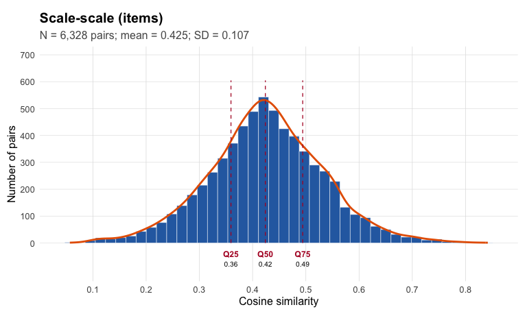

``` r
plot_similarity_distribution(definitions_cos, title = "Definition-definition")
```

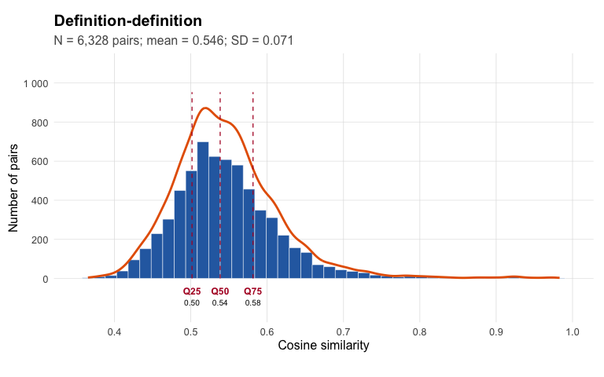

``` r
plot_similarity_distribution(scale_definitions_cross, matrix_triangle = "all",
                             title = "Scale x definition")
```

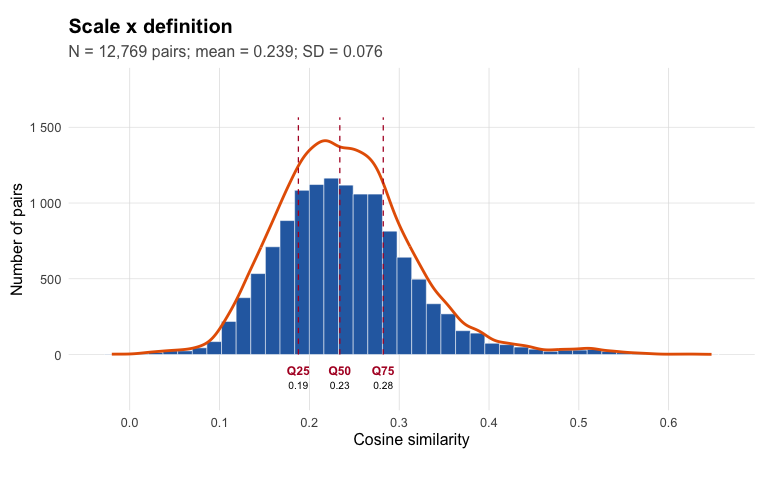

How well does each scale's item content match its own definition? The diagonal of the cross matrix is the similarity of each scale with its own definition; we compare it with the scale's similarity to all other definitions.


``` r
self_match <- tibble(
  scale_id = rownames(scale_definitions_cross),
  own_def  = diag(scale_definitions_cross)
) %>%
  mutate(rank_own = map_int(scale_id, ~ as.integer(rank(-scale_definitions_cross[.x, ])[[.x]])),
         best_def = colnames(scale_definitions_cross)[apply(scale_definitions_cross, 1, which.max)],
         test     = instrument_by_scale[scale_id],
         facet    = short_by_scale[scale_id],
         best_def_label = paste0(short_by_scale[best_def], " (", instrument_by_scale[best_def], ")"))

# share of scales whose own definition is the best-matching definition, by test
self_match %>%
  group_by(test) %>%
  summarise(n = n(), own_is_best = mean(rank_own == 1), median_rank = median(rank_own),
            mean_cos_own = mean(own_def))
#> # A tibble: 4 × 5
#>   test           n own_is_best median_rank mean_cos_own
#>   <chr>      <int>       <dbl>       <dbl>        <dbl>
#> 1 b5_aspects    10       0.2           2.5        0.448
#> 2 bfi2          15       0.133         2          0.503
#> 3 facetmap      70       0.871         1          0.469
#> 4 senna         18       0.5           1.5        0.492

# scales that best match another scale's definition
self_match %>%
  filter(rank_own > 1) %>%
  select(test, facet, rank_own, best_def_label) %>%
  arrange(desc(rank_own))
#> # A tibble: 39 × 4
#>    test       facet             rank_own best_def_label                                   
#>    <chr>      <chr>                <int> <chr>                                            
#>  1 facetmap   Empathy                  9 Compassion (b5_aspects)                          
#>  2 b5_aspects Withdrawal               5 Worry (facetmap)                                 
#>  3 bfi2       Organization             4 Orderliness (b5_aspects)                         
#>  4 bfi2       Depression               4 Self-confidence (Optimism) (senna)               
#>  5 b5_aspects Openness                 4 Aesthetic Sensitivity (bfi2)                     
#>  6 senna      Stress modulation        4 Anxiety (bfi2)                                   
#>  7 bfi2       Productiveness           3 Persistence (Self-discipline) (senna)            
#>  8 bfi2       Responsibility           3 Dependability (facetmap)                         
#>  9 bfi2       Sociability              3 Affability (facetmap)                            
#> 10 bfi2       Trust                    3 Trust (forgiveness and appreciation of others) (…
#> # ℹ 29 more rows
```

## 3. Jingle-jangle classification


``` r
# Pair table: one row per scale pair, with content sim (scale_cos) and
# definition sim (definitions_cos). `labels` and `instrument` set the text
# shown in the plots: "facet name (test)".
jj_base <- jingle_jangle_pairs(
  scale_cos, definitions_cos,
  label_by_scale = definitions_by_scale,
  labels         = short_by_scale[rownames(scale_cos)],
  instrument     = instrument_by_scale[rownames(scale_cos)]
)

# Cutoffs at the .25 / .75 quantiles of the similarity distributions (Wulff &
# Mata used .80 / .99, the default). Only the upper triangle of each matrix is
# used, so each pair counts once and the diagonal of 1s is left out; the
# scatter below (threshold_rule = "quartile") draws the same cutoffs.
thresholds <- jingle_jangle_thresholds(
  scale_cos, definitions_cos,
  probs = c(.25, .75)
)

thresholds
#>  scale_low  label_low scale_high label_high 
#>  0.3593800  0.5015691  0.4941089  0.5814784

# Tag each pair as jingle / jangle / nothing.
jj <- classify_jingle_jangle(jj_base, thresholds)

count(jj, type)
#>             type    n
#> 1 Jangle fallacy  129
#> 2 Jingle fallacy  178
#> 3        nothing 6021

plot_jingle_jangle_scatter(
  jj,
  output_file = file.path(out_dir, "b5_empirical_relabeling_harmonized-scatter_scale_definitions.png"),
  show_threshold_note = TRUE, threshold_rule = "quartile"
)
```

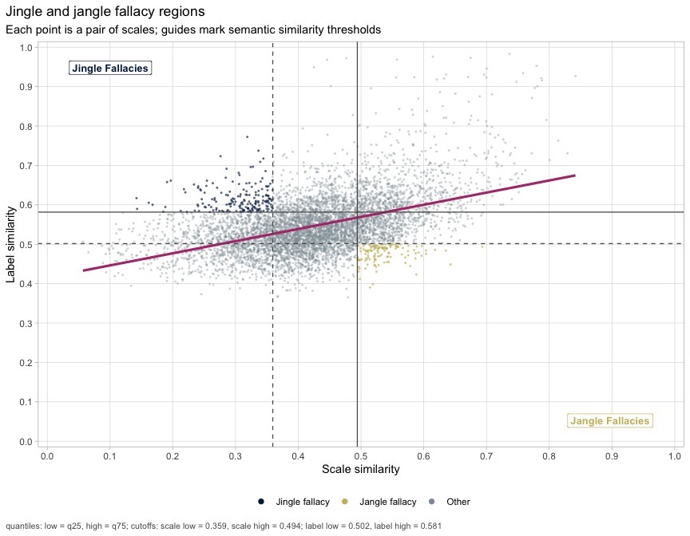

``` r

plot_jingle_jangle(jj, thresholds,
                   output_file = file.path(out_dir, "b5_empirical_relabeling_harmonized-selected_jingle_jangle.png"), res = 150)
```

<div class="figure">
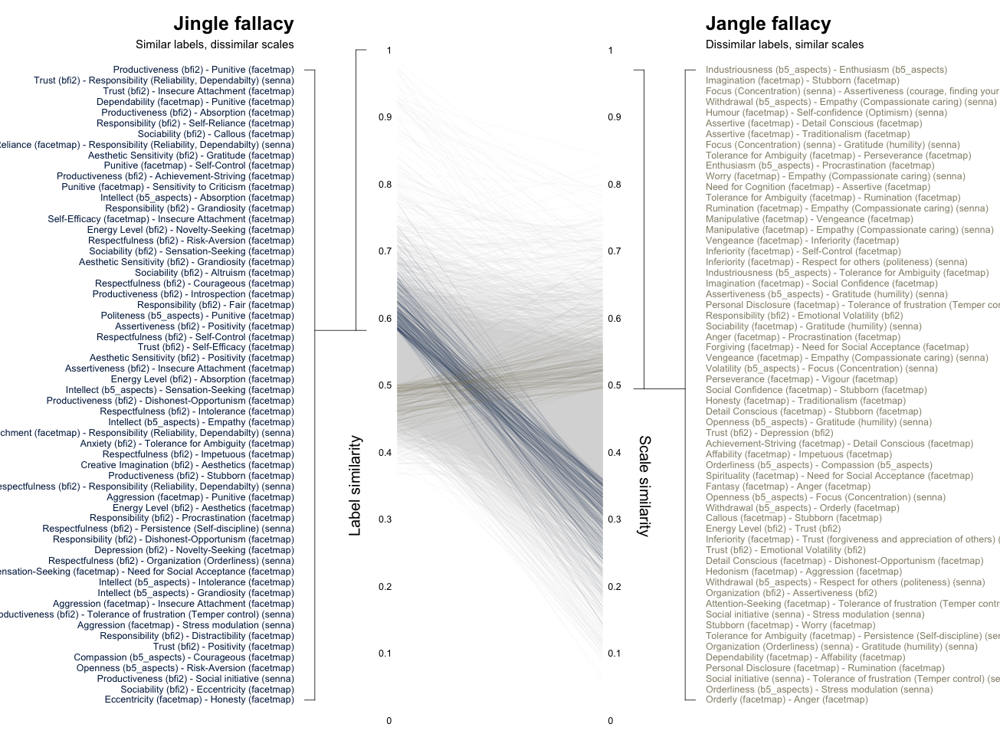
<p class="caption">plot of chunk jj-display</p>
</div>

Jingle and jangle pairs between **different tests** are the most informative: they show where the tests use different names for the same content, or the same names for different content. Note that most jingles occur **within** a test: definitions written by the same authors share a style (e.g. all FacetMap definitions start with "Propensity to ..."), which inflates their similarity even when the items differ.


``` r
jj_pairs <- jj %>%
  filter(type %in% c("Jingle fallacy", "Jangle fallacy")) %>%
  mutate(between_tests = instrument_1 != instrument_2)

count(jj_pairs, type, between_tests)
#>             type between_tests   n
#> 1 Jangle fallacy         FALSE  90
#> 2 Jangle fallacy          TRUE  39
#> 3 Jingle fallacy         FALSE  22
#> 4 Jingle fallacy          TRUE 156

jj_pairs %>%
  filter(between_tests) %>%
  transmute(type,
            scale_1 = paste0(label_1, " (", instrument_1, ")"),
            scale_2 = paste0(label_2, " (", instrument_2, ")"),
            item_sim = scale_cos, definition_sim = label_cos) %>%
  arrange(type, desc(abs(item_sim - definition_sim))) %>%
  mutate(across(where(is.numeric), ~ round(.x, 2)))
#>               type                            scale_1
#> 1   Jangle fallacy            Enthusiasm (b5_aspects)
#> 2   Jangle fallacy            Withdrawal (b5_aspects)
#> 3   Jangle fallacy                  Humour (facetmap)
#> 4   Jangle fallacy           Orderliness (b5_aspects)
#> 5   Jangle fallacy                 Orderly (facetmap)
#> 6   Jangle fallacy         Assertiveness (b5_aspects)
#> 7   Jangle fallacy     Personal Disclosure (facetmap)
#> 8   Jangle fallacy            Enthusiasm (b5_aspects)
#> 9   Jangle fallacy            Enthusiasm (b5_aspects)
#> 10  Jangle fallacy                   Worry (facetmap)
#> 11  Jangle fallacy            Volatility (b5_aspects)
#> 12  Jangle fallacy              Rumination (facetmap)
#> 13  Jangle fallacy            Manipulative (facetmap)
#> 14  Jangle fallacy             Inferiority (facetmap)
#> 15  Jangle fallacy       Industriousness (b5_aspects)
#> 16  Jangle fallacy            Enthusiasm (b5_aspects)
#> 17  Jangle fallacy         Assertiveness (b5_aspects)
#> 18  Jangle fallacy     Personal Disclosure (facetmap)
#> 19  Jangle fallacy            Enthusiasm (b5_aspects)
#> 20  Jangle fallacy                  Humour (facetmap)
#> 21  Jangle fallacy     Personal Disclosure (facetmap)
#> 22  Jangle fallacy             Sociability (facetmap)
#> 23  Jangle fallacy               Vengeance (facetmap)
#> 24  Jangle fallacy            Volatility (b5_aspects)
#> 25  Jangle fallacy            Self-Control (facetmap)
#> 26  Jangle fallacy       Industriousness (b5_aspects)
#> 27  Jangle fallacy              Openness (b5_aspects)
#> 28  Jangle fallacy              Openness (b5_aspects)
#> 29  Jangle fallacy            Withdrawal (b5_aspects)
#> 30  Jangle fallacy            Enthusiasm (b5_aspects)
#> 31  Jangle fallacy             Inferiority (facetmap)
#> 32  Jangle fallacy         Assertiveness (b5_aspects)
#> 33  Jangle fallacy            Withdrawal (b5_aspects)
#> 34  Jangle fallacy       Attention-Seeking (facetmap)
#> 35  Jangle fallacy       Industriousness (b5_aspects)
#> 36  Jangle fallacy Tolerance for Ambiguity (facetmap)
#> 37  Jangle fallacy            Withdrawal (b5_aspects)
#> 38  Jangle fallacy          Traditionalism (facetmap)
#> 39  Jangle fallacy           Orderliness (b5_aspects)
#> 40  Jingle fallacy              Productiveness (bfi2)
#> 41  Jingle fallacy              Responsibility (bfi2)
#> 42  Jingle fallacy                Punitive (facetmap)
#> 43  Jingle fallacy                       Trust (bfi2)
#> 44  Jingle fallacy                       Trust (bfi2)
#> 45  Jingle fallacy              Productiveness (bfi2)
#> 46  Jingle fallacy              Respectfulness (bfi2)
#> 47  Jingle fallacy        Creative Imagination (bfi2)
#> 48  Jingle fallacy                 Sociability (bfi2)
#> 49  Jingle fallacy                Punitive (facetmap)
#> 50  Jingle fallacy              Responsibility (bfi2)
#> 51  Jingle fallacy                 Sociability (bfi2)
#> 52  Jingle fallacy           Self-Reliance (facetmap)
#> 53  Jingle fallacy                 Sociability (bfi2)
#> 54  Jingle fallacy                Punitive (facetmap)
#> 55  Jingle fallacy       Aesthetic Sensitivity (bfi2)
#> 56  Jingle fallacy                     Anxiety (bfi2)
#> 57  Jingle fallacy                 Sociability (bfi2)
#> 58  Jingle fallacy              Responsibility (bfi2)
#> 59  Jingle fallacy                 Sociability (bfi2)
#> 60  Jingle fallacy              Productiveness (bfi2)
#> 61  Jingle fallacy              Productiveness (bfi2)
#> 62  Jingle fallacy             Intellect (b5_aspects)
#> 63  Jingle fallacy              Responsibility (bfi2)
#> 64  Jingle fallacy                Energy Level (bfi2)
#> 65  Jingle fallacy              Respectfulness (bfi2)
#> 66  Jingle fallacy                       Trust (bfi2)
#> 67  Jingle fallacy                 Sociability (bfi2)
#> 68  Jingle fallacy       Aesthetic Sensitivity (bfi2)
#> 69  Jingle fallacy       Aesthetic Sensitivity (bfi2)
#> 70  Jingle fallacy                 Sociability (bfi2)
#> 71  Jingle fallacy              Respectfulness (bfi2)
#> 72  Jingle fallacy              Respectfulness (bfi2)
#> 73  Jingle fallacy                       Trust (bfi2)
#> 74  Jingle fallacy              Responsibility (bfi2)
#> 75  Jingle fallacy       Aesthetic Sensitivity (bfi2)
#> 76  Jingle fallacy                 Sociability (bfi2)
#> 77  Jingle fallacy              Productiveness (bfi2)
#> 78  Jingle fallacy              Responsibility (bfi2)
#> 79  Jingle fallacy              Responsibility (bfi2)
#> 80  Jingle fallacy                 Sociability (bfi2)
#> 81  Jingle fallacy                       Trust (bfi2)
#> 82  Jingle fallacy            Politeness (b5_aspects)
#> 83  Jingle fallacy      Intellectual Curiosity (bfi2)
#> 84  Jingle fallacy                  Depression (bfi2)
#> 85  Jingle fallacy               Assertiveness (bfi2)
#> 86  Jingle fallacy              Respectfulness (bfi2)
#> 87  Jingle fallacy                       Trust (bfi2)
#> 88  Jingle fallacy       Aesthetic Sensitivity (bfi2)
#> 89  Jingle fallacy                     Anxiety (bfi2)
#> 90  Jingle fallacy              Productiveness (bfi2)
#> 91  Jingle fallacy               Assertiveness (bfi2)
#> 92  Jingle fallacy                Energy Level (bfi2)
#> 93  Jingle fallacy                 Sociability (bfi2)
#> 94  Jingle fallacy        Emotional Volatility (bfi2)
#> 95  Jingle fallacy              Responsibility (bfi2)
#> 96  Jingle fallacy      Intellectual Curiosity (bfi2)
#> 97  Jingle fallacy                       Trust (bfi2)
#> 98  Jingle fallacy              Respectfulness (bfi2)
#> 99  Jingle fallacy                 Sociability (bfi2)
#> 100 Jingle fallacy              Respectfulness (bfi2)
#> 101 Jingle fallacy             Intellect (b5_aspects)
#> 102 Jingle fallacy             Intellect (b5_aspects)
#> 103 Jingle fallacy                 Empathy (facetmap)
#> 104 Jingle fallacy                  Compassion (bfi2)
#> 105 Jingle fallacy              Productiveness (bfi2)
#> 106 Jingle fallacy       Aesthetic Sensitivity (bfi2)
#> 107 Jingle fallacy              Absorption (facetmap)
#> 108 Jingle fallacy       Aesthetic Sensitivity (bfi2)
#> 109 Jingle fallacy              Respectfulness (bfi2)
#> 110 Jingle fallacy              Responsibility (bfi2)
#> 111 Jingle fallacy             Intellect (b5_aspects)
#> 112 Jingle fallacy     Insecure Attachment (facetmap)
#> 113 Jingle fallacy                     Anxiety (bfi2)
#> 114 Jingle fallacy              Respectfulness (bfi2)
#> 115 Jingle fallacy     Insecure Attachment (facetmap)
#> 116 Jingle fallacy        Creative Imagination (bfi2)
#> 117 Jingle fallacy       Aesthetic Sensitivity (bfi2)
#> 118 Jingle fallacy        Creative Imagination (bfi2)
#> 119 Jingle fallacy              Productiveness (bfi2)
#> 120 Jingle fallacy              Respectfulness (bfi2)
#> 121 Jingle fallacy                 Sociability (bfi2)
#> 122 Jingle fallacy               Assertiveness (bfi2)
#> 123 Jingle fallacy                     Anxiety (bfi2)
#> 124 Jingle fallacy        Creative Imagination (bfi2)
#> 125 Jingle fallacy        Emotional Volatility (bfi2)
#> 126 Jingle fallacy                Punitive (facetmap)
#> 127 Jingle fallacy                Energy Level (bfi2)
#> 128 Jingle fallacy              Responsibility (bfi2)
#> 129 Jingle fallacy                Energy Level (bfi2)
#> 130 Jingle fallacy                       Trust (bfi2)
#> 131 Jingle fallacy        Emotional Volatility (bfi2)
#> 132 Jingle fallacy        Creative Imagination (bfi2)
#> 133 Jingle fallacy              Responsibility (bfi2)
#> 134 Jingle fallacy              Responsibility (bfi2)
#> 135 Jingle fallacy                  Compassion (bfi2)
#> 136 Jingle fallacy                  Depression (bfi2)
#> 137 Jingle fallacy              Respectfulness (bfi2)
#> 138 Jingle fallacy               Assertiveness (bfi2)
#> 139 Jingle fallacy                  Compassion (bfi2)
#> 140 Jingle fallacy             Intellect (b5_aspects)
#> 141 Jingle fallacy              Respectfulness (bfi2)
#> 142 Jingle fallacy                     Anxiety (bfi2)
#> 143 Jingle fallacy                  Depression (bfi2)
#> 144 Jingle fallacy                       Trust (bfi2)
#> 145 Jingle fallacy                Organization (bfi2)
#> 146 Jingle fallacy                  Depression (bfi2)
#> 147 Jingle fallacy        Emotional Volatility (bfi2)
#> 148 Jingle fallacy              Responsibility (bfi2)
#> 149 Jingle fallacy        Emotional Volatility (bfi2)
#> 150 Jingle fallacy                  Depression (bfi2)
#> 151 Jingle fallacy              Responsibility (bfi2)
#> 152 Jingle fallacy        Creative Imagination (bfi2)
#> 153 Jingle fallacy                  Depression (bfi2)
#> 154 Jingle fallacy              Respectfulness (bfi2)
#> 155 Jingle fallacy                     Anxiety (bfi2)
#> 156 Jingle fallacy              Responsibility (bfi2)
#> 157 Jingle fallacy            Politeness (b5_aspects)
#> 158 Jingle fallacy                Organization (bfi2)
#> 159 Jingle fallacy              Responsibility (bfi2)
#> 160 Jingle fallacy             Intellect (b5_aspects)
#> 161 Jingle fallacy                     Anxiety (bfi2)
#> 162 Jingle fallacy              Productiveness (bfi2)
#> 163 Jingle fallacy              Productiveness (bfi2)
#> 164 Jingle fallacy                  Depression (bfi2)
#> 165 Jingle fallacy              Responsibility (bfi2)
#> 166 Jingle fallacy       Attention-Seeking (facetmap)
#> 167 Jingle fallacy             Intellect (b5_aspects)
#> 168 Jingle fallacy             Intellect (b5_aspects)
#> 169 Jingle fallacy       Aesthetic Sensitivity (bfi2)
#> 170 Jingle fallacy         Novelty-Seeking (facetmap)
#> 171 Jingle fallacy                  Compassion (bfi2)
#> 172 Jingle fallacy              Productiveness (bfi2)
#> 173 Jingle fallacy                  Compassion (bfi2)
#> 174 Jingle fallacy             Intellect (b5_aspects)
#> 175 Jingle fallacy              Responsibility (bfi2)
#> 176 Jingle fallacy                 Sociability (bfi2)
#> 177 Jingle fallacy              Responsibility (bfi2)
#> 178 Jingle fallacy                  Depression (bfi2)
#> 179 Jingle fallacy              Respectfulness (bfi2)
#> 180 Jingle fallacy              Productiveness (bfi2)
#> 181 Jingle fallacy              Aggression (facetmap)
#> 182 Jingle fallacy               Assertiveness (bfi2)
#> 183 Jingle fallacy              Responsibility (bfi2)
#> 184 Jingle fallacy                Energy Level (bfi2)
#> 185 Jingle fallacy                  Depression (bfi2)
#> 186 Jingle fallacy        Emotional Volatility (bfi2)
#> 187 Jingle fallacy                       Trust (bfi2)
#> 188 Jingle fallacy            Compassion (b5_aspects)
#> 189 Jingle fallacy              Openness (b5_aspects)
#> 190 Jingle fallacy              Productiveness (bfi2)
#> 191 Jingle fallacy               Assertiveness (bfi2)
#> 192 Jingle fallacy              Respectfulness (bfi2)
#> 193 Jingle fallacy                 Sociability (bfi2)
#> 194 Jingle fallacy               Assertiveness (bfi2)
#> 195 Jingle fallacy        Emotional Volatility (bfi2)
#>                                                    scale_2 item_sim definition_sim
#> 1                             Gratitude (humility) (senna)     0.60           0.47
#> 2                   Empathy (Compassionate caring) (senna)     0.60           0.49
#> 3                       Self-confidence (Optimism) (senna)     0.57           0.48
#> 4                             Gratitude (humility) (senna)     0.54           0.46
#> 5                             Gratitude (humility) (senna)     0.54           0.45
#> 6   Trust (forgiveness and appreciation of others) (senna)     0.54           0.45
#> 7                             Gratitude (humility) (senna)     0.58           0.50
#> 8                                     Impetuous (facetmap)     0.54           0.47
#> 9                               Procrastination (facetmap)     0.51           0.44
#> 10                  Empathy (Compassionate caring) (senna)     0.54           0.48
#> 11                  Empathy (Compassionate caring) (senna)     0.56           0.49
#> 12                  Empathy (Compassionate caring) (senna)     0.50           0.43
#> 13                  Empathy (Compassionate caring) (senna)     0.56           0.49
#> 14                 Respect for others (politeness) (senna)     0.56           0.50
#> 15                      Tolerance for Ambiguity (facetmap)     0.52           0.46
#> 16                                 Self-Control (facetmap)     0.50           0.44
#> 17                            Gratitude (humility) (senna)     0.56           0.50
#> 18       Tolerance of frustration (Temper control) (senna)     0.52           0.46
#> 19                               Stress modulation (senna)     0.56           0.50
#> 20                 Respect for others (politeness) (senna)     0.54           0.48
#> 21                               Stress modulation (senna)     0.50           0.44
#> 22                            Gratitude (humility) (senna)     0.51           0.46
#> 23                  Empathy (Compassionate caring) (senna)     0.54           0.49
#> 24                           Focus (Concentration) (senna)     0.52           0.47
#> 25          Enthusiasm (energy; positive attitude) (senna)     0.55           0.50
#> 26                            Gratitude (humility) (senna)     0.51           0.47
#> 27                            Gratitude (humility) (senna)     0.51           0.46
#> 28                           Focus (Concentration) (senna)     0.53           0.49
#> 29                                      Orderly (facetmap)     0.53           0.49
#> 30                              Curiosity to learn (senna)     0.52           0.49
#> 31  Trust (forgiveness and appreciation of others) (senna)     0.52           0.49
#> 32       Tolerance of frustration (Temper control) (senna)     0.51           0.48
#> 33                 Respect for others (politeness) (senna)     0.49           0.47
#> 34       Tolerance of frustration (Temper control) (senna)     0.51           0.49
#> 35                            Social Confidence (facetmap)     0.51           0.48
#> 36                   Persistence (Self-discipline) (senna)     0.52           0.50
#> 37                      Organization (Orderliness) (senna)     0.52           0.49
#> 38  Trust (forgiveness and appreciation of others) (senna)     0.50           0.48
#> 39                               Stress modulation (senna)     0.51           0.50
#> 40                                     Punitive (facetmap)     0.14           0.62
#> 41                                     Punitive (facetmap)     0.19           0.66
#> 42                   Persistence (Self-discipline) (senna)     0.20           0.66
#> 43      Responsibility (Reliability, Dependabilty) (senna)     0.32           0.77
#> 44                          Insecure Attachment (facetmap)     0.28           0.72
#> 45                                   Absorption (facetmap)     0.23           0.65
#> 46                                     Punitive (facetmap)     0.22           0.63
#> 47                       Intellectual Curiosity (facetmap)     0.25           0.66
#> 48                          Insecure Attachment (facetmap)     0.24           0.65
#> 49       Tolerance of frustration (Temper control) (senna)     0.19           0.59
#> 50                                Self-Reliance (facetmap)     0.29           0.69
#> 51                                      Callous (facetmap)     0.24           0.64
#> 52      Responsibility (Reliability, Dependabilty) (senna)     0.34           0.74
#> 53                                  Intolerance (facetmap)     0.18           0.58
#> 54      Responsibility (Reliability, Dependabilty) (senna)     0.24           0.64
#> 55                                    Gratitude (facetmap)     0.25           0.65
#> 56                                   Aggression (facetmap)     0.26           0.65
#> 57                              Novelty-Seeking (facetmap)     0.28           0.67
#> 58                                      Callous (facetmap)     0.25           0.63
#> 59                            Social Dependence (facetmap)     0.31           0.68
#> 60                         Achievement-Striving (facetmap)     0.34           0.72
#> 61                                      Honesty (facetmap)     0.27           0.64
#> 62                                   Absorption (facetmap)     0.32           0.70
#> 63                                  Grandiosity (facetmap)     0.31           0.68
#> 64                              Novelty-Seeking (facetmap)     0.33           0.70
#> 65                                Risk-Aversion (facetmap)     0.25           0.61
#> 66                                Self-Reliance (facetmap)     0.30           0.66
#> 67                            Sensation-Seeking (facetmap)     0.22           0.58
#> 68                                      Callous (facetmap)     0.24           0.60
#> 69                                  Grandiosity (facetmap)     0.25           0.60
#> 70                                     Altruism (facetmap)     0.28           0.63
#> 71                                    Gratitude (facetmap)     0.26           0.61
#> 72                                   Courageous (facetmap)     0.24           0.59
#> 73                                 Spirituality (facetmap)     0.27           0.61
#> 74                         Achievement-Striving (facetmap)     0.25           0.59
#> 75                                       Humour (facetmap)     0.24           0.58
#> 76                   Need for Social Acceptance (facetmap)     0.29           0.63
#> 77                                Introspection (facetmap)     0.26           0.60
#> 78                Emotion-based Decision Making (facetmap)     0.25           0.59
#> 79                                         Fair (facetmap)     0.29           0.63
#> 80                                Risk-Aversion (facetmap)     0.27           0.61
#> 81                        Dishonest-Opportunism (facetmap)     0.35           0.69
#> 82                                     Punitive (facetmap)     0.32           0.65
#> 83                            Sensation-Seeking (facetmap)     0.29           0.62
#> 84                                       Vigour (facetmap)     0.32           0.66
#> 85                                   Positivity (facetmap)     0.26           0.59
#> 86                                 Self-Control (facetmap)     0.31           0.64
#> 87                                Self-Efficacy (facetmap)     0.34           0.67
#> 88                                   Positivity (facetmap)     0.26           0.58
#> 89                                Self-Efficacy (facetmap)     0.33           0.65
#> 90                                Extrospection (facetmap)     0.26           0.59
#> 91                          Insecure Attachment (facetmap)     0.27           0.59
#> 92                                   Absorption (facetmap)     0.30           0.62
#> 93                                   Positivity (facetmap)     0.33           0.65
#> 94                                   Aggression (facetmap)     0.34           0.66
#> 95                            Social Dependence (facetmap)     0.31           0.63
#> 96                            Attention-Seeking (facetmap)     0.27           0.59
#> 97                Emotion-based Decision Making (facetmap)     0.30           0.62
#> 98                                Self-Reliance (facetmap)     0.30           0.61
#> 99                                Self-Reliance (facetmap)     0.32           0.63
#> 100                                Eccentricity (facetmap)     0.29           0.61
#> 101                           Attention-Seeking (facetmap)     0.29           0.60
#> 102                           Sensation-Seeking (facetmap)     0.31           0.62
#> 103                           Creative imagination (senna)     0.29           0.60
#> 104                                  Courageous (facetmap)     0.30           0.61
#> 105                       Dishonest-Opportunism (facetmap)     0.29           0.60
#> 106                  Need for Social Acceptance (facetmap)     0.27           0.58
#> 107                  Persistence (Self-discipline) (senna)     0.32           0.63
#> 108                               Extrospection (facetmap)     0.30           0.61
#> 109                                 Intolerance (facetmap)     0.32           0.63
#> 110                         Insecure Attachment (facetmap)     0.28           0.58
#> 111                                     Empathy (facetmap)     0.29           0.60
#> 112     Responsibility (Reliability, Dependabilty) (senna)     0.36           0.66
#> 113                     Tolerance for Ambiguity (facetmap)     0.32           0.62
#> 114                                   Impetuous (facetmap)     0.30           0.60
#> 115    Assertiveness (courage, finding your voice) (senna)     0.28           0.58
#> 116                                  Aesthetics (facetmap)     0.33           0.63
#> 117                           Attention-Seeking (facetmap)     0.31           0.61
#> 118                           Sensation-Seeking (facetmap)     0.29           0.59
#> 119                                    Stubborn (facetmap)     0.34           0.64
#> 120     Responsibility (Reliability, Dependabilty) (senna)     0.35           0.65
#> 121                                  Suspicious (facetmap)     0.36           0.65
#> 122                         Personal Disclosure (facetmap)     0.34           0.64
#> 123                             Novelty-Seeking (facetmap)     0.29           0.58
#> 124                               Self-Reliance (facetmap)     0.31           0.61
#> 125                                  Positivity (facetmap)     0.31           0.61
#> 126                Respect for others (politeness) (senna)     0.35           0.65
#> 127                           Sensation-Seeking (facetmap)     0.35           0.65
#> 128                                     Planful (facetmap)     0.33           0.63
#> 129                                  Aesthetics (facetmap)     0.29           0.58
#> 130                                     Anxiety (facetmap)     0.31           0.60
#> 131                                      Vigour (facetmap)     0.31           0.60
#> 132                               Risk-Aversion (facetmap)     0.31           0.60
#> 133                                  Indecisive (facetmap)     0.34           0.62
#> 134                             Procrastination (facetmap)     0.33           0.62
#> 135                           Attention-Seeking (facetmap)     0.32           0.61
#> 136                                     Callous (facetmap)     0.35           0.64
#> 137                  Persistence (Self-discipline) (senna)     0.31           0.59
#> 138                                Eccentricity (facetmap)     0.30           0.58
#> 139                                  Positivity (facetmap)     0.32           0.60
#> 140                                 Sociability (facetmap)     0.31           0.59
#> 141                           Attention-Seeking (facetmap)     0.32           0.60
#> 142                               Risk-Aversion (facetmap)     0.36           0.64
#> 143                          Need for Cognition (facetmap)     0.32           0.59
#> 144                               Risk-Aversion (facetmap)     0.33           0.61
#> 145                             Novelty-Seeking (facetmap)     0.34           0.62
#> 146                                    Hedonism (facetmap)     0.35           0.62
#> 147                                  Courageous (facetmap)     0.31           0.58
#> 148                       Dishonest-Opportunism (facetmap)     0.33           0.61
#> 149                               Extrospection (facetmap)     0.31           0.59
#> 150                             Novelty-Seeking (facetmap)     0.34           0.61
#> 151                                    Critical (facetmap)     0.33           0.60
#> 152                                  Positivity (facetmap)     0.31           0.59
#> 153                                  Aesthetics (facetmap)     0.32           0.59
#> 154                     Organization (Orderliness) (senna)     0.33           0.60
#> 155                                     Callous (facetmap)     0.31           0.58
#> 156    Assertiveness (courage, finding your voice) (senna)     0.32           0.59
#> 157                                Eccentricity (facetmap)     0.35           0.62
#> 158                              Traditionalism (facetmap)     0.33           0.60
#> 159                                  Positivity (facetmap)     0.34           0.61
#> 160                                 Intolerance (facetmap)     0.32           0.59
#> 161                                 Inferiority (facetmap)     0.33           0.59
#> 162                               Risk-Aversion (facetmap)     0.33           0.59
#> 163                Respect for others (politeness) (senna)     0.33           0.59
#> 164                                    Critical (facetmap)     0.32           0.58
#> 165                                Compassion (b5_aspects)     0.35           0.62
#> 166                             Curiosity to learn (senna)     0.32           0.59
#> 167                               Self-Reliance (facetmap)     0.35           0.61
#> 168                                 Grandiosity (facetmap)     0.35           0.61
#> 169                                    Hedonism (facetmap)     0.33           0.59
#> 170  Determination (Goal striving, high standards) (senna)     0.35           0.62
#> 171                                   Gratitude (facetmap)     0.34           0.60
#> 172                             Curiosity to learn (senna)     0.34           0.60
#> 173                                      Humour (facetmap)     0.32           0.58
#> 174                                  Aesthetics (facetmap)     0.36           0.61
#> 175                              Social initiative (senna)     0.33           0.59
#> 176                                    Hedonism (facetmap)     0.35           0.61
#> 177                                   Forgiving (facetmap)     0.35           0.61
#> 178                                 Grandiosity (facetmap)     0.33           0.58
#> 179                                   Vengeance (facetmap)     0.33           0.59
#> 180      Tolerance of frustration (Temper control) (senna)     0.36           0.61
#> 181                              Stress modulation (senna)     0.36           0.61
#> 182                               Risk-Aversion (facetmap)     0.34           0.59
#> 183                             Distractibility (facetmap)     0.34           0.59
#> 184                          Need for Cognition (facetmap)     0.34           0.59
#> 185                               Extrospection (facetmap)     0.35           0.60
#> 186                                     Callous (facetmap)     0.33           0.58
#> 187                                  Positivity (facetmap)     0.34           0.59
#> 188                                  Courageous (facetmap)     0.35           0.60
#> 189                               Risk-Aversion (facetmap)     0.35           0.60
#> 190                              Social initiative (senna)     0.34           0.58
#> 191                                     Honesty (facetmap)     0.35           0.59
#> 192                           Social Dependence (facetmap)     0.34           0.58
#> 193                                Eccentricity (facetmap)     0.36           0.60
#> 194                                       Anger (facetmap)     0.35           0.58
#> 195                                       Worry (facetmap)     0.36           0.59
```

### Did harmonizing remove the style of each test?

Compare the definition similarities of the original and harmonized definitions, within and between tests. If style drove the within-test similarity, harmonizing should bring the within-test mean closer to the between-test mean and cut the within-test jingles.


``` r
definitions_emb_orig <- as.matrix(cached_embeddings("b5_definitions", definitions$definition_original))
rownames(definitions_emb_orig) <- definitions$scale_id

jj_orig <- jingle_jangle_pairs(
  scale_cos, cosine_matrix(definitions_emb_orig),
  labels     = short_by_scale[rownames(scale_cos)],
  instrument = instrument_by_scale[rownames(scale_cos)]
)
jj_orig <- classify_jingle_jangle(
  jj_orig,
  jingle_jangle_thresholds(scale_cos, cosine_matrix(definitions_emb_orig), probs = c(.25, .75))
)

both <- bind_rows(original = jj_orig, harmonized = jj, .id = "definitions") %>%
  mutate(pair = if_else(instrument_1 == instrument_2, "within test", "between tests"))

# mean definition similarity within and between tests
both %>%
  group_by(definitions, pair) %>%
  summarise(definition_sim = mean(label_cos), .groups = "drop") %>%
  pivot_wider(names_from = pair, values_from = definition_sim)
#> # A tibble: 2 × 3
#>   definitions `between tests` `within test`
#>   <chr>                 <dbl>         <dbl>
#> 1 harmonized            0.549         0.543
#> 2 original              0.312         0.443

# fallacies within and between tests
both %>%
  filter(type != "nothing") %>%
  count(definitions, type, pair) %>%
  pivot_wider(names_from = pair, values_from = n)
#> # A tibble: 4 × 4
#>   definitions type           `between tests` `within test`
#>   <chr>       <chr>                    <int>         <int>
#> 1 harmonized  Jangle fallacy              39            90
#> 2 harmonized  Jingle fallacy             156            22
#> 3 original    Jangle fallacy             103            44
#> 4 original    Jingle fallacy              27            70

# agreement between item similarity and definition similarity
both %>% group_by(definitions) %>% summarise(r = cor(scale_cos, label_cos))
#> # A tibble: 2 × 2
#>   definitions     r
#>   <chr>       <dbl>
#> 1 harmonized  0.468
#> 2 original    0.449
```

## 4. Empirical relabeling

The classification above points to two kinds of problems, and each has a natural fix:

-   **Jangle** (similar items, different definitions): the two scales measure the same thing under different names. We **merge** them: their items are combined into one new scale, and an LLM writes a short label (2 to 4 words) and a definition from the combined items.
-   **Jingle** (different items, similar definitions): the definitions do not tell the scales apart. We **contrast** them: the LLM rewrites both labels and definitions so each one is closer to its own items and more distinct from the other.

The LLM writes the new definitions with the same template as the harmonized ones (`definition_template`), so all definitions keep one format. Then the new definitions are embedded, the scale embeddings are recomputed from the new item groupings, and the jingle-jangle classification is run again with new cutoffs (the 25th and 75th percentiles of that step's similarities). This is one **step**. `empirical_relabeling()` repeats it `n_steps` times, or until no fallacies are left.

A scale enters at most one action per step. Pairs are taken in order of the gap between item similarity and definition similarity, skipping pairs whose scales were already used, so each step merges disjoint pairs. Because the scales keep merging, many steps lead toward a few broad scales.


``` r
n_steps <- 12
```


``` r
relabel_items  <- items %>% select(item_id, item_text = item_en_text, scale_id, test)
relabel_scales <- definitions %>%
  transmute(scale_id, label = paste0(facet_name, " (", test, ")"), definition, test)
relabel_cache  <- file.path("emb_cache", paste0("relabel_harmonized_", emb_model, "_", llm_model))

relabel <- empirical_relabeling(
  items     = relabel_items,
  scales    = relabel_scales,
  item_emb  = items_emb,
  def_emb   = definitions_emb,
  embed_fun = embed,
  n_steps   = n_steps,
  probs     = c(.25, .75),
  provider  = llm_provider,
  model     = llm_model,
  chat_args = llm_args,
  definition_template = definition_template(),
  test_col  = "test",
  cache_dir = relabel_cache
)
```

The result is a list of tidy tables. The main ones:

-   `relabel$labels`: every label a scale ever had (`scale_id`, `step`, `source` = original / merge / contrast, `label`, `definition`);
-   `relabel$membership`: which items belong to each scale, for every scale ever created;
-   `relabel$merges`: the merge tree (`scale_id` = new scale, `parent` = merged scale);
-   `relabel$scales_by_step`: the active scales of each step with their current label and their fit with it;
-   `relabel$pairs`, `relabel$thresholds`: the jingle-jangle classification of each step;
-   `relabel$actions`: one row per LLM call, with its prompt.


``` r
relabel$labels %>% filter(step > 0) %>% select(scale_id, step, source, label, definition)
#> # A tibble: 191 × 5
#>    scale_id  step source label                              definition                    
#>    <chr>    <int> <chr>  <chr>                              <chr>                         
#>  1 S1.1         1 merge  Emotional Expressiveness           Individual differences in ope…
#>  2 S1.2         1 merge  Confidence and Flexibility         Individual differences in con…
#>  3 S1.3         1 merge  Sociability and Assertiveness      Individual differences in soc…
#>  4 S1.4         1 merge  Emotional Well-being               Individual differences in exp…
#>  5 S1.5         1 merge  Self-Control and Stability         Individual differences in the…
#>  6 S1.6         1 merge  Emotional Reactivity               Individual differences in the…
#>  7 S1.7         1 merge  Emotional Self-Control             Individual differences in man…
#>  8 S1.8         1 merge  Respect for Tradition and Fairness Individual differences in val…
#>  9 S1.9         1 merge  Focused Engagement                 Individual differences in the…
#> 10 S1.10        1 merge  Emotional Stability and Energy     Individual differences in emo…
#> # ℹ 181 more rows
relabel$merges
#> # A tibble: 146 × 3
#>     step scale_id parent                      
#>    <int> <chr>    <chr>                       
#>  1     1 S1.1     b5_aspects_E_enthusiasm     
#>  2     1 S1.1     b5_aspects_N_withdrawal     
#>  3     1 S1.2     facetmap_A_stubborn         
#>  4     1 S1.2     facetmap_N_inferiority      
#>  5     1 S1.3     senna_E_Soc                 
#>  6     1 S1.3     senna_A_Mod                 
#>  7     1 S1.4     facetmap_N_depression       
#>  8     1 S1.4     facetmap_N_procrastination  
#>  9     1 S1.5     b5_aspects_C_industriousness
#> 10     1 S1.5     b5_aspects_N_volatility     
#> # ℹ 136 more rows
```

## 5. What changes across steps

`relabeling_summary()` gives one row per step. Besides the counts of scales, merges, contrasts and fallacies, three indices show how well the labels follow the item content:

-   `r_scale_label`: correlation, across pairs, between item similarity and definition similarity. When the labels describe the content well, scales with similar items have similar definitions.
-   `mean_own_cos`: mean similarity of each scale with its own definition.
-   `prop_own_best`: share of scales whose own definition is the best-matching definition among all definitions.


``` r
relabeling_summary(relabel) %>%
  mutate(across(where(is.double), ~ round(.x, 3)))
#> # A tibble: 13 × 15
#>     step n_scales merges contrasts mean_own_cos prop_own_best jingle jangle jingle_between
#>    <int>    <int>  <int>     <int>        <dbl>         <dbl>  <int>  <int>          <int>
#>  1     0      113      0         0        0.476         0.655    178    129            156
#>  2     1       87     26        13        0.499         0.839     64     48             56
#>  3     2       70     17         7        0.495         0.843     38     53             31
#>  4     3       60     10         8        0.498         0.883     18     34             15
#>  5     4       55      5         7        0.499         0.873     13     25             11
#>  6     5       50      5         5        0.498         0.86       9     16              7
#>  7     6       47      3         3        0.5           0.894      6      6              5
#>  8     7       45      2         4        0.499         0.911      6     19              4
#>  9     8       43      2         3        0.501         0.907      5      4              4
#> 10     9       41      2         3        0.499         0.878      4      7              3
#> 11    10       40      1         2        0.501         0.9        4      0              3
#> 12    11       40      0         2        0.501         0.9        4      0              3
#> 13    12       40      0         2        0.502         0.9        3      0              2
#> # ℹ 6 more variables: jangle_between <int>, r_scale_label <dbl>, scale_low <dbl>,
#> #   label_low <dbl>, scale_high <dbl>, label_high <dbl>

plot_relabeling_trajectory(relabel)
```

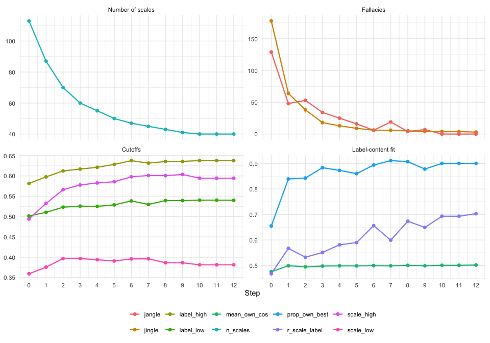

The fit of each scale with its own definition, step by step:


``` r
relabel$scales_by_step %>%
  ggplot(aes(factor(step), own_cos)) +
  geom_boxplot(outlier.size = .6, fill = "grey90") +
  labs(x = "Step", y = "Similarity of scale with its own definition") +
  theme_minimal()
```

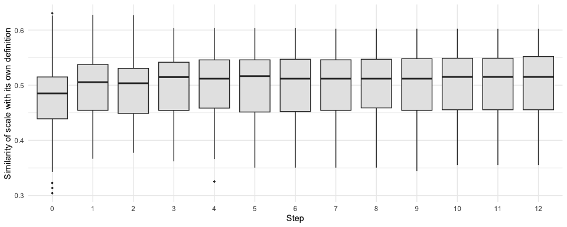

## 6. Merge tree

The original scales are on the left. Each merge is a node at the step where it happened (pink), labeled with the LLM's short label; diamonds (blue) mark scales relabeled to undo a jingle (their labels show on hover; use `show_text = c("merge", "contrast")` to print them). Hover over a node to read its definition; click the legend to hide a node type; zoom in to read dense regions.


``` r
# interactive (plotly): run it in your own session
plot_relabeling_tree(relabel)
```

All three tree plots take `steps`, the last step to draw, so you can look at earlier, finer solutions.

**Circular tree.** The same tree as a circle, in the style of Wulff & Mata (2025): original scales on the rim, merges further inside the later they happened, each cluster in its own colour and labelled with its current short label.


``` r
plot_relabeling_circle(relabel)
```

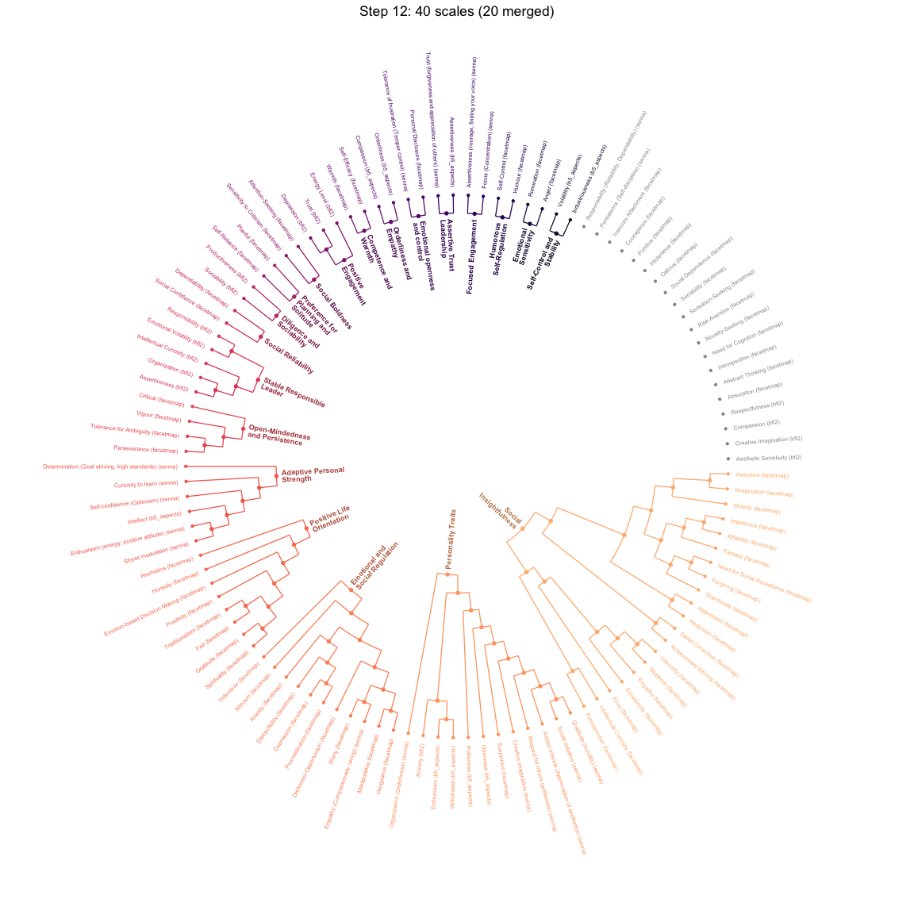

``` r
plot_relabeling_circle(relabel, steps = 2)
```

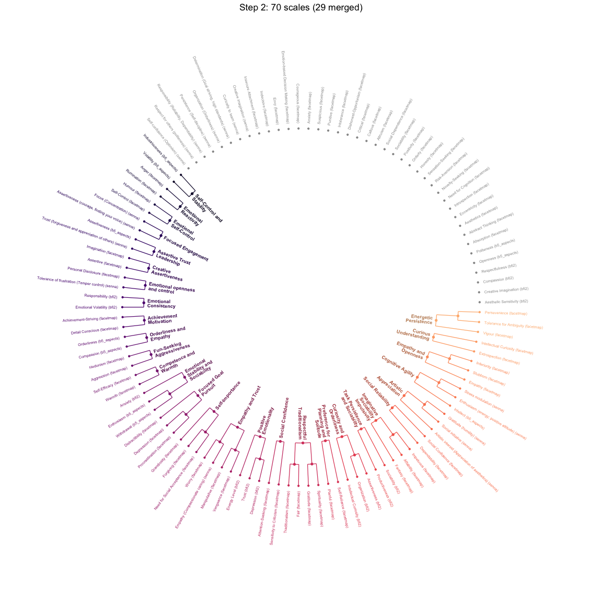

**ICLUST-style diagram.** Like `psych::ICLUST.diagram()`: original scales are boxes, merged scales are ellipses at the step where they were formed, and arrows carry the cosine between each part and the merged scale (the analogue of ICLUST's loadings). Each ellipse shows

-   $\alpha$: semantic alpha of the merged scale, $k\bar{c}/(1+(k-1)\bar{c})$ with $\bar{c}$ the mean item-item cosine;
-   $\beta$: split-half reliability between the two merged parts, ICLUST's beta for that split. A low $\beta$ flags a merge of heterogeneous content;
-   $N$: number of items.

Scales never merged are left out (`drop_unmerged = TRUE`).


``` r
plot_relabeling_iclust(relabel)
```

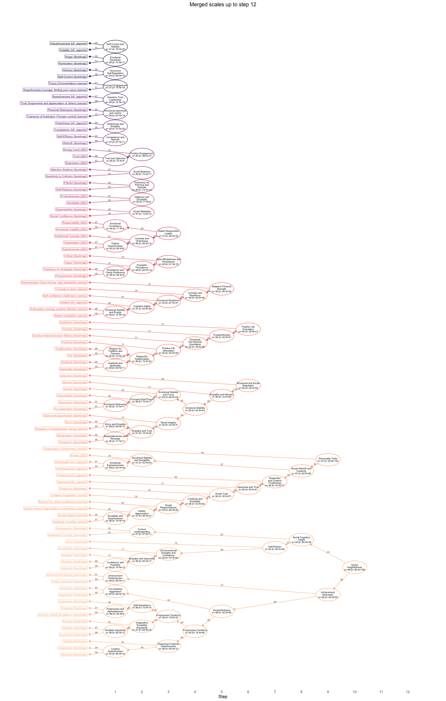


``` r
plot_relabeling_iclust(relabel, steps = 3)
```

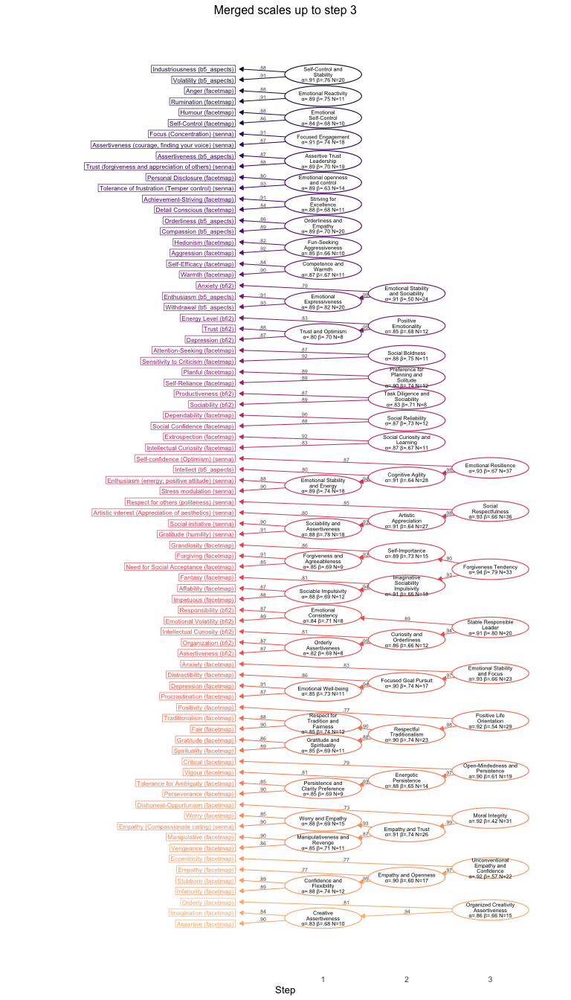

## 7. Scales at a given step

`relabeling_scales()` lists the active scales of a step with their label, definition and the original scales they contain.


``` r
final_scales <- relabeling_scales(relabel)            # last step
final_scales %>% select(scale_id, label, n_items, n_original, own_cos, definition)
#> # A tibble: 40 × 6
#>    scale_id label                           n_items n_original own_cos definition         
#>    <chr>    <chr>                             <int>      <int>   <dbl> <chr>              
#>  1 S10.1    Social Insightfulness               108         20   0.355 Individual differe…
#>  2 S9.2     Personality Traits                  104         12   0.399 Individual differe…
#>  3 S6.3     Emotional and Social Regulation      66         11   0.402 Individual differe…
#>  4 S6.1     Positive Life Orientation            47          8   0.480 Individual differe…
#>  5 S5.3     Adaptive Personal Strength           55          6   0.463 Individual differe…
#>  6 S3.4     Stable Responsible Leader            20          5   0.540 Individual differe…
#>  7 S3.7     Open-Mindedness and Persistence      19          4   0.422 Individual differe…
#>  8 S2.5     Positive Engagement                  12          3   0.476 Individual differe…
#>  9 S1.5     Self-Control and Stability           20          2   0.439 Individual differe…
#> 10 S1.23    Orderliness and Empathy              20          2   0.518 Individual differe…
#> # ℹ 30 more rows

# an intermediate step
relabeling_scales(relabel, step = 5) %>%
  select(scale_id, label, n_items, n_original, original_scales)
#> # A tibble: 50 × 5
#>    scale_id label                                 n_items n_original original_scales      
#>    <chr>    <chr>                                   <int>      <int> <chr>                
#>  1 S5.1     Social Boldness                            58         11 Affability (facetmap…
#>  2 S5.2     Empathy and Altruism                       60         10 Altruism (facetmap);…
#>  3 S5.4     Trustworthiness                            41          7 Emotion-based Decisi…
#>  4 S5.3     Adaptive Personal Strength                 55          6 Curiosity to learn (…
#>  5 S5.5     Social Trust                               51          6 Artistic interest (A…
#>  6 S3.4     Stable Responsible Leader                  20          5 Assertiveness (bfi2)…
#>  7 S3.9     Unconventional Empathy and Confidence      22          4 Eccentricity (facetm…
#>  8 S3.7     Open-Mindedness and Persistence            19          4 Critical (facetmap);…
#>  9 S2.1     Emotional Stability and Sociability        24          3 Anxiety (bfi2); Enth…
#> 10 S2.5     Energetic Optimism                         12          3 Depression (bfi2); E…
#> # ℹ 40 more rows
```

Which tests contribute to each scale? Merges across tests show where different tests measure the same content.


``` r
step_show <- 5

relabel$scales_by_step %>%
  filter(step == step_show, scale_id %in% relabel$merges$scale_id) %>%   # merged scales only
  left_join(relabel$membership, by = "scale_id", relationship = "one-to-many") %>%
  left_join(select(items, item_id, test), by = "item_id") %>%
  left_join(select(relabel$labels, label_id, label), by = "label_id") %>%
  ggplot(aes(y = fct_rev(fct_infreq(label)), fill = test)) +
  geom_bar() +
  labs(x = "Number of items", y = NULL, fill = "Test",
       title = paste("Merged scales at step", step_show)) +
  theme_minimal()
```

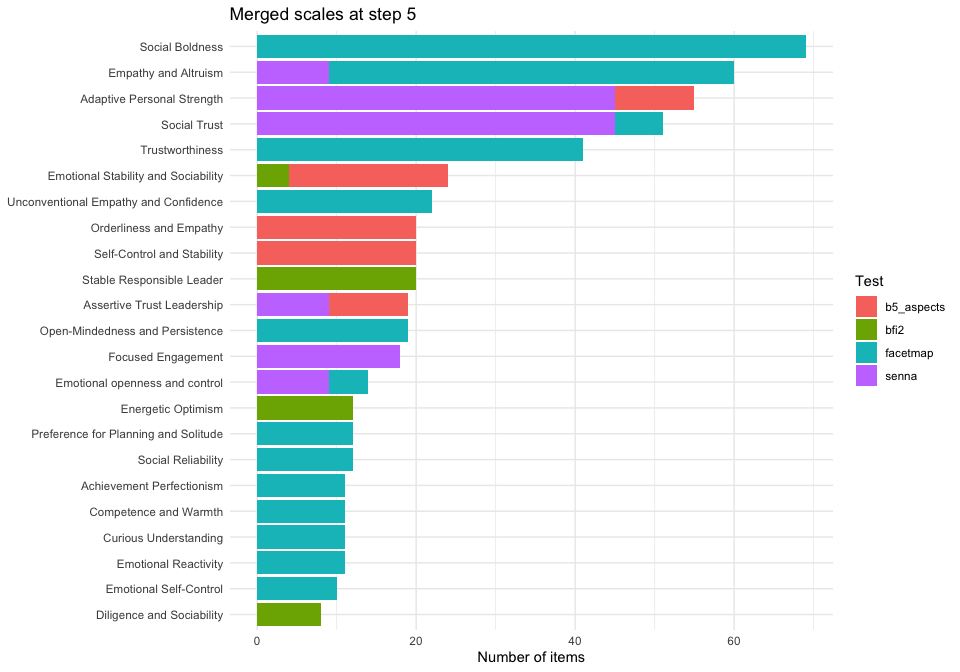

## 8. Jingle-jangle before and after

The same scatter as in section 3, for the original taxonomy and for later steps. Each panel uses its own quartile cutoffs.


``` r
steps_show <- unique(c(0, 1, 5, max(relabel$pairs$step)))

relabel$pairs %>%
  filter(step %in% steps_show) %>%
  ggplot(aes(scale_cos, label_cos, colour = type)) +
  geom_point(size = .5, alpha = .5) +
  geom_smooth(aes(group = 1), method = "lm", se = FALSE, colour = "black", linewidth = .6) +
  facet_wrap(~ step, nrow = 1, labeller = label_both) +
  scale_colour_manual(values = c(`Jingle fallacy` = "#2C7FB8",
                                 `Jangle fallacy` = "#B23A7A", nothing = "grey70")) +
  labs(x = "Item (scale) similarity", y = "Definition similarity", colour = NULL) +
  theme_minimal() +
  theme(legend.position = "bottom")
```

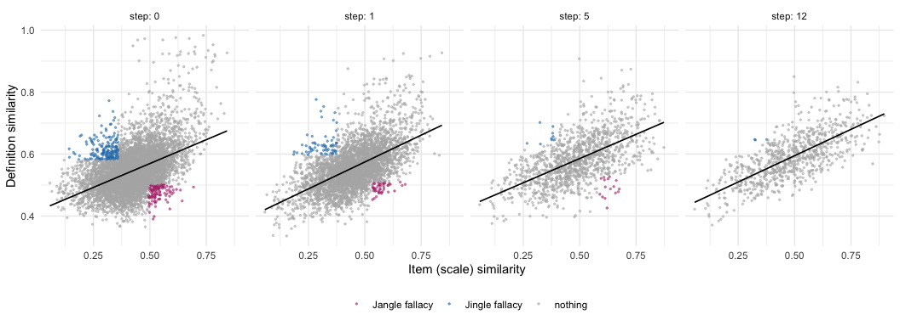

## 9. Inspect the LLM calls

Every LLM call is in `relabel$actions`, with the pair that triggered it and the prompt sent.


``` r
relabel$actions %>% count(step, action) %>% pivot_wider(names_from = action, values_from = n)
#> # A tibble: 12 × 3
#>     step contrast merge
#>    <int>    <int> <int>
#>  1     1       13    26
#>  2     2        7    17
#>  3     3        8    10
#>  4     4        7     5
#>  5     5        5     5
#>  6     6        3     3
#>  7     7        4     2
#>  8     8        3     2
#>  9     9        3     2
#> 10    10        2     1
#> 11    11        2    NA
#> 12    12        2    NA

# one contrast (jingle) relabeling: before and after
one <- relabel$actions %>% filter(action == "contrast") %>% slice(1)
relabel$labels %>%
  filter(scale_id %in% c(one$scale_1, one$scale_2), step %in% c(0, one$step)) %>%
  select(scale_id, step, source, label, definition)
#> # A tibble: 4 × 5
#>   scale_id             step source   label                        definition              
#>   <chr>               <int> <chr>    <chr>                        <chr>                   
#> 1 bfi2_C_prod             0 original Productiveness (bfi2)        Individual differences …
#> 2 facetmap_A_punitive     0 original Punitive (facetmap)          Individual differences …
#> 3 bfi2_C_prod             1 contrast Task Persistence             Individual differences …
#> 4 facetmap_A_punitive     1 contrast Support for Harsh Punishment Individual differences …

cat(one$prompt)
#> Below are the items of 2 psychological scales. Their current labels are too similar, but their items measure different content. For each scale, write a new short label (2 to 4 words) and a definition that describe its own items closely and clearly distinguish it from the other scale. Answer scale_1 for Scale 1, scale_2 for Scale 2, and so on.
#> 
#> Rules:
#> - Base the label and definition only on the content of the items.
#> - Some items are reverse-keyed (they describe the opposite pole); name the construct by its positive pole.
#> - Do not repeat the label in the definition, and do not mention the items or the scale itself.
#> - Write the definition following this template:
#> Individual differences in <core attribute, named by its high pole>.
#> People high on it <two or three characteristic thoughts, feelings or behaviours,
#> stated concretely as they show up in everyday situations>;
#> people low on it <the opposite pattern>.
#> 
#> - One or two sentences, 30 to 60 words.
#> - Describe a stable tendency (how people usually are), not a single act or a state.
#> - Concrete, observable manifestations, in plain language, close to how questionnaire items are phrased.
#> - No causes, consequences, correlates or examples of measures.
#> - Do not name the scale, the test or the label.
#> 
#> Scale 1:
#> Current label: Productiveness (bfi2) (Individual differences in diligence and persistence in pursuing goals. People high on it consistently work hard, stay focused, and complete tasks efficiently; people low on it tend to delay work, lose focus, and struggle to finish tasks on time.)
#> Items:
#> - Has difficulty getting started on tasks.
#> - Is efficient, gets things done.
#> - Is persistent, works until the task is finished.
#> - Tends to be lazy.
#> 
#> Scale 2:
#> Current label: Punitive (facetmap) (Individual differences in the tendency to enforce discipline through punishment. People high on it often respond to misbehavior by imposing penalties or reprimands; people low on it prefer to avoid punishment and may use other methods to manage behavior.)
#> Items:
#> - Criminals should be harshly punished to make them pay.
#> - Children who lie or steal should be severely punished.
#> - Heroin dealers deserve a life sentence for their crimes.
#> - Parents should punish small children for swearing and saying dirty words.
#> - The death penalty should be used as a punishment for serious crimes.
```

## 10. Save results

Not run here: this writes an Excel file and the plots to `out_dir`.


``` r
# one row per item, with the scale and label it belongs to at each step
items_by_step <- relabel$scales_by_step %>%
  left_join(relabel$membership, by = "scale_id", relationship = "many-to-many") %>%
  left_join(select(relabel$labels, label_id, label), by = "label_id") %>%
  select(step, item_id, scale_id, label)

writexl::write_xlsx(
  list(summary        = relabeling_summary(relabel),
       labels         = relabel$labels,
       merges         = relabel$merges,
       scales_by_step = relabel$scales_by_step,
       final_scales   = final_scales,
       items_by_step  = items_by_step,
       actions        = relabel$actions,
       pairs          = relabel$pairs %>% filter(type != "nothing")),
  file.path(out_dir, "b5_empirical_relabeling_harmonized.xlsx")
)

htmlwidgets::saveWidget(plot_relabeling_tree(relabel),
                        file.path(out_dir, "b5_empirical_relabeling_harmonized-relabeling_tree.html"))
ggsave(file.path(out_dir, "b5_empirical_relabeling_harmonized-relabeling_circle.png"), plot_relabeling_circle(relabel),
       width = 12, height = 12, bg = "white")
ggsave(file.path(out_dir, "b5_empirical_relabeling_harmonized-relabeling_iclust.png"), plot_relabeling_iclust(relabel),
       width = 14, height = 22, bg = "white")
```

## References

-   Podsakoff, P. M., MacKenzie, S. B., & Podsakoff, N. P. (2016). Recommendations for creating better concept definitions in the organizational, behavioral, and social sciences. *Organizational Research Methods, 19*(2), 159–203. https://doi.org/10.1177/1094428115624965
-   Wulff, D. U., & Mata, R. (2025). Semantic embeddings reveal and address taxonomic incommensurability in psychological measurement. *Nature Human Behaviour, 9*(5), 944–954. https://doi.org/10.1038/s41562-024-02089-y
