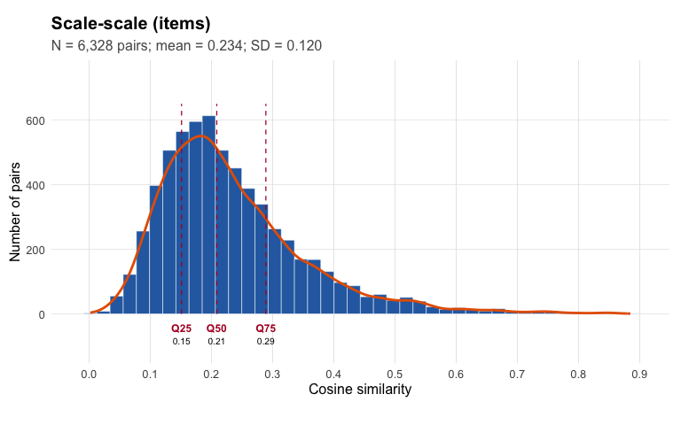
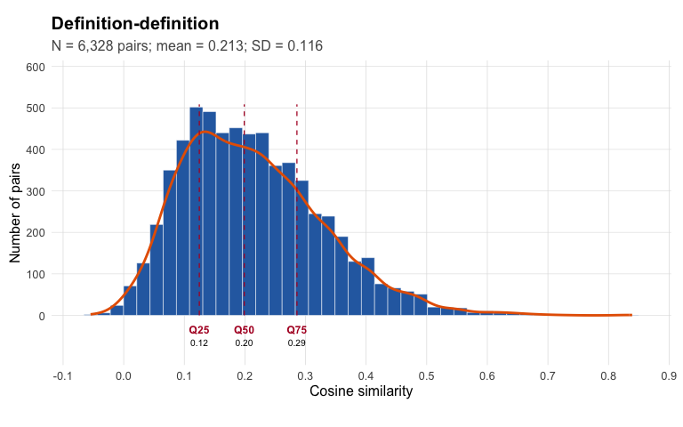
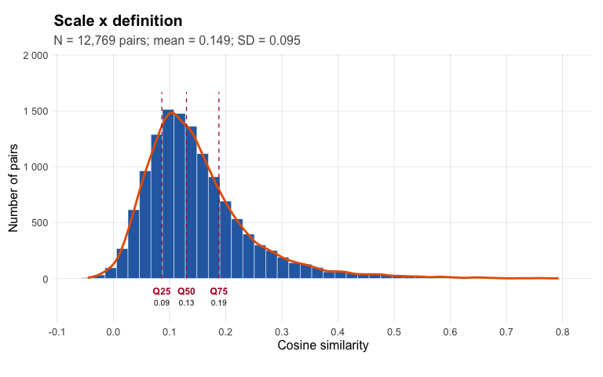
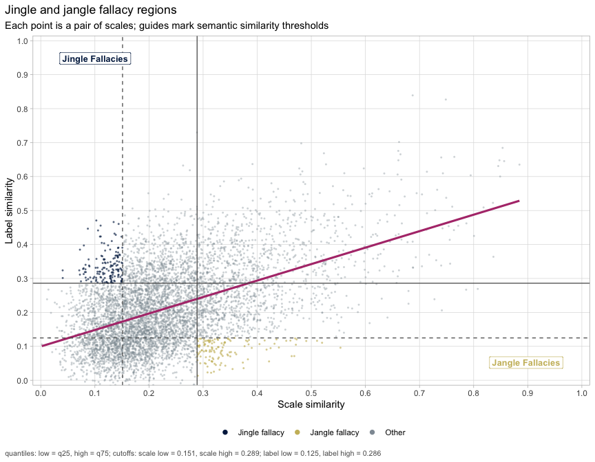
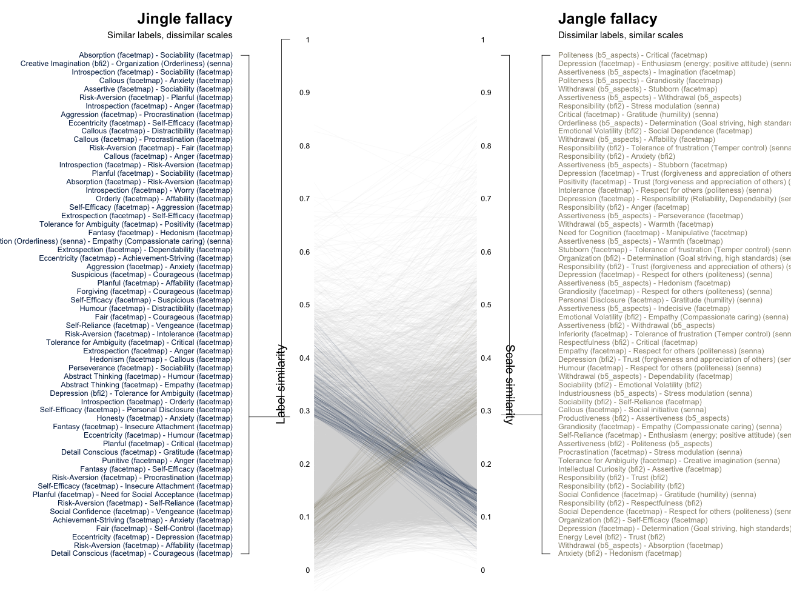
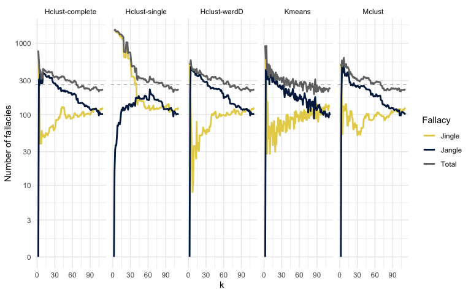
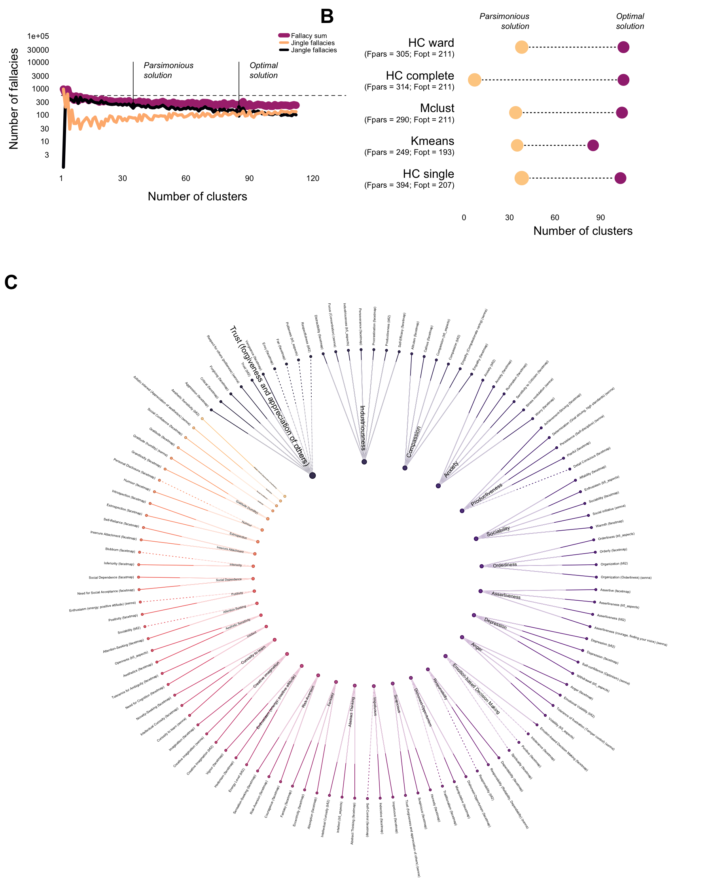

<!-- This vignette is precompiled: edit b5_jingle_jangle.Rmd.orig and run
     vignettes/precompile.R. It needs a local Python with
     sentence-transformers (or an OpenAI API key), so it is not run when the
     package is built. -->


## Idea

Run the Wulff & Mata (2025) jingle-jangle + relabeling pipeline on four Big Five inventories: **BFI-2**, **Big Five Aspect Scales**, **FacetMap** and **SENNA**.

-   **scale side** = empirical scale embeddings (average of the item embeddings of each facet scale);
-   **label side** = the authors' definitions of each facet scale.

A scale is identified by `test_domain_facet` (e.g. `bfi2_O_aes`). Its short display label is the facet name (e.g. *Aesthetic Sensitivity*), shown as `facet name (test)` in the plots.

*Jangle* here means: two scales whose items look alike but whose definitions differ. *Jingle* means: two scales whose items look different but whose definitions are alike.

## Libraries


``` r
# remotes::install_github("rprimi/embeddcv")
library(tidyverse)
library(embeddcv)
```

## Data

The package includes `b5_items` (one row per item) and `b5_scales` (one row per facet scale, with the authors' definition).


``` r
items  <- b5_items
scales <- b5_scales

# scale id = test_domain_facet
items <- items %>%
  mutate(scale_id = paste(test, domain, facet, sep = "_"))

# keep only scales that have items (7 FacetMap scales have no items)
definitions <- scales %>%
  filter(n_items > 0) %>%
  mutate(scale_id = paste(test, domain, facet, sep = "_")) %>%
  select(scale_id, test, domain, facet, facet_name, definition, n_items)

# every item scale has a definition, and vice versa
stopifnot(setequal(unique(items$scale_id), definitions$scale_id))

definitions %>% count(test)
#>         test  n
#> 1 b5_aspects 10
#> 2       bfi2 15
#> 3   facetmap 70
#> 4      senna 18
```

## 1. Prepare embeddings

Choose the embedding model. Wulff & Mata (2025) used `mpnet-personality`, a sentence transformer fine-tuned on personality items; `openai` uses `text-embedding-3-small`. Embeddings are cached in `emb_cache/`.


``` r
emb_model <- "mpnet"   # "mpnet" or "openai"

embed <- function(text) {
  switch(emb_model,
    mpnet  = {
      reticulate::py_require(c("sentence-transformers", "torch"))
      get_embeddings(text, provider = "huggingface_local",
                     model = "dwulff/mpnet-personality")
    },
    openai = get_embeddings(text, provider = "openai",
                            model = "text-embedding-3-small"))
}

cached_embeddings <- function(file, text) {
  path <- file.path("emb_cache", paste0(file, "_", emb_model, ".rds"))
  if (file.exists(path)) return(readRDS(path))
  dir.create("emb_cache", showWarnings = FALSE)
  emb <- embed(text)
  saveRDS(emb, path)
  emb
}

# folder for the PNG figures written by the base-graphics plots
out_dir <- "figures"
dir.create(out_dir, showWarnings = FALSE)
```


``` r
# Items + the scale each item belongs to.
items_emb <- as.matrix(cached_embeddings("b5_items", items$item_en_text))
rownames(items_emb) <- paste(items$test, items$coditem, sep = "_")

count(items, test)
#>         test   n
#> 1 b5_aspects 100
#> 2       bfi2  60
#> 3   facetmap 386
#> 4      senna 162

# SCALE side: empirical scale embedding = mean of its item embeddings.
# Rownames = scale ids (test_domain_facet).
scale_emb <- get_scale_embeddings(items_emb, items$scale_id)

# LABEL side: definition embeddings (authors' facet definitions).
# Rownames = scale ids too, so a scale's label id is its own scale id.
definitions_emb <- as.matrix(cached_embeddings("b5_definitions", definitions$definition))
rownames(definitions_emb) <- definitions$scale_id

# put scale_emb in the same order as the definitions
scale_emb <- scale_emb[definitions$scale_id, ]
stopifnot(identical(rownames(scale_emb), rownames(definitions_emb)))

# Each scale's label is its own definition (identity map over ids).
definitions_by_scale <- setNames(definitions$scale_id, definitions$scale_id)

# DISPLAY only: short label (facet name) and instrument (test) per scale.
# Different tests can share a short label (e.g. "Assertiveness"); the
# instrument suffix keeps them apart in the plots.
short_by_scale      <- setNames(definitions$facet_name, definitions$scale_id)
instrument_by_scale <- setNames(definitions$test, definitions$scale_id)

dim(scale_emb)
#> [1] 113 768
dim(definitions_emb)
#> [1] 113 768
```

## 2. Similarity matrices


``` r
# Content similarity between scales (empirical, item-based).
scale_cos <- cosine_matrix(scale_emb)

# Definition similarity = similarity between the authors' definitions.
definitions_cos <- cosine_matrix(definitions_emb)

# Scale x definition cross-similarity: the weights used to assign a
# definition to each cluster in the relabeling step.
scale_definitions <- cosim_xy(
  scale_emb, definitions_emb,
  x_type = "scale", y_type = "definition", make_plot = TRUE
)
scale_definitions_cross <- scale_definitions$matrix

plot_similarity_distribution(scale_cos, title = "Scale-scale (items)")
```



``` r
plot_similarity_distribution(definitions_cos, title = "Definition-definition")
```



``` r
plot_similarity_distribution(scale_definitions_cross, matrix_triangle = "all",
                             title = "Scale x definition")
```



How well does each scale's item content match its own definition? The diagonal of the cross matrix is the similarity of each scale with its own definition; we compare it with the scale's similarity to all other definitions.


``` r
self_match <- tibble(
  scale_id = rownames(scale_definitions_cross),
  own_def  = diag(scale_definitions_cross)
) %>%
  mutate(rank_own = map_int(scale_id, ~ as.integer(rank(-scale_definitions_cross[.x, ])[[.x]])),
         best_def = colnames(scale_definitions_cross)[apply(scale_definitions_cross, 1, which.max)],
         test     = instrument_by_scale[scale_id],
         facet    = short_by_scale[scale_id],
         best_def_label = paste0(short_by_scale[best_def], " (", instrument_by_scale[best_def], ")"))

# share of scales whose own definition is the best-matching definition, by test
self_match %>%
  group_by(test) %>%
  summarise(n = n(), own_is_best = mean(rank_own == 1), median_rank = median(rank_own),
            mean_cos_own = mean(own_def))
#> # A tibble: 4 × 5
#>   test           n own_is_best median_rank mean_cos_own
#>   <chr>      <int>       <dbl>       <dbl>        <dbl>
#> 1 b5_aspects    10       0.5           1.5        0.549
#> 2 bfi2          15       0.267         3          0.476
#> 3 facetmap      70       0.643         1          0.468
#> 4 senna         18       0.222         2.5        0.439

# scales that best match another scale's definition
self_match %>%
  filter(rank_own > 1) %>%
  select(test, facet, rank_own, best_def_label) %>%
  arrange(desc(rank_own))
#> # A tibble: 55 × 4
#>    test     facet                                         rank_own best_def_label         
#>    <chr>    <chr>                                            <int> <chr>                  
#>  1 facetmap Self-Reliance                                       27 Insecure Attachment (f…
#>  2 facetmap Critical                                            20 Trust (forgiveness and…
#>  3 facetmap Self-Efficacy                                       18 Perseverance (facetmap)
#>  4 bfi2     Responsibility                                      17 Dependability (facetma…
#>  5 senna    Determination (Goal striving, high standards)       17 Productiveness (bfi2)  
#>  6 facetmap Need for Social Acceptance                          15 Stubborn (facetmap)    
#>  7 senna    Organization (Orderliness)                          13 Orderly (facetmap)     
#>  8 facetmap Assertive                                           12 Assertiveness (courage…
#>  9 facetmap Callous                                              9 Compassion (b5_aspects)
#> 10 senna    Responsibility (Reliability, Dependabilty)           7 Responsibility (bfi2)  
#> # ℹ 45 more rows
```

## 3. Jingle-jangle classification


``` r
# Pair table: one row per scale pair, with content sim (scale_cos) and
# definition sim (definitions_cos). `labels` and `instrument` set the text
# shown in the plots: "facet name (test)".
jj_base <- jingle_jangle_pairs(
  scale_cos, definitions_cos,
  label_by_scale = definitions_by_scale,
  labels         = short_by_scale[rownames(scale_cos)],
  instrument     = instrument_by_scale[rownames(scale_cos)]
)

# Cutoffs from the similarity distributions. min_constructs = 1.333 and
# max_constructs = 4 give the .25 / .75 quantiles (Wulff & Mata used 5 / 100,
# i.e. .80 / .99).
thresholds <- jingle_jangle_thresholds(
  scale_cos, definitions_cos,
  min_constructs = 1.333, max_constructs = 4
)
thresholds
#>  scale_low  label_low scale_high label_high 
#>  0.1517462  0.1255144  0.2919217  0.2882904

# Tag each pair as jingle / jangle / nothing.
jj <- classify_jingle_jangle(jj_base, thresholds)

count(jj, type)
#>             type    n
#> 1 Jangle fallacy  120
#> 2 Jingle fallacy  142
#> 3        nothing 6066

plot_jingle_jangle_scatter(
  jj, show_threshold_note = TRUE, threshold_rule = "quartile"
)
```



``` r

# base-graphics figure written to a PNG file
plot_jingle_jangle(jj, thresholds, res = 150,
                   output_file = file.path(out_dir, "b5_jingle_jangle-selected.png"))
```

<div class="figure">

<p class="caption">plot of chunk jj-display</p>
</div>

Jingle and jangle pairs between **different tests** are the most informative: they show where the tests use different names for the same content, or the same names for different content. Note that most jingles occur **within** a test: definitions written by the same authors share a style (e.g. all FacetMap definitions start with "Propensity to ..."), which inflates their similarity even when the items differ.


``` r
jj_pairs <- jj %>%
  filter(type %in% c("Jingle fallacy", "Jangle fallacy")) %>%
  mutate(between_tests = instrument_1 != instrument_2)

count(jj_pairs, type, between_tests)
#>             type between_tests   n
#> 1 Jangle fallacy         FALSE  17
#> 2 Jangle fallacy          TRUE 103
#> 3 Jingle fallacy         FALSE 136
#> 4 Jingle fallacy          TRUE   6

jj_pairs %>%
  filter(between_tests) %>%
  transmute(type,
            scale_1 = paste0(label_1, " (", instrument_1, ")"),
            scale_2 = paste0(label_2, " (", instrument_2, ")"),
            item_sim = scale_cos, definition_sim = label_cos) %>%
  arrange(type, desc(abs(item_sim - definition_sim))) %>%
  mutate(across(where(is.numeric), ~ round(.x, 2)))
#>               type                                  scale_1
#> 1   Jangle fallacy               Assertiveness (b5_aspects)
#> 2   Jangle fallacy                  Politeness (b5_aspects)
#> 3   Jangle fallacy                 Dependability (facetmap)
#> 4   Jangle fallacy                    Depression (facetmap)
#> 5   Jangle fallacy               Assertiveness (b5_aspects)
#> 6   Jangle fallacy               Assertiveness (b5_aspects)
#> 7   Jangle fallacy                 Self-Reliance (facetmap)
#> 8   Jangle fallacy               Assertiveness (b5_aspects)
#> 9   Jangle fallacy                  Politeness (b5_aspects)
#> 10  Jangle fallacy                Traditionalism (facetmap)
#> 11  Jangle fallacy           Personal Disclosure (facetmap)
#> 12  Jangle fallacy                  Withdrawal (b5_aspects)
#> 13  Jangle fallacy                  Withdrawal (b5_aspects)
#> 14  Jangle fallacy                  Politeness (b5_aspects)
#> 15  Jangle fallacy      Sensitivity to Criticism (facetmap)
#> 16  Jangle fallacy                    Responsibility (bfi2)
#> 17  Jangle fallacy                      Stubborn (facetmap)
#> 18  Jangle fallacy           Personal Disclosure (facetmap)
#> 19  Jangle fallacy                    Responsibility (bfi2)
#> 20  Jangle fallacy                     Assertive (facetmap)
#> 21  Jangle fallacy                      Critical (facetmap)
#> 22  Jangle fallacy                 Orderliness (b5_aspects)
#> 23  Jangle fallacy              Emotional Volatility (bfi2)
#> 24  Jangle fallacy                  Withdrawal (b5_aspects)
#> 25  Jangle fallacy               Assertiveness (b5_aspects)
#> 26  Jangle fallacy                   Inferiority (facetmap)
#> 27  Jangle fallacy                    Responsibility (bfi2)
#> 28  Jangle fallacy               Assertiveness (b5_aspects)
#> 29  Jangle fallacy                    Depression (facetmap)
#> 30  Jangle fallacy           Personal Disclosure (facetmap)
#> 31  Jangle fallacy                    Positivity (facetmap)
#> 32  Jangle fallacy                   Intolerance (facetmap)
#> 33  Jangle fallacy                    Depression (facetmap)
#> 34  Jangle fallacy                    Responsibility (bfi2)
#> 35  Jangle fallacy               Assertiveness (b5_aspects)
#> 36  Jangle fallacy                  Withdrawal (b5_aspects)
#> 37  Jangle fallacy               Assertiveness (b5_aspects)
#> 38  Jangle fallacy                      Stubborn (facetmap)
#> 39  Jangle fallacy                      Organization (bfi2)
#> 40  Jangle fallacy                    Responsibility (bfi2)
#> 41  Jangle fallacy               Assertiveness (b5_aspects)
#> 42  Jangle fallacy                      Critical (facetmap)
#> 43  Jangle fallacy                    Depression (facetmap)
#> 44  Jangle fallacy               Assertiveness (b5_aspects)
#> 45  Jangle fallacy           Insecure Attachment (facetmap)
#> 46  Jangle fallacy                    Depression (facetmap)
#> 47  Jangle fallacy                   Grandiosity (facetmap)
#> 48  Jangle fallacy                        Depression (bfi2)
#> 49  Jangle fallacy           Personal Disclosure (facetmap)
#> 50  Jangle fallacy               Assertiveness (b5_aspects)
#> 51  Jangle fallacy                       Fantasy (facetmap)
#> 52  Jangle fallacy              Emotional Volatility (bfi2)
#> 53  Jangle fallacy      Sensitivity to Criticism (facetmap)
#> 54  Jangle fallacy                  Withdrawal (b5_aspects)
#> 55  Jangle fallacy                     Assertiveness (bfi2)
#> 56  Jangle fallacy                  Withdrawal (b5_aspects)
#> 57  Jangle fallacy                  Politeness (b5_aspects)
#> 58  Jangle fallacy                   Inferiority (facetmap)
#> 59  Jangle fallacy                    Respectfulness (bfi2)
#> 60  Jangle fallacy                           Anxiety (bfi2)
#> 61  Jangle fallacy                       Empathy (facetmap)
#> 62  Jangle fallacy               Assertiveness (b5_aspects)
#> 63  Jangle fallacy Emotion-based Decision Making (facetmap)
#> 64  Jangle fallacy                        Depression (bfi2)
#> 65  Jangle fallacy                        Humour (facetmap)
#> 66  Jangle fallacy                  Volatility (b5_aspects)
#> 67  Jangle fallacy          Achievement-Striving (facetmap)
#> 68  Jangle fallacy               Assertiveness (b5_aspects)
#> 69  Jangle fallacy                  Withdrawal (b5_aspects)
#> 70  Jangle fallacy               Assertiveness (b5_aspects)
#> 71  Jangle fallacy                       Anxiety (facetmap)
#> 72  Jangle fallacy                 Introspection (facetmap)
#> 73  Jangle fallacy              Emotional Volatility (bfi2)
#> 74  Jangle fallacy             Industriousness (b5_aspects)
#> 75  Jangle fallacy         Dishonest-Opportunism (facetmap)
#> 76  Jangle fallacy       Tolerance for Ambiguity (facetmap)
#> 77  Jangle fallacy                    Responsibility (bfi2)
#> 78  Jangle fallacy           Insecure Attachment (facetmap)
#> 79  Jangle fallacy                       Sociability (bfi2)
#> 80  Jangle fallacy                       Callous (facetmap)
#> 81  Jangle fallacy                        Depression (bfi2)
#> 82  Jangle fallacy             Social Confidence (facetmap)
#> 83  Jangle fallacy                    Productiveness (bfi2)
#> 84  Jangle fallacy                   Grandiosity (facetmap)
#> 85  Jangle fallacy                 Self-Reliance (facetmap)
#> 86  Jangle fallacy                     Assertiveness (bfi2)
#> 87  Jangle fallacy               Procrastination (facetmap)
#> 88  Jangle fallacy             Social Dependence (facetmap)
#> 89  Jangle fallacy       Tolerance for Ambiguity (facetmap)
#> 90  Jangle fallacy                     Impetuous (facetmap)
#> 91  Jangle fallacy                    Productiveness (bfi2)
#> 92  Jangle fallacy            Intellectual Curiosity (bfi2)
#> 93  Jangle fallacy                           Anxiety (bfi2)
#> 94  Jangle fallacy             Social Confidence (facetmap)
#> 95  Jangle fallacy                 Dependability (facetmap)
#> 96  Jangle fallacy             Social Dependence (facetmap)
#> 97  Jangle fallacy            Intellectual Curiosity (bfi2)
#> 98  Jangle fallacy                  Withdrawal (b5_aspects)
#> 99  Jangle fallacy                      Organization (bfi2)
#> 100 Jangle fallacy                    Depression (facetmap)
#> 101 Jangle fallacy      Sensitivity to Criticism (facetmap)
#> 102 Jangle fallacy                  Withdrawal (b5_aspects)
#> 103 Jangle fallacy                           Anxiety (bfi2)
#> 104 Jingle fallacy              Creative Imagination (bfi2)
#> 105 Jingle fallacy                      Energy Level (bfi2)
#> 106 Jingle fallacy                        Depression (bfi2)
#> 107 Jingle fallacy                           Anxiety (bfi2)
#> 108 Jingle fallacy                        Depression (bfi2)
#> 109 Jingle fallacy             Aesthetic Sensitivity (bfi2)
#>                                                    scale_2 item_sim definition_sim
#> 1                                 Self-Efficacy (facetmap)     0.55           0.10
#> 2                                      Critical (facetmap)     0.52           0.11
#> 3   Trust (forgiveness and appreciation of others) (senna)     0.47           0.07
#> 4           Enthusiasm (energy; positive attitude) (senna)     0.51           0.12
#> 5                                    Courageous (facetmap)     0.46           0.07
#> 6                                   Imagination (facetmap)     0.47           0.10
#> 7                                Social initiative (senna)     0.42           0.06
#> 8                                   Inferiority (facetmap)     0.47           0.12
#> 9                                   Grandiosity (facetmap)     0.47           0.12
#> 10                 Respect for others (politeness) (senna)     0.46           0.12
#> 11                  Empathy (Compassionate caring) (senna)     0.44           0.10
#> 12                                     Stubborn (facetmap)     0.37           0.04
#> 13                                Self-Efficacy (facetmap)     0.45           0.12
#> 14                                  Inferiority (facetmap)     0.43           0.11
#> 15                  Empathy (Compassionate caring) (senna)     0.35           0.03
#> 16                                 Volatility (b5_aspects)     0.37           0.05
#> 17                               Stress modulation (senna)     0.38           0.06
#> 18          Enthusiasm (energy; positive attitude) (senna)     0.44           0.12
#> 19                               Stress modulation (senna)     0.33           0.03
#> 20                            Creative imagination (senna)     0.34           0.04
#> 21                            Gratitude (humility) (senna)     0.40           0.11
#> 22   Determination (Goal striving, high standards) (senna)     0.41           0.12
#> 23                            Social Dependence (facetmap)     0.39           0.10
#> 24                                   Affability (facetmap)     0.32           0.03
#> 25                                   Depression (facetmap)     0.31           0.02
#> 26                 Respect for others (politeness) (senna)     0.33           0.04
#> 27       Tolerance of frustration (Temper control) (senna)     0.31           0.02
#> 28                                     Stubborn (facetmap)     0.33           0.05
#> 29  Trust (forgiveness and appreciation of others) (senna)     0.35           0.07
#> 30  Trust (forgiveness and appreciation of others) (senna)     0.32           0.05
#> 31  Trust (forgiveness and appreciation of others) (senna)     0.38           0.11
#> 32                 Respect for others (politeness) (senna)     0.36           0.08
#> 33      Responsibility (Reliability, Dependabilty) (senna)     0.35           0.07
#> 34                                        Anger (facetmap)     0.32           0.05
#> 35                                 Perseverance (facetmap)     0.34           0.08
#> 36                                       Warmth (facetmap)     0.35           0.08
#> 37                                       Warmth (facetmap)     0.38           0.11
#> 38       Tolerance of frustration (Temper control) (senna)     0.35           0.08
#> 39   Determination (Goal striving, high standards) (senna)     0.38           0.12
#> 40  Trust (forgiveness and appreciation of others) (senna)     0.34           0.07
#> 41                     Sensitivity to Criticism (facetmap)     0.33           0.06
#> 42                  Empathy (Compassionate caring) (senna)     0.38           0.12
#> 43                 Respect for others (politeness) (senna)     0.32           0.05
#> 44                                     Hedonism (facetmap)     0.33           0.07
#> 45  Trust (forgiveness and appreciation of others) (senna)     0.32           0.06
#> 46                               Social initiative (senna)     0.32           0.06
#> 47                 Respect for others (politeness) (senna)     0.33           0.08
#> 48                               Social initiative (senna)     0.32           0.06
#> 49                            Gratitude (humility) (senna)     0.30           0.05
#> 50                                   Indecisive (facetmap)     0.30           0.05
#> 51                            Creative imagination (senna)     0.32           0.07
#> 52                  Empathy (Compassionate caring) (senna)     0.31           0.06
#> 53     Assertiveness (courage, finding your voice) (senna)     0.33           0.09
#> 54                            Attention-Seeking (facetmap)     0.29           0.05
#> 55                                 Withdrawal (b5_aspects)     0.31           0.07
#> 56                                     Hedonism (facetmap)     0.34           0.10
#> 57                            Attention-Seeking (facetmap)     0.32           0.08
#> 58       Tolerance of frustration (Temper control) (senna)     0.31           0.07
#> 59                                     Critical (facetmap)     0.35           0.12
#> 60                                     Stubborn (facetmap)     0.34           0.10
#> 61                 Respect for others (politeness) (senna)     0.36           0.12
#> 62                              Procrastination (facetmap)     0.32           0.09
#> 63          Enthusiasm (energy; positive attitude) (senna)     0.32           0.09
#> 64  Trust (forgiveness and appreciation of others) (senna)     0.33           0.10
#> 65                 Respect for others (politeness) (senna)     0.32           0.09
#> 66                                     Stubborn (facetmap)     0.33           0.10
#> 67                            Gratitude (humility) (senna)     0.34           0.11
#> 68                               Stress modulation (senna)     0.35           0.12
#> 69                                Dependability (facetmap)     0.34           0.11
#> 70                              Distractibility (facetmap)     0.31           0.08
#> 71          Enthusiasm (energy; positive attitude) (senna)     0.34           0.11
#> 72                            Creative imagination (senna)     0.30           0.07
#> 73                Emotion-based Decision Making (facetmap)     0.33           0.11
#> 74                               Stress modulation (senna)     0.35           0.12
#> 75                   Persistence (Self-discipline) (senna)     0.35           0.12
#> 76   Determination (Goal striving, high standards) (senna)     0.31           0.09
#> 77                                   Depression (facetmap)     0.32           0.10
#> 78          Enthusiasm (energy; positive attitude) (senna)     0.31           0.09
#> 79                                Self-Reliance (facetmap)     0.29           0.08
#> 80                               Social initiative (senna)     0.29           0.08
#> 81                              Assertiveness (b5_aspects)     0.30           0.09
#> 82                            Creative imagination (senna)     0.30           0.09
#> 83                              Assertiveness (b5_aspects)     0.33           0.12
#> 84                  Empathy (Compassionate caring) (senna)     0.32           0.11
#> 85          Enthusiasm (energy; positive attitude) (senna)     0.32           0.11
#> 86                                 Politeness (b5_aspects)     0.33           0.12
#> 87                               Stress modulation (senna)     0.33           0.12
#> 88       Tolerance of frustration (Temper control) (senna)     0.32           0.12
#> 89                            Creative imagination (senna)     0.32           0.12
#> 90                      Organization (Orderliness) (senna)     0.31           0.11
#> 91                                   Depression (facetmap)     0.30           0.10
#> 92                                    Assertive (facetmap)     0.31           0.11
#> 93                              Assertiveness (b5_aspects)     0.31           0.11
#> 94                            Gratitude (humility) (senna)     0.31           0.12
#> 95                               Stress modulation (senna)     0.31           0.12
#> 96                 Respect for others (politeness) (senna)     0.31           0.12
#> 97                              Assertiveness (b5_aspects)     0.29           0.10
#> 98                                    Impetuous (facetmap)     0.31           0.12
#> 99                                Self-Efficacy (facetmap)     0.29           0.10
#> 100  Determination (Goal striving, high standards) (senna)     0.30           0.11
#> 101                Respect for others (politeness) (senna)     0.30           0.12
#> 102                                  Absorption (facetmap)     0.30           0.12
#> 103                                    Hedonism (facetmap)     0.29           0.12
#> 104                     Organization (Orderliness) (senna)     0.11           0.46
#> 105                                  Absorption (facetmap)     0.12           0.40
#> 106                     Tolerance for Ambiguity (facetmap)     0.10           0.30
#> 107                                  Aggression (facetmap)     0.11           0.30
#> 108                                     Callous (facetmap)     0.13           0.30
#> 109                                      Warmth (facetmap)     0.15           0.29
```

## 4. Relabeling

The reference taxonomies are (a) the original one, where each scale keeps its own definition, and (b) a Big Five taxonomy, where scales are grouped by domain (O, C, E, A, N).


``` r
# (a) original taxonomy: each scale keeps its own definition
original_solution <- definitions_by_scale[rownames(scale_cos)]
original_score <- score_label_solution(original_solution, scale_cos,
                                       definitions_cos, thresholds)
original_score
#>        good      jangle      jingle fallacy_sum 
#>        6066         120         142         262

# (b) Big Five domains as the reference clustering ("original_b5")
b5_solution <- setNames(definitions$domain, definitions$scale_id)[rownames(scale_cos)]

# Candidate taxonomies: cluster the empirical scale similarity for each k.
solutions <- make_relabeling_clustering_solutions(
  scale_cos         = scale_cos,
  k_seq             = 2:(nrow(scale_cos) - 1),
  original_solution = b5_solution,
  include_mclust    = TRUE,
  include_louvain   = TRUE,
  seed              = 42
)

# Relabel each cluster with its best-fitting definition, then count fallacies.
scored <- score_relabeling_solutions(solutions, scale_definitions_cross,
                                     scale_cos, definitions_cos, thresholds)

# Big Five reference, relabeled with the best definition per domain
scored %>% filter(type == "original_b5") %>% select(type, k, jingle, jangle, fallacy_sum)
#>          type k jingle jangle fallacy_sum
#> 1 original_b5 5     59    472         531

# Best (optimal) and most parsimonious solution per algorithm family.
max_constructs <- 40
selection <- select_relabeling_solutions(scored, max_constructs = max_constructs)
selection %>% select(type, selection, k, jingle, jangle, fallacy_sum)
#>               type    selection   k jingle jangle fallacy_sum
#> 1  hclust_complete      Optimal 105    114     97         211
#> 2  hclust_complete Parsimonious   7     39    275         314
#> 3    hclust_single      Optimal 103    113     94         207
#> 4    hclust_single Parsimonious  38    262    132         394
#> 5      hclust_ward      Optimal 105    114     97         211
#> 6      hclust_ward Parsimonious  38     74    231         305
#> 7           kmeans      Optimal  85    105     88         193
#> 8           kmeans Parsimonious  35     74    175         249
#> 9           mclust      Optimal 104    114     97         211
#> 10          mclust Parsimonious  34     55    235         290
```

## 5. Figures: fallacies per number of clusters


``` r
# Three-panel relabeling figure (A: scale-definition fit, B: fallacies by k
# with optimal/parsimonious markers, C: the selected relabeled taxonomy).
panels <- prepare_relabeling_panels(
  labels_scored     = scored,
  scale_label_cross = scale_definitions_cross,
  label_by_scale    = definitions_by_scale,
  max_constructs    = max_constructs,
  palette           = "magma",
  labels            = short_by_scale,
  instrument        = instrument_by_scale
)

plot_relabeling_figure(relabeling_panels = panels, res = 150,
                       output_file = file.path(out_dir, "b5_jingle_jangle-relabeling.png"),
                       max_constructs = max_constructs, palette = "magma")

# Robustness: fallacy_sum as a function of k, one curve per clustering
# algorithm, with the original taxonomy as reference.
plot_relabeling_robustness(
  scored,
  original_fallacy_sum = original_score[["fallacy_sum"]]
)
```



<div class="figure">

<p class="caption">plot of chunk figures-display</p>
</div>

## 6. Extract cluster solutions as tidy tables

Where the solutions are stored:

-   `solutions[[type]][[i]]`: the raw clustering, a named vector (names = scale ids, values = **cluster number**), one per k.
-   `scored$label_vectors[[row]]`: the **relabeled** solution, a named vector (names = scale ids, values = **assigned label id**), one row per (type, k). Scales that share an assigned label form one cluster.
-   `selection`: the same, restricted to the Optimal / Parsimonious rows.


``` r
# Turn ONE solution (a named label vector) into a tidy table:
# scale id -> cluster number -> assigned label (id + short label).
solution_table <- function(label_vector) {
  tibble(
    scale_id          = names(label_vector),
    assigned_label_id = unname(label_vector)
  ) |>
    mutate(
      cluster          = dense_rank(assigned_label_id),
      test             = unname(instrument_by_scale[scale_id]),
      scale_short      = unname(short_by_scale[scale_id]),
      assigned_short   = unname(short_by_scale[assigned_label_id]),
      assigned_test    = unname(instrument_by_scale[assigned_label_id])
    ) |>
    arrange(cluster, test, scale_short)
}

# (a) One specific solution by algorithm and k
row_idx <- which(scored$type == "hclust_ward" & scored$k == 30)
sol_one <- solution_table(scored$label_vectors[[row_idx]])

# (b) The PARSIMONIOUS solution of the best family
par_row <- selection |>
  filter(selection == "Parsimonious") |>
  slice_min(fallacy_sum, n = 1, with_ties = FALSE)
sol_par <- solution_table(par_row$label_vectors[[1]])

par_row |> select(type, k, jingle, jangle, fallacy_sum)
#>     type  k jingle jangle fallacy_sum
#> 1 kmeans 35     74    175         249

# clusters of the parsimonious solution: which scales from which tests?
sol_par |>
  group_by(cluster, assigned = paste0(assigned_short, " (", assigned_test, ")")) |>
  summarise(n_scales = n(),
            tests    = paste(sort(unique(test)), collapse = ", "),
            scales   = paste0(scale_short, " (", test, ")", collapse = "; "),
            .groups  = "drop")
#> # A tibble: 35 × 5
#>    cluster assigned                         n_scales tests                          scales
#>      <int> <chr>                               <int> <chr>                          <chr> 
#>  1       1 Compassion (b5_aspects)                 6 b5_aspects, bfi2, facetmap, s… Compa…
#>  2       2 Industriousness (b5_aspects)            7 b5_aspects, bfi2, facetmap, s… Indus…
#>  3       3 Orderliness (b5_aspects)                4 b5_aspects, bfi2, facetmap, s… Order…
#>  4       4 Assertiveness (b5_aspects)              4 b5_aspects, bfi2, facetmap, s… Asser…
#>  5       5 Intellect (b5_aspects)                  2 facetmap                       Need …
#>  6       6 Productiveness (bfi2)                   5 facetmap, senna                Achie…
#>  7       7 Responsibility (bfi2)                   3 bfi2, facetmap, senna          Respo…
#>  8       8 Depression (bfi2)                       4 b5_aspects, bfi2, facetmap, s… Withd…
#>  9       9 Aesthetic Sensitivity (bfi2)            2 b5_aspects, facetmap           Openn…
#> 10      10 Dishonest-Opportunism (facetmap)        3 facetmap                       Disho…
#> # ℹ 25 more rows

# All selected solutions stacked into one long table
solutions_long <- selection |>
  mutate(solution_id = paste0(type, "_", selection, "_k", k)) |>
  transmute(solution_id, type, k, selection, label_vectors) |>
  mutate(tbl = map(label_vectors, solution_table)) |>
  select(-label_vectors) |>
  unnest(tbl)
```

## 7. Merge a solution back to definitions and items


``` r
sol <- sol_par

# one row per scale/definition
sol_definitions <- sol |>
  left_join(select(definitions, scale_id, domain, facet, definition, n_items),
            by = "scale_id")

# one row per item: each item inherits its scale's cluster and assigned label
sol_items <- items |>
  left_join(select(sol, scale_id, cluster, assigned_label_id, assigned_short, assigned_test),
            by = "scale_id")

glimpse(sol_definitions)
#> Rows: 113
#> Columns: 11
#> $ scale_id          <chr> "b5_aspects_A_compassion", "bfi2_A_cmp", "facetmap_A_altruism"…
#> $ assigned_label_id <chr> "b5_aspects_A_compassion", "b5_aspects_A_compassion", "b5_aspe…
#> $ cluster           <int> 1, 1, 1, 1, 1, 1, 2, 2, 2, 2, 2, 2, 2, 3, 3, 3, 3, 4, 4, 4, 4,…
#> $ test              <chr> "b5_aspects", "bfi2", "facetmap", "facetmap", "facetmap", "sen…
#> $ scale_short       <chr> "Compassion", "Compassion", "Altruism", "Callous", "Empathy", …
#> $ assigned_short    <chr> "Compassion", "Compassion", "Compassion", "Compassion", "Compa…
#> $ assigned_test     <chr> "b5_aspects", "b5_aspects", "b5_aspects", "b5_aspects", "b5_as…
#> $ domain            <chr> "A", "A", "A", "A", "N", "A", "C", "C", "N", "C", "N", "C", "C…
#> $ facet             <chr> "compassion", "cmp", "altruism", "callous", "empathy", "Cmp", …
#> $ definition        <chr> "Prosocial interest in others and empathic concern for their f…
#> $ n_items           <int> 10, 4, 6, 6, 5, 9, 10, 4, 6, 5, 5, 5, 9, 10, 4, 5, 9, 10, 4, 6…

# save the results, e.g.
# writexl::write_xlsx(
#   list(definitions = sol_definitions, items = sol_items,
#        jingle_jangle = jj_pairs, self_match = self_match,
#        solutions_long = solutions_long),
#   "b5_relabeling_results.xlsx"
# )
```

## References

-   Wulff, D. U., & Mata, R. (2025). Semantic embeddings reveal and address taxonomic incommensurability in psychological measurement. *Nature Human Behaviour, 9*(5), 944–954. https://doi.org/10.1038/s41562-024-02089-y
