<!-- This vignette is precompiled: edit bfi2_facetmap.Rmd.orig and run
     vignettes/precompile.R. It needs an OpenAI API key and a local Python
     with sentence-transformers, so it is not run when the package is built. -->


## Research question

How do the BFI-2 items map onto a new Big Five facet model (FacetMap)?

-   **BFI-2**: Soto, C. J., & John, O. P. (2017). The next Big Five Inventory (BFI-2): Developing and assessing a hierarchical model with 15 facets to enhance bandwidth, fidelity, and predictive power. *Journal of Personality and Social Psychology, 113*(1), 117–143. https://doi.org/10.1037/pspp0000096

-   **FacetMap** (https://facetmap.org): Irwing, P., Hughes, D. J., & Tokarev, A. (2023). Towards a taxonomy of personality facets. *European Journal of Personality, 37*(5), 606–629. https://doi.org/10.1177/08902070231200919

The logic is simple:

1.  Embed every item (BFI-2 and FacetMap) as a vector.
2.  Represent each FacetMap facet by the average embedding of its items (an *empirical definition* of the facet).
3.  Compute the cosine similarity of each BFI-2 item with each FacetMap facet.
4.  Aggregate the similarities by BFI-2 facet and find the best-matching FacetMap facets.
5.  Explore how BFI-2 items group according to their similarity profiles over the 70 FacetMap facets.

We repeat the analysis with two embedding models:

-   **OpenAI** `text-embedding-3-small`, a general-purpose model.
-   **mpnet-personality** (`dwulff/mpnet-personality`, https://huggingface.co/dwulff/mpnet-personality), a sentence-transformer fine-tuned on personality items by Wulff & Mata. It was trained to reproduce empirical correlations among personality items.

## Packages


``` r
# devtools::install_github("rprimi/embeddcv")
library(embeddcv)
library(tidyverse)
```

## Data

The package includes a tidy item dictionary (`b5_items`, one row per item) and a scale dictionary with the authors' definitions (`b5_scales`, one row per facet) for four Big Five inventories. We keep the BFI-2 and FacetMap tests.


``` r
items  <- b5_items
scales <- b5_scales

# readable facet labels, prefixed by domain (e.g. "O_Aesthetic Sensitivity")
scales <- scales %>%
  mutate(scale_label = paste0(domain, "_", facet_name))

bfi <- items %>%
  filter(test == "bfi2") %>%
  left_join(select(scales, test, facet, scale_label), by = c("test", "facet"))

facet_map <- items %>%
  filter(test == "facetmap") %>%
  left_join(select(scales, test, facet, scale_label), by = c("test", "facet"))

bfi %>% count(domain, scale_label)
#>    domain              scale_label n
#> 1       A             A_Compassion 4
#> 2       A         A_Respectfulness 4
#> 3       A                  A_Trust 4
#> 4       C           C_Organization 4
#> 5       C         C_Productiveness 4
#> 6       C         C_Responsibility 4
#> 7       E          E_Assertiveness 4
#> 8       E           E_Energy Level 4
#> 9       E            E_Sociability 4
#> 10      N                N_Anxiety 4
#> 11      N             N_Depression 4
#> 12      N   N_Emotional Volatility 4
#> 13      O  O_Aesthetic Sensitivity 4
#> 14      O   O_Creative Imagination 4
#> 15      O O_Intellectual Curiosity 4
facet_map %>% count(domain, scale_label) %>% print(n = Inf)
#> Error in `print.default()`:
#> ! especificação de 'na.print' inválida
```

## Embeddings

Embeddings are computed once and cached as `.rds` files in `emb_cache/`, so the analysis can be re-run without calling the APIs again.


``` r
dir.create("emb_cache", showWarnings = FALSE)

cached_embeddings <- function(file, expr) {
  path <- file.path("emb_cache", file)
  if (file.exists(path)) return(readRDS(path))
  emb <- expr
  saveRDS(emb, path)
  emb
}
```

### OpenAI `text-embedding-3-small`

Requires the `OPENAI_API_KEY` environment variable (use `usethis::edit_r_environ()` to set it).


``` r
bfi_emb_oai <- cached_embeddings("bfi_openai.rds",
  get_embeddings(text = bfi$item_en_text, provider = "openai",
                 model = "text-embedding-3-small"))

fm_emb_oai <- cached_embeddings("facetmap_openai.rds",
  get_embeddings(text = facet_map$item_en_text, provider = "openai",
                 model = "text-embedding-3-small"))

dim(bfi_emb_oai)
#> [1]   60 1536
```

### mpnet-personality (local, via Python)

The model runs locally with `sentence-transformers`. `reticulate::py_require()` declares the Python dependencies; the first call downloads the model (\~420 MB).


``` r
reticulate::py_require(c("sentence-transformers", "torch"))

bfi_emb_mp <- cached_embeddings("bfi_mpnet.rds",
  get_embeddings(text = bfi$item_en_text, provider = "huggingface_local",
                 model = "dwulff/mpnet-personality"))

fm_emb_mp <- cached_embeddings("facetmap_mpnet.rds",
  get_embeddings(text = facet_map$item_en_text, provider = "huggingface_local",
                 model = "dwulff/mpnet-personality"))

dim(bfi_emb_mp)
#> [1]  60 768
```

## FacetMap scale embeddings

Average the item embeddings by FacetMap facet with `get_scale_embeddings()`. This yields an empirical definition of each target construct. The result is a matrix with one row per facet; the row names are the facet labels.


``` r
scale_emb_oai <- get_scale_embeddings(fm_emb_oai, facet_map$scale_label)
scale_emb_mp  <- get_scale_embeddings(fm_emb_mp,  facet_map$scale_label)

fm_scales <- rownames(scale_emb_oai)   # 70 FacetMap facets
length(fm_scales)
#> [1] 70
dim(scale_emb_oai)
#> [1]   70 1536
```

## Item × facet cosine similarities

`cosim_itens_scales()` returns a list. `cosim_mat` has one row per BFI-2 item, one column per FacetMap facet, the best and second-best matching facets, and three indices of each item's similarity profile:

-   `complexity` (Hoffman): how many facets the item relates to (1 = one dominant facet);
-   `sparsity` (Hoyer): 0 = flat profile, 1 = a single facet;
-   `within_sd`: spread of the item's similarities.


``` r
cosim_oai <- cosim_itens_scales(
  item_emb     = bfi_emb_oai,
  scale_emb    = scale_emb_oai,
  item_text    = bfi$item_en_text,
  factor_itens = bfi$scale_label,      # BFI-2 facet of each item
  factor_scale = rownames(scale_emb_oai)   # FacetMap facet names
)

cosim_mp <- cosim_itens_scales(
  item_emb     = bfi_emb_mp,
  scale_emb    = scale_emb_mp,
  item_text    = bfi$item_en_text,
  factor_itens = bfi$scale_label,
  factor_scale = rownames(scale_emb_mp)
)


cosim_oai$cosim_mat %>%
  select(item_text, scale, best_target_factor, second_best_target_factor,
         complexity, sparsity) %>%
  head(10)
#>                                          item_text                    scale
#> 1                      Has few artistic interests.  O_Aesthetic Sensitivity
#> 2              Thinks poetry and plays are boring.  O_Aesthetic Sensitivity
#> 3      Is fascinated by art, music, or literature.  O_Aesthetic Sensitivity
#> 4                           Values art and beauty.  O_Aesthetic Sensitivity
#> 5    Is inventive, finds clever ways to do things.   O_Creative Imagination
#> 6                           Has little creativity.   O_Creative Imagination
#> 7                 Has difficulty imagining things.   O_Creative Imagination
#> 8            Is original, comes up with new ideas.   O_Creative Imagination
#> 9          Is curious about many different things. O_Intellectual Curiosity
#> 10 Avoids intellectual, philosophical discussions. O_Intellectual Curiosity
#>          best_target_factor second_best_target_factor complexity   sparsity
#> 1              O_Aesthetics       O_Abstract Thinking   51.40253 0.05105417
#> 2       O_Abstract Thinking      O_Need for Cognition   50.95679 0.04811688
#> 3              O_Aesthetics  O_Intellectual Curiosity   39.38219 0.07635976
#> 4              O_Aesthetics          C_Traditionalism   31.66275 0.07432378
#> 5             O_Imagination           C_Self-Efficacy   50.86935 0.05514968
#> 6             O_Imagination      O_Need for Cognition   48.89937 0.05297843
#> 7      O_Need for Cognition             O_Imagination   49.27680 0.05797686
#> 8             O_Imagination         O_Novelty-Seeking   34.49058 0.07639799
#> 9  O_Intellectual Curiosity            O_Eccentricity   51.66954 0.04791706
#> 10      O_Abstract Thinking      O_Need for Cognition   39.82291 0.06255946

cosim_oai$plot_dist
```

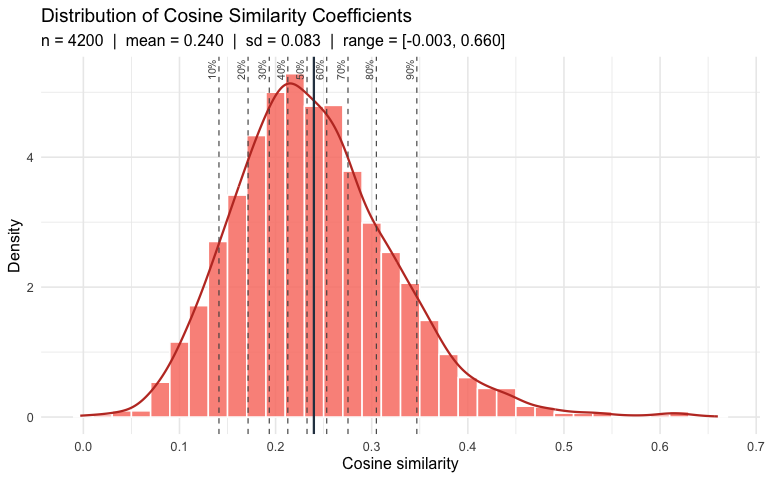

### Distribution of the similarities

Each model has its own similarity scale (different baseline and spread), so the same cosine value means different things in each model, and thresholds must be chosen per model. `plot_similarity_distribution()` shows the distribution and its quartiles.


``` r
plot_similarity_distribution(
  as.matrix(cosim_oai$cosim_mat[, fm_scales]),
  title = "BFI-2 items x FacetMap facets - OpenAI",
  matrix_triangle = "all"
)
```

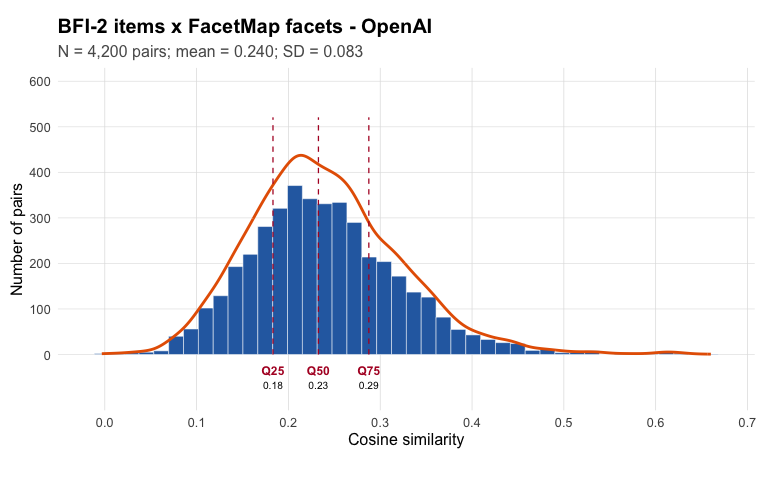

``` r

plot_similarity_distribution(
  as.matrix(cosim_mp$cosim_mat[, fm_scales]),
  title = "BFI-2 items x FacetMap facets - mpnet-personality",
  matrix_triangle = "all"
)
```

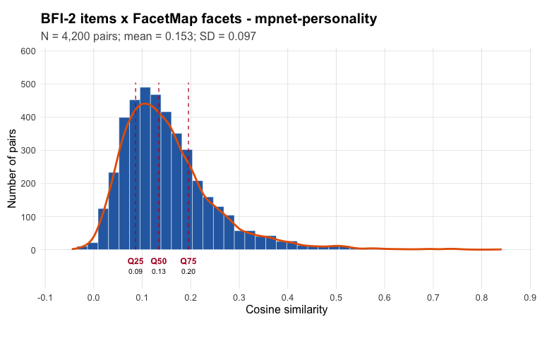

It is also useful to look at item–item similarities among the BFI-2 items. Here the matrix is square and symmetric, so only the upper triangle is used.


``` r
bfi_item_sims <- cosim_xy(bfi_emb_mp, x_labels = bfi$item_en_text,
                          x_group = bfi$scale_label, x_type = "item")

plot_similarity_distribution(
  bfi_item_sims$matrix,
  title = "BFI-2 item-item similarities - mpnet-personality",
  show_percentiles = TRUE
)
```

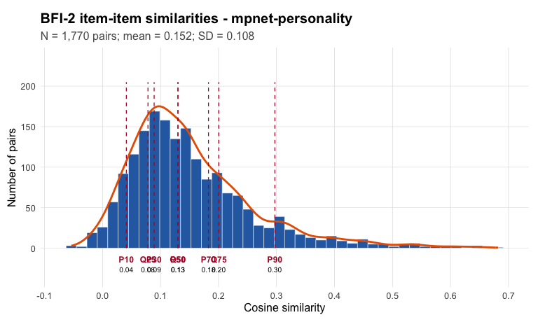

## Summarize results by BFI-2 facet

`mean_cosim_by_item_factors()` computes the mean (Fisher-z) similarity between the items of each BFI-2 facet and each FacetMap facet, and keeps the two best target facets.


``` r
summary_oai <- mean_cosim_by_item_factors(
  cosim_mat     = cosim_oai$cosim_mat[, fm_scales],
  item_factor   = cosim_oai$cosim_mat$scale,
  target_factor = fm_scales
)

summary_mp <- mean_cosim_by_item_factors(
  cosim_mat     = cosim_mp$cosim_mat[, fm_scales],
  item_factor   = cosim_mp$cosim_mat$scale,
  target_factor = fm_scales
)

# best two FacetMap matches for each BFI-2 facet, both models side by side
matches <- full_join(
  summary_oai$matches_by_row %>%
    rename_with(~ paste0(.x, "_oai"), -item_factor),
  summary_mp$matches_by_row %>%
    rename_with(~ paste0(.x, "_mp"), -item_factor),
  by = "item_factor"
)

matches %>%
  select(item_factor,
         best_oai = best_target_factor_oai, r_oai = best_correlation_oai,
         best_mp  = best_target_factor_mp,  r_mp  = best_correlation_mp,
         second_oai = second_best_target_factor_oai,
         second_mp  = second_best_target_factor_mp) %>%
  mutate(across(where(is.numeric), ~ round(.x, 2)))
#>                 item_factor            best_oai r_oai             best_mp r_mp
#> 1   O_Aesthetic Sensitivity        O_Aesthetics  0.47        O_Aesthetics 0.61
#> 2    O_Creative Imagination       O_Imagination  0.48       O_Imagination 0.58
#> 3  O_Intellectual Curiosity O_Abstract Thinking  0.52 O_Abstract Thinking 0.66
#> 4            C_Organization           C_Orderly  0.50           C_Orderly 0.59
#> 5          C_Productiveness   N_Procrastination  0.45   N_Procrastination 0.49
#> 6          C_Responsibility     C_Dependability  0.43     C_Dependability 0.35
#> 7           E_Assertiveness         C_Assertive  0.43         C_Assertive 0.41
#> 8            E_Energy Level            E_Vigour  0.43            E_Vigour 0.47
#> 9             E_Sociability        E_Affability  0.42        E_Affability 0.42
#> 10             A_Compassion          A_Altruism  0.43          A_Altruism 0.40
#> 11         A_Respectfulness         C_Assertive  0.39        A_Aggression 0.31
#> 12                  A_Trust          A_Critical  0.46          A_Critical 0.44
#> 13                N_Anxiety           N_Anxiety  0.50           N_Anxiety 0.55
#> 14             N_Depression        N_Depression  0.47        N_Depression 0.58
#> 15   N_Emotional Volatility      N_Self-Control  0.46           N_Anxiety 0.41
#>                      second_oai                second_mp
#> 1           O_Abstract Thinking O_Intellectual Curiosity
#> 2          O_Need for Cognition      O_Abstract Thinking
#> 3          O_Need for Cognition O_Intellectual Curiosity
#> 4                     C_Planful                C_Planful
#> 5                C_Perseverance                C_Planful
#> 6                     C_Honesty              N_Impetuous
#> 7           E_Social Confidence      E_Social Confidence
#> 8                  E_Positivity             E_Positivity
#> 9           E_Social Confidence      E_Social Confidence
#> 10                     E_Warmth                N_Empathy
#> 11 N_Need for Social Acceptance                   A_Fair
#> 12                 A_Suspicious             A_Suspicious
#> 13                      N_Worry                  N_Worry
#> 14                 E_Positivity             E_Positivity
#> 15                      N_Anger           N_Self-Control
```

### Do the two models agree?


``` r
# same best FacetMap facet?
mean(matches$best_target_factor_oai == matches$best_target_factor_mp)
#> [1] 0.8666667

# same FacetMap domain for the best match? (first letter of the label)
mean(str_sub(matches$best_target_factor_oai, 1, 1) ==
     str_sub(matches$best_target_factor_mp, 1, 1))
#> [1] 0.9333333

# correlation between the two BFI-2 x FacetMap mean-similarity matrices
cor(as.vector(summary_oai$matriz_corr), as.vector(summary_mp$matriz_corr))
#> [1] 0.7350623
```

### Heatmap of BFI-2 facets × FacetMap facets


``` r
heat_df <- function(m, model) {
  as.data.frame(m) %>%
    rownames_to_column("bfi") %>%
    pivot_longer(-bfi, names_to = "facetmap", values_to = "cosim") %>%
    mutate(model = model,
           z = (cosim - mean(cosim)) / sd(cosim))   # standardize within model
}

bind_rows(heat_df(summary_oai$matriz_corr, "OpenAI"),
          heat_df(summary_mp$matriz_corr, "mpnet-personality")) %>%
  ggplot(aes(x = facetmap, y = bfi, fill = z)) +
  geom_tile() +
  scale_fill_gradient2(low = "#2166AC", mid = "white", high = "#B2182B") +
  facet_wrap(~ model, ncol = 1) +
  labs(x = "FacetMap facet", y = "BFI-2 facet", fill = "z(cosine)") +
  theme_minimal(base_size = 8) +
  theme(axis.text.x = element_text(angle = 90, hjust = 1, vjust = .5))
```

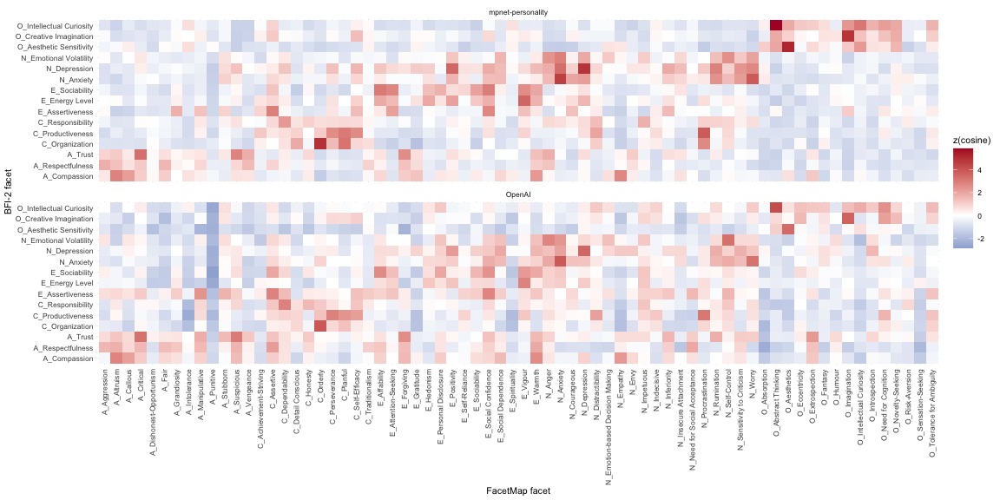

## Plot links

A Sankey diagram links each BFI-2 facet to the FacetMap facets above a threshold. Because the two models are on different scales, we choose the threshold from each model's distribution (here, the 95th percentile of the mean similarities). The diagrams are interactive (`networkD3`), so run the code in your session to see them.


``` r
thr_oai <- quantile(summary_oai$matriz_corr, .95)
thr_mp  <- quantile(summary_mp$matriz_corr, .95)

sankey_from_matrix(summary_oai$matriz_corr, value = thr_oai)
sankey_from_matrix(summary_mp$matriz_corr,  value = thr_mp)
```

## How do BFI-2 items group in FacetMap space?

Each BFI-2 item now has a profile of 70 similarities, one per FacetMap facet. Items with similar profiles relate to FacetMap in the same way. `reduce_cosim_dims()` projects these profiles into two dimensions (MDS, t-SNE and UMAP), clusters the items with k-means on each projection, runs Exploratory Graph Analysis (EGA) on the item-item correlations of the profiles, and computes Tucker's congruence between every cluster solution and the original BFI-2 facets.

First we add useful grouping variables to `cosim_mat`: the BFI-2 domain and the FacetMap domain of the best-matching facet. These columns are carried over to `coords`.


``` r
add_groups <- function(cosim_mat) {
  cosim_mat %>%
    mutate(bfi_domain  = str_sub(scale, 1, 1),
           best_domain = str_sub(best_target_factor, 1, 1))
}

cm_oai <- add_groups(cosim_oai$cosim_mat)
cm_mp  <- add_groups(cosim_mp$cosim_mat)

# cross-tab: BFI-2 domain x FacetMap domain of the best match
table(bfi = cm_mp$bfi_domain, facetmap = cm_mp$best_domain)
#>    facetmap
#> bfi  A  C  E  N  O
#>   A  8  0  2  2  0
#>   C  0  7  0  5  0
#>   E  0  2  9  1  0
#>   N  0  0  0 12  0
#>   O  0  0  0  0 12
```

### Dimensionality reduction and clustering

We ask for 5 clusters (the Big Five) and compare them with the 15 BFI-2 facets.


``` r
red_oai <- reduce_cosim_dims(
  cosim_mat        = cm_oai,
  factor_scale     = fm_scales,
  n_clusters       = 5,
  item_factor      = cm_oai$bfi_domain,
  node_label       = "item_text",
  node_label_width = 20,
  tsne_perplexity  = 15
)

red_mp <- reduce_cosim_dims(
  cosim_mat        = cm_mp,
  factor_scale     = fm_scales,
  n_clusters       = 5,
  item_factor      = cm_mp$bfi_domain,
  node_label       = "item_text",
  node_label_width = 20,
  tsne_perplexity  = 15
)
```

`reduce_cosim_dims()` returns the item coordinates and cluster memberships (`coords`), the congruence matrix (`congruence`), the EGA network loadings (`ega_loadings`) and the EGA network plot (`ega_plot`).


``` r
names(red_mp)
#> [1] "coords"       "congruence"   "ega_loadings" "ega_plot"
head(red_oai$coords)
#>                                       item_text                   scale
#> 1                   Has few artistic interests. O_Aesthetic Sensitivity
#> 2           Thinks poetry and plays are boring. O_Aesthetic Sensitivity
#> 3   Is fascinated by art, music, or literature. O_Aesthetic Sensitivity
#> 4                        Values art and beauty. O_Aesthetic Sensitivity
#> 5 Is inventive, finds clever ways to do things.  O_Creative Imagination
#> 6                        Has little creativity.  O_Creative Imagination
#>    best_target_factor second_best_target_factor complexity   sparsity  within_sd
#> 1        O_Aesthetics       O_Abstract Thinking   51.40253 0.05105417 0.06342707
#> 2 O_Abstract Thinking      O_Need for Cognition   50.95679 0.04811688 0.05567006
#> 3        O_Aesthetics  O_Intellectual Curiosity   39.38219 0.07635976 0.07867697
#> 4        O_Aesthetics          C_Traditionalism   31.66275 0.07432378 0.07351909
#> 5       O_Imagination           C_Self-Efficacy   50.86935 0.05514968 0.08421703
#> 6       O_Imagination      O_Need for Cognition   48.89937 0.05297843 0.06206878
#>   bfi_domain best_domain      mds_1       mds_2    tsne_1    tsne_2    umap_1    umap_2
#> 1          O           O -0.3892571  0.28803618 -4.622967 -4.533454 1.8766354 1.4618945
#> 2          O           O -0.4966078  0.18898641 -4.203674 -4.623478 1.5530288 1.5793276
#> 3          O           O -0.4336400  0.28841061 -5.350652 -4.975314 1.9911899 1.5867415
#> 4          O           O -0.5159976 -0.12600015 -5.669405 -5.708382 1.7722736 2.0065514
#> 5          O           O -0.1591833  0.02811936  1.140291 -7.042115 0.4750708 0.8533407
#> 6          O           O -0.5052158  0.17589885 -3.394562 -4.704871 1.4275246 1.6963525
#>   mds_cluster tsne_cluster umap_cluster ega_cluster
#> 1       mds_3       tsne_5       umap_2       ega_1
#> 2       mds_3       tsne_5       umap_2       ega_1
#> 3       mds_3       tsne_5       umap_2       ega_1
#> 4       mds_3       tsne_5       umap_2       ega_1
#> 5       mds_5       tsne_1       umap_3       ega_1
#> 6       mds_3       tsne_5       umap_2       ega_1
round(head(red_oai$congruence[, 1:8]), 2)
#>          factor_A factor_C factor_E factor_N factor_O mds_1 mds_5 mds_2
#> factor_A        1     0.00     0.00     0.00     0.00  0.00  0.08  0.50
#> factor_C        0     1.00     0.00     0.00     0.00  0.15  0.32  0.00
#> factor_E        0     0.00     1.00     0.00     0.00  0.23  0.24  0.25
#> factor_N        0     0.00     0.00     1.00     0.00  0.46  0.24  0.25
#> factor_O        0     0.00     0.00     0.00     1.00  0.23  0.16  0.00
#> mds_1           0     0.15     0.23     0.46     0.23  1.00  0.00  0.00
head(red_oai$ega_loadings)
#>                                                       1           2           3
#> Has little interest\nin abstract ideas.       0.6614405  0.00000000  0.00000000
#> Is fascinated by\nart, music, or\nliterature. 0.5164193 -0.05023485 -0.05241482
#> Has few artistic\ninterests.                  0.4915263  0.00000000  0.00000000
#> Is curious about\nmany different\nthings.     0.4709007  0.00000000  0.00000000
#> Is complex, a deep\nthinker.                  0.4384838  0.00000000  0.00000000
#> Is original, comes\nup with new ideas.        0.4381901  0.00000000  0.00000000
#>                                                        4            5            6
#> Has little interest\nin abstract ideas.       0.00000000 -0.052719610 -0.007315518
#> Is fascinated by\nart, music, or\nliterature. 0.01428255 -0.047477640  0.000000000
#> Has few artistic\ninterests.                  0.00000000 -0.002006592  0.113449196
#> Is curious about\nmany different\nthings.     0.04399178 -0.020245121 -0.002247865
#> Is complex, a deep\nthinker.                  0.00000000  0.028924858  0.045338726
#> Is original, comes\nup with new ideas.        0.00000000 -0.003316335 -0.027290171

red_oai$ega_plot
```

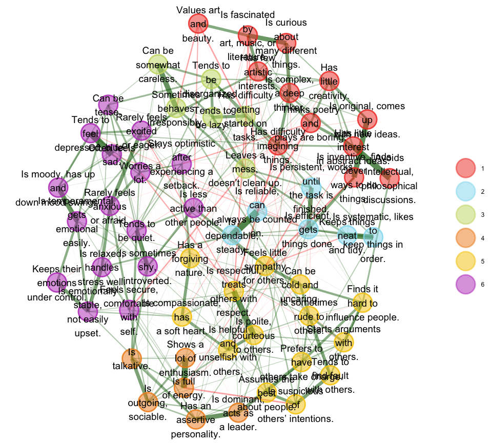


### Congruence between clusters and BFI-2 domains

Tucker's congruence between each cluster and each BFI-2 domain (1 = same items). For each BFI-2 domain we show the best-matching cluster of each method.


``` r
best_congruence <- function(red) {
  cg <- red$congruence
  dom_rows <- grep("^factor", rownames(cg), value = TRUE)
  cl_cols  <- grep("^factor", colnames(cg), value = TRUE, invert = TRUE)
  as.data.frame(cg[dom_rows, cl_cols]) %>%
    rownames_to_column("bfi_domain") %>%
    pivot_longer(-bfi_domain, names_to = "cluster", values_to = "congruence") %>%
    mutate(method = str_extract(cluster, "^[a-z]+")) %>%
    group_by(bfi_domain, method) %>%
    slice_max(congruence, n = 1, with_ties = FALSE) %>%
    ungroup() %>%
    select(-cluster) %>%
    pivot_wider(names_from = method, values_from = congruence)
}

best_congruence(red_oai) %>% mutate(across(where(is.numeric), ~ round(.x, 2)))
#> # A tibble: 5 × 5
#>   bfi_domain   ega   mds  tsne  umap
#>   <chr>      <dbl> <dbl> <dbl> <dbl>
#> 1 factor_A    0.93  0.5   0.93  0.55
#> 2 factor_C    0.71  0.32  0.56  0.58
#> 3 factor_E    0.71  0.25  0.4   0.27
#> 4 factor_N    0.87  0.46  0.75  0.53
#> 5 factor_O    1     0.61  0.82  0.82
best_congruence(red_mp)  %>% mutate(across(where(is.numeric), ~ round(.x, 2)))
#> # A tibble: 5 × 5
#>   bfi_domain   ega   mds  tsne  umap
#>   <chr>      <dbl> <dbl> <dbl> <dbl>
#> 1 factor_A    0.96  0.91  0.96  0.96
#> 2 factor_C    0.91  0.72  1     0.87
#> 3 factor_E    0.76  0.51  0.96  0.96
#> 4 factor_N    0.93  0.77  0.93  0.84
#> 5 factor_O    1     1     1     1
```

### EGA network

EGA finds the number of communities from the data. Each node is a BFI-2 item; edges are partial correlations between item profiles.


``` r
red_mp$ega_plot
```

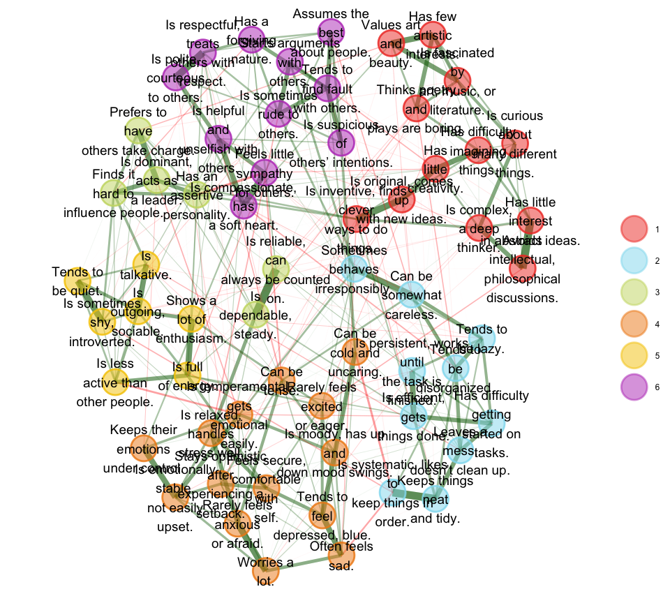

``` r

# which BFI-2 facets fall into each EGA community?
table(red_mp$coords$scale, red_mp$coords$ega_cluster)
#>                           
#>                            ega_1 ega_2 ega_3 ega_4 ega_5 ega_6
#>   A_Compassion                 0     0     0     1     0     3
#>   A_Respectfulness             0     0     0     0     0     4
#>   A_Trust                      0     0     0     0     0     4
#>   C_Organization               0     4     0     0     0     0
#>   C_Productiveness             0     4     0     0     0     0
#>   C_Responsibility             0     2     2     0     0     0
#>   E_Assertiveness              0     0     4     0     0     0
#>   E_Energy Level               0     0     0     1     3     0
#>   E_Sociability                0     0     0     0     4     0
#>   N_Anxiety                    0     0     0     4     0     0
#>   N_Depression                 0     0     0     4     0     0
#>   N_Emotional Volatility       0     0     0     4     0     0
#>   O_Aesthetic Sensitivity      4     0     0     0     0     0
#>   O_Creative Imagination       4     0     0     0     0     0
#>   O_Intellectual Curiosity     4     0     0     0     0     0
```

### Maps of the items

`plot_cosim_dims()` returns interactive (plotly, hover to see the item, e.g. `plot_umap`) and static (ggplot, `*_gg`) maps; the static versions are shown here. Colour by the original BFI-2 facet:


``` r
plots_mp <- plot_cosim_dims(red_mp$coords, colour_by = "scale", label_width = 25)
# plots_mp$plot_umap   # interactive plotly version (hover to see the items)
plots_mp$plot_umap_gg
```

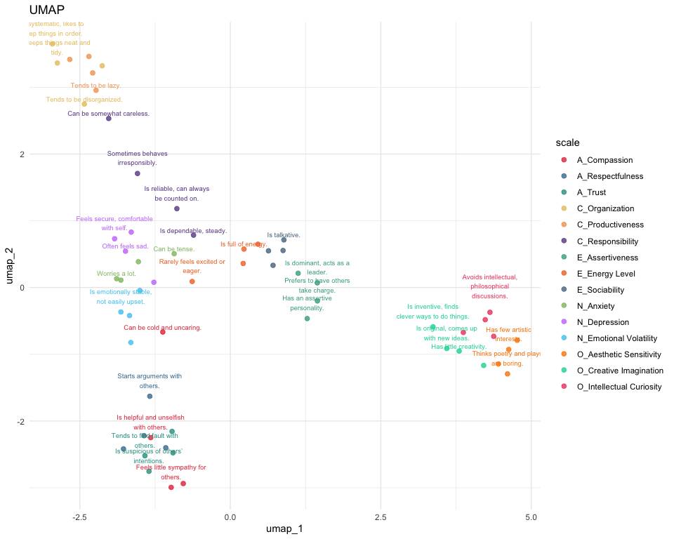

Colour by the FacetMap domain of each item's best match. Items placed in a different FacetMap domain from their BFI-2 domain are the interesting cases: they show where the two taxonomies disagree.


``` r
plots_mp_best <- plot_cosim_dims(red_mp$coords, colour_by = "best_domain", label_width = 25)
plots_mp_best$plot_umap_gg
```

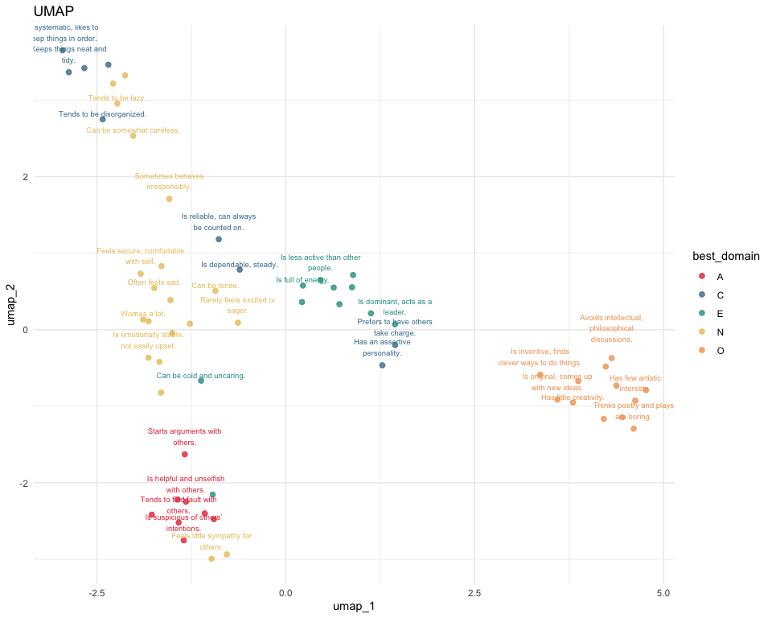

``` r

plots_oai <- plot_cosim_dims(red_oai$coords, colour_by = "scale", label_width = 25)
plots_oai$plot_umap_gg
```

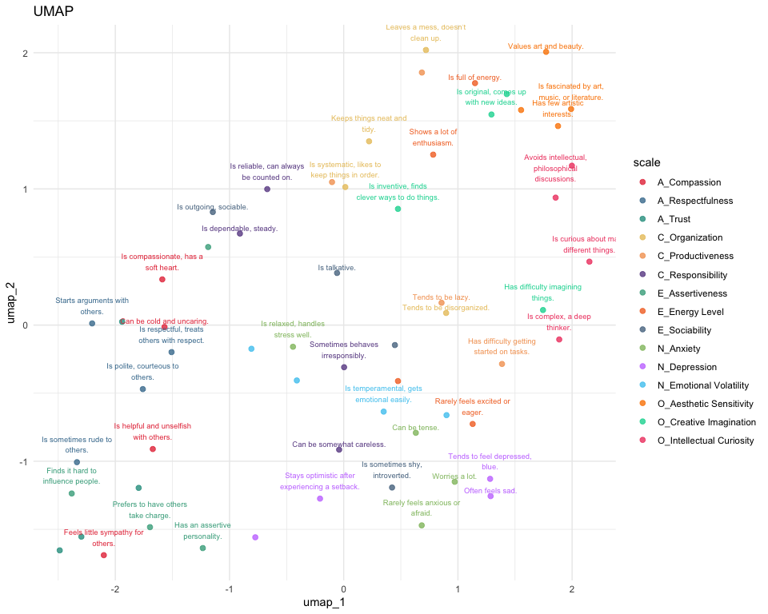

Finally, the k-means clusters on the UMAP projection:


``` r
plot_cosim_dims(red_mp$coords, colour_by = "umap_cluster", label_width = 25)$plot_umap_gg
```

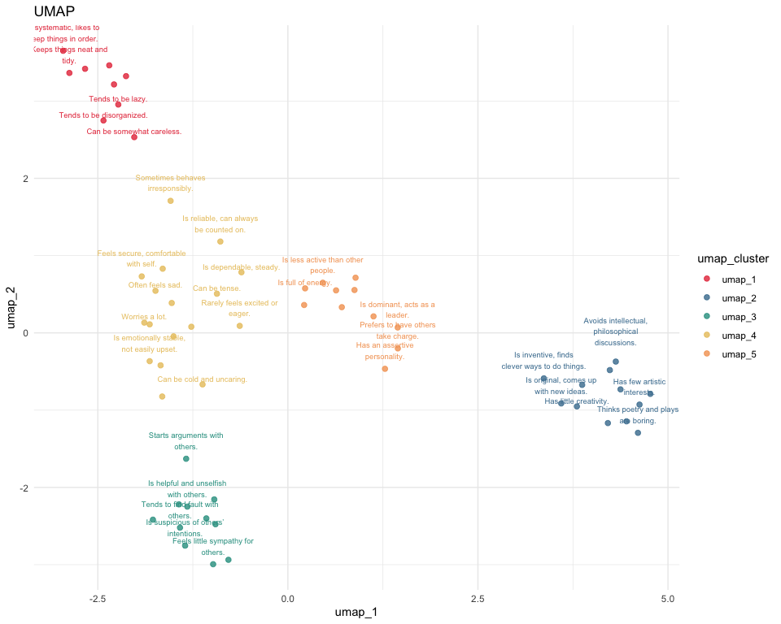

### Items whose best match is outside their BFI-2 domain


``` r
cm_mp %>%
  filter(bfi_domain != best_domain) %>%
  select(item_text, scale, best_target_factor, second_best_target_factor,
         complexity) %>%
  arrange(scale)
#>                                   item_text            scale best_target_factor
#> 1         Feels little sympathy for others.     A_Compassion          N_Empathy
#> 2                 Can be cold and uncaring.     A_Compassion           E_Warmth
#> 3       Is compassionate, has a soft heart.     A_Compassion          N_Empathy
#> 4                   Has a forgiving nature.          A_Trust        E_Forgiving
#> 5          Leaves a mess, doesn’t clean up.   C_Organization  N_Procrastination
#> 6  Has difficulty getting started on tasks. C_Productiveness  N_Procrastination
#> 7                         Tends to be lazy. C_Productiveness  N_Procrastination
#> 8          Sometimes behaves irresponsibly. C_Responsibility        N_Impetuous
#> 9                 Can be somewhat careless. C_Responsibility        N_Impetuous
#> 10      Prefers to have others take charge.  E_Assertiveness        C_Assertive
#> 11            Has an assertive personality.  E_Assertiveness        C_Assertive
#> 12           Rarely feels excited or eager.   E_Energy Level       N_Depression
#>    second_best_target_factor complexity
#> 1                  A_Callous   21.99774
#> 2                    N_Anger   40.94226
#> 3                 A_Altruism   28.50334
#> 4                 A_Critical   28.12183
#> 5                  C_Orderly   21.60673
#> 6             C_Perseverance   16.91871
#> 7                  C_Planful   24.85474
#> 8                    N_Anger   30.96686
#> 9          N_Distractibility   31.58188
#> 10       E_Social Confidence   34.20238
#> 11           C_Self-Efficacy   30.15759
#> 12              E_Positivity   36.17315
```

## Save results


``` r
writexl::write_xlsx(
  list(
    matches         = matches,
    item_cosim_oai  = cosim_oai$cosim_mat,
    item_cosim_mp   = cosim_mp$cosim_mat,
    facet_cosim_oai = as.data.frame(summary_oai$matriz_corr) %>% rownames_to_column("bfi_facet"),
    facet_cosim_mp  = as.data.frame(summary_mp$matriz_corr)  %>% rownames_to_column("bfi_facet"),
    coords_mp       = red_mp$coords
  ),
  "bfi2_facetmap_results.xlsx"
)
```
